# Cooperative payload transport by a four-robot formation: methods, replication and physics validation

Documentation of the `~/ros2_ws` project. It explains every concept the code
uses, what each figure shows and how to read it, what was measured, and what
the measurements do and do not establish. Commands are in
[RUNBOOK.md](RUNBOOK.md); every number quoted here is in
[RESULTS_TABLES.md](RESULTS_TABLES.md), generated from the result files; the
publication-readiness review is in [Q2_ASSESSMENT.md](Q2_ASSESSMENT.md).

**Contents**

1. What the project is
2. The mission and the kinematic model
3. Sensing: one front end for every steering law
4. The eight steering laws
5. The mission layer: safety gate, escapes, anti-deadlock, motion limits
6. Experiments and metrics
7. Result 1 — the Python port reproduces the MATLAB reference
8. Result 2 — a defect in the reference safety gate, and what it changes
9. Result 3 — the validation warehouse (your `aws_warehouse.xml`)
10. Result 4 — physics validation in MuJoCo
11. What is established, what is not
12. File map

---

## 1. What the project is

Four small differential-drive robots carry one load across a warehouse with
static obstacles and moving traffic. They first drive from scattered start
positions into a formation (phase 1), then move as one rigid body to the goal
(phase 2). The research question is the *steering law* of that rigid body:
given a noisy range scan, which direction should the formation turn?

There are three implementations of the same mission, and this project is
about making them agree and then testing the model against physics:

| Stack | What it is | Role |
|---|---|---|
| **MATLAB** (`matlab_ref/`, copy of `bundle/reference/matlab/`) | `Simulation8_dynamic.m`, kinematic | The specification. Its Monte Carlo grid (2,730 runs) is `bundle/reference/results_all.csv`. |
| **Python headless** (`src/ros2_swarm_transport/`) | The same mission, in-process, no ROS | The independent replication. Was pre-audit code at the start of this work; now ported. |
| **MuJoCo validation** (`mujoco_validation.py`) | The same mission code driving robots with mass, wheels and a real payload | Tests the kinematic model's assumptions. Replaces the planned Gazebo runs. |

A ROS 2 node (`formation_controller.py`) drives the same mission code and
publishes `cmd_vel`; it is tested in closed loop against an ideal unicycle
but not against a simulator.

What was done in this work, in one paragraph: the October 2026 audit fixes of
the MATLAB reference (section 9 of `bundle/ROS2_REPLICATION.md`) were ported
to Python; three new steering laws, a range filter and the full mission layer
were added; the port was verified step for step against MATLAB at zero
noise; the whole 2,730-run grid was re-run on the Python stack and compared
cell by cell; a defect in the reference's collision test was found and its
effect measured; your MuJoCo warehouse was turned into a scenario all three
stacks load from one file; and the mission was run under physics with three
kinds of payload.

---

## 2. The mission and the kinematic model

### 2.1 Unicycle kinematics

The model has no mass and no inertia. A body has a position `p = (x, y)` and
a heading `θ`, and each control step of `dt = 0.1 s` (10 Hz) does

```
θ ← θ + clip(Δθ, ±ω_max)          turn, rate-limited
p ← p + v · (cos θ, sin θ) · dt   move along the new heading
```

This is the *unicycle* model: the body moves only along its heading and
turns at a bounded rate. It is what a differential-drive robot does when its
wheel controllers track `cmd_vel` perfectly. `v = 0.6 m/s` in transport,
`0.5 m/s` while forming. `ω_max` is 0.3 rad **per step** in transport (so up
to 3 rad/s — this number matters later, §5.5 and §10).

The desired heading is low-pass filtered before the rate limit,
`θ_des = θ + α · wrap(θ_raw − θ)` with `α = 0.35`, so the load is not yanked
by a steering law that changes its mind every step.

### 2.2 Phase 1 — forming

The start positions are on a ring around the start point A. Slots are
assigned to robots by the Hungarian algorithm (minimum total travel). Each
robot then runs, independently:

- an **artificial potential field** (APF) that gives a *virtual goal*: a
  constant-magnitude pull toward its slot plus a linear push away from any
  team-mate closer than 1.2 m;
- the steering law, pointed at that virtual goal, to avoid obstacles on the
  way (a *cascaded* architecture: APF decides where, the steering law decides
  how);
- a speed that tapers to zero within 1.5 m of the slot.

Two extra behaviours handle crowding: robots that meet at a compact static
obstacle queue behind a leader along its trail (*convoy*), and a robot
blocked for more than five steps probes for an escape heading and backs off.
Forming ends when every robot is within 0.3 m of its slot.

### 2.3 Phase 2 — rigid transport

From here the four robots are slots of one rigid frame with centre `c` and
heading `θ`: robot `i` is at `c + R(θ) · offset_i`. One *virtual leader*
steers the frame; the load is the convex hull of the slots, grown by the
robot radius (0.18 m).

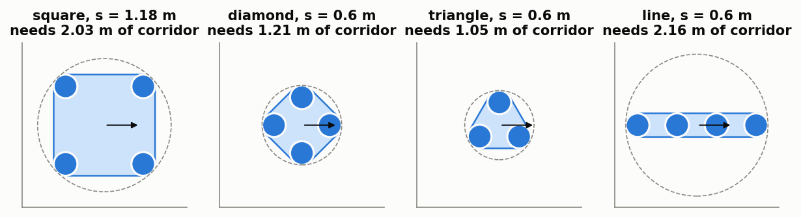

*Figure: the four formation shapes. Filled disks are robots, the shaded
region is the body the collision test uses (hull of the slots + robot
radius), the dashed circle is the circumscribed circle. Because the body
rotates with the heading, the corridor it needs is the circle's diameter,
not the body's width. The square at s = 1.18 m needs 2.03 m; the line at
0.6 m needs 2.16 m.*

Each step the heading target is a weighted sum of two unit vectors,

```
θ_raw = angle( w_goal · vec_goal + w_vfh · vec_steer ),   w_goal = 1, w_vfh = 2
```

`vec_goal` points at the goal, `vec_steer` comes from the steering law. With
*blend fade*, `w_goal` is multiplied by `max(0, cos∠(vec_goal, vec_steer))`:
when the law has chosen a detour the goal term stops dragging the heading
back toward the obstacle.

### 2.4 Movers and the motion contract

Moving obstacles (forklifts, carts) are *kinematic*: they follow straight
routes at constant speed from a JSON file (`dynamic_obstacles*.json`), pause
at the ends, and **never yield**. One file drives all stacks, so obstacle
motion is identical by construction, and because the motion is piecewise
linear, predicting a mover's position `T` seconds ahead is exact, not an
estimate. A contract may also carry a `waypoints` route (the local steering
laws have no global planner) and the start point.

---

## 3. Sensing: one front end for every steering law

Every law consumes the same scan from the same function, so a difference in
results is a difference in the steering law, not in what it was shown.

- **Raycast.** An analytic 2D range scan from the formation centre: 288 beams
  over the full circle (*lidar*), or `n` beams over a 60° fan fixed to the
  body heading (*ToF*, time-of-flight array). Range is limited to
  `4 m + body radius`.
- **Prediction horizon.** For laws that use it, each mover is also raycast at
  its contracted positions over the next 0.5 s; every beam keeps the nearest
  hit. The scan then shows where a mover *will be*.
- **Noise.** Gaussian range noise with standard deviation `s_b`: constant
  `σ0` for the lidar, `σ0 + 0.03·d` for the ToF fan (noise grows with range).
- **Seeding.** Each run has its own random generator. Laws that share a seed
  see the same noise until their trajectories diverge (*common random
  numbers*, which makes paired comparisons sharper).

---

## 4. The eight steering laws

| Name | Idea | Sees the mover horizon | Role |
|---|---|---|---|
| **APF** | push away from near returns, pull to the goal | no | classical baseline |
| **VFH** | polar histogram, steer into the best free valley | no | classical baseline |
| **FGM** | Follow-the-Gap: aim at the widest free gap | yes | external baseline |
| **DWA** | Dynamic Window: sample constant-turn arcs, score them | yes | external baseline |
| **MPC** | search turn-rate *sequences* over a horizon | yes | external baseline |
| **pVFH** | VFH + horizon | yes | ablation step 1 |
| **pVFH+F** | pVFH + recursive range filter | yes | ablation step 2 |
| **P-VFH** | pVFH+F + expected kernel | yes | the proposal |

VFH → pVFH → pVFH+F → P-VFH is an *ablation ladder*: each step adds exactly
one ingredient, so the effect of each can be measured separately.

### 4.1 The polar histogram (VFH, pVFH, pVFH+F, P-VFH)

The circle of bearings is cut into 72 sectors of 5°. Each sector gets a
*danger value* from its nearest return at range `d`:

```
env(d) = exp( −d² / (2 σ_h²) )
```

near returns give values close to 1, far returns close to 0. The width `σ_h`
is not tuned: it is set so that `env` equals the threshold (0.3) exactly at
the range where the body must start reacting, `d_block = body radius + 1 m`
(about 2 m here, so `σ_h ≈ 1.3 m`).

Three more steps turn values into a decision:

1. **Enlargement (VFH+).** The scan is taken from the centre, but the body is
   2 m wide. A return at range `d` therefore also blocks every bearing within
   `asin(r_body / d)` of it.
2. **Smoothing and threshold.** A 5-sector moving average, then sectors
   below 0.3 are *free*.
3. **Valley choice.** Among free sectors within ±45° of the goal bearing,
   take the one minimising `|deviation from goal| + 0.6·|deviation from the
   current heading|` (the second term is hysteresis: do not flip sides).

A close-range *reflex* is then added: an APF push away from returns inside
`1.2 m + body radius`, weighted by `1/d³`.

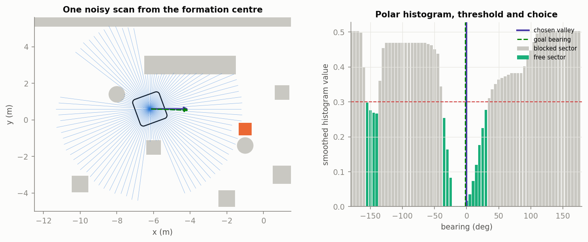

*Figure: left, one noisy scan (thin blue beams) from the formation centre in
the study's warehouse; the orange box is a mover, the outline is the body.
Right, the resulting histogram. Grey bars are blocked sectors (above the red
threshold line), green bars are free. The dashed green line is the goal
bearing, the purple line the chosen sector. Read it as: "the goal direction
is free, so the law steers almost straight at it; had it been grey, the law
would pick the nearest green bar".*

### 4.2 The expected kernel (P-VFH)

A measured range is uncertain. If the true range is distributed as
`N(d_meas, s_b²)`, the *expected* danger value has a closed form:

```
u_b = E[env(d_true)] = sqrt( σ_h² / (σ_h² + s_b²) ) · exp( −d_meas² / (2(σ_h² + s_b²)) )
```

Two properties are proved in the reference report and tested here
(`test_audit_port.py`):

- **Deterministic limit.** As `s_b → 0`, `u_b → env(d_meas)`: with a precise
  sensor P-VFH *is* pVFH.
- **Proposition 2.** The range at which a return crosses the threshold (the
  *reaction distance*) grows with `s_b` for all `s_b < 1.757 σ_h`: a noisier
  sensor makes the law react earlier.

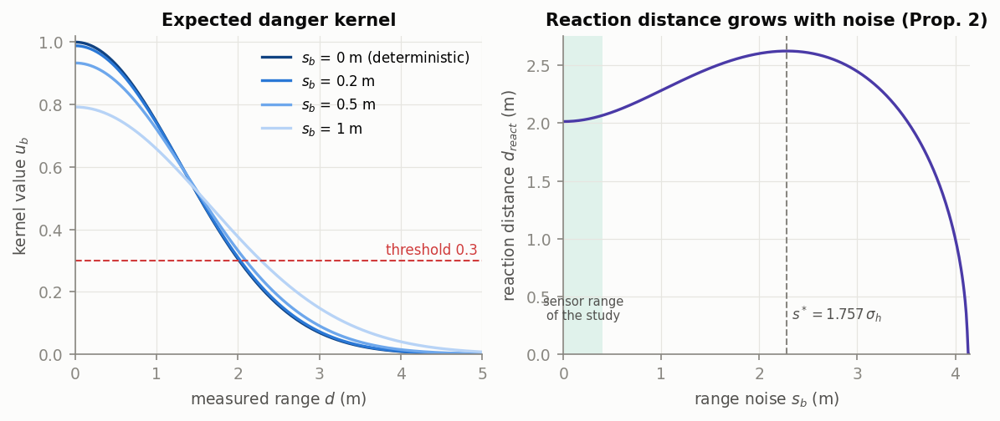

*Figure: left, the kernel against measured range for four noise levels; the
curve is wider for a noisier sensor, so it crosses the threshold (dashed) at
a larger range. Right, that crossing range against the noise level; it rises
up to `s* = 1.757 σ_h` and falls after. The green band is the noise range of
the study (≤ 0.4 m): there the reaction distance moves from 2.01 m to about
2.07 m. **That 3 % is the whole effect of the kernel**, and it is why the
experiments find no measurable difference between pVFH+F and P-VFH (§7.3).*

### 4.3 The recursive range filter (pVFH+F, P-VFH)

Each beam keeps a one-dimensional Kalman filter over time. Per step the
uncertainty grows by a process noise `q = 0.08 m` (how much a range can
change in 0.1 s), then the new measurement is blended in with gain

```
K = (P + q²) / (P + q² + s_b²)
```

A precise sensor (`s_b ≪ q`) gives `K ≈ 1`, i.e. no filtering; a noisy one
averages several scans. If a measurement is more than 3 standard deviations
from the prediction (a beam slides off an edge, a mover enters), that beam
is reset to the measurement instead of being dragged toward it.

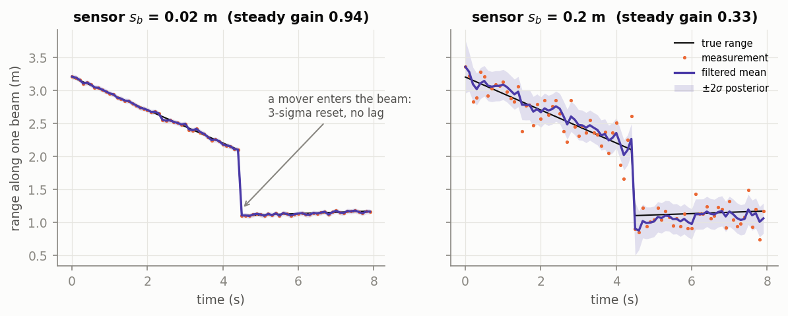

*Figure: one beam over time. Black is the true range, orange dots the
measurements, purple the filtered value with its ±2σ band. Left, a precise
sensor: the filter follows the dots (gain ≈ 1). Right, a noisy sensor: the
filter averages, and at 4.5 s, when a mover enters the beam, it jumps to the
new range at once rather than lagging.*

### 4.4 The external baselines

- **FGM** marks every return closer than the reaction range as an obstacle
  with a body-radius bubble, finds the widest run of free beams, and steers
  between the gap centre and the goal bearing, weighting the gap more the
  closer the nearest obstacle is.
- **DWA** rolls out 31 constant-turn-rate arcs for 2 s against the scan
  points, discards arcs that touch within 1 s, and picks the best
  `0.8·heading + 0.2·clearance`.
- **MPC** searches all 125 sequences of three turn-rate segments (five
  levels each, 0.8 s per segment), with a hard clearance constraint over the
  first second and a cost of `−progress + obstacle barrier + smoothness`.
  Unlike DWA it can plan an S-shaped manoeuvre. The search is exhaustive, so
  it uses no random numbers.

These are compact re-implementations with default parameters, not tuned
navigation-stack planners.

---

## 5. The mission layer

The steering law only proposes a heading. Whether the body actually moves is
decided by the mission layer, which is identical for every law.

### 5.1 The safety gate (atomic pose commit)

A candidate pose (position **and** heading) is committed only if the whole
body is collision-free at that pose now *and* one step later with the movers
advanced. If not, the layer tries, in order:

| `reject` | Meaning |
|---|---|
| 0 | translation and rotation accepted |
| 1 | translation blocked, rotation in place is safe → pivot |
| 2 | both blocked → hold the pose |
| 3 | held for more than five steps → back up half a step, or turn the other way |

The gate uses the true geometry, so **gate rejections count the collisions
the steering law would have caused**. That is the safety metric of the
study. Contact with static geometry must be zero in every run; a non-zero
value would be a gate bug. Contact with a *mover* is possible, because
movers never yield and can drive into a body that is holding still.

### 5.2 The collision test

The body is the convex hull of the slots, inflated by the robot radius; an
obstacle is a box or a circle. Overlap is decided by the **separating-axis
theorem** (SAT): two convex shapes are disjoint if and only if some axis
exists on which their projections do not overlap. For these shapes it is
enough to test the edge normals of both and the directions between vertex
pairs (the last handle the rounded corners).

### 5.3 A defect in the reference gate

The MATLAB test (and the pre-audit Python port, which copied it) lists a
box's corners in the order `(+,+), (+,−), (−,+), (−,−)` and takes "edges"
between consecutive entries. That order is not a walk around the box: the
four "edges" are the two vertical sides and the two **diagonals**. One of the
box's two edge normals is therefore never tested, and some poses that are in
fact collision-free are reported as overlapping.

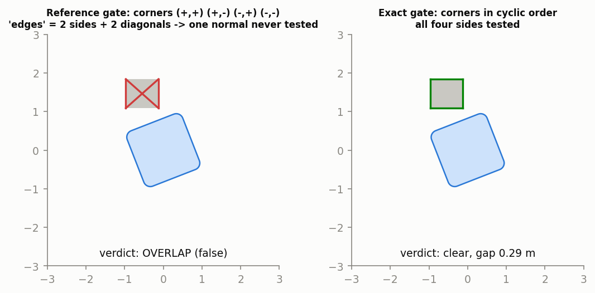

*Figure: the same pose under both tests. Left, the reference's "edges" (red)
— two sides and the diagonals; the test finds no separating axis and reports
an overlap although the body is 0.29 m clear. Right, with the corners in
cyclic order all four sides (green) are tested and the pose is accepted.*

The defect is **conservative**: it never misses a real overlap (tested
against a brute-force distance computation), it only refuses some safe
poses. It does not invalidate the reference's safety results, but it
inflates its rejection counts and lengthens some missions (§8). The Python
gate has both modes: `gate="matlab"` reproduces the reference bit for bit,
`gate="exact"` is the corrected test.

### 5.4 Escape probe and the anti-deadlock layer

A law can stall without ever being rejected, by making small legal moves
that cancel out. Two mechanisms deal with stalls:

- **Escape probe.** 36 headings, tried in order of deviation from the goal
  bearing; the first one along which the body can translate 0.4 m and then
  hold that pose for 1.5 s while the movers move is taken.
- **Anti-deadlock layer (ADL).** If the formation gains less than 0.30 m
  along the start→goal axis in 150 steps (15 s), a probe is forced, skipping
  headings near the previous escape; the found heading is then *committed*
  for 40 steps, the body turning toward it at the rate limit and every pose
  still passing the gate.

### 5.5 Load-carrying motion limits

A slot at distance `r` from the centre moves at `v + |ω|·r`. With the
default turn limit the frame can ask a corner robot for 3 m/s while the
centre drives 0.6 m/s. The optional limits (`kin`) shape the turn so the
outer robot stays below 1 m/s and yaw acceleration below 2.5 rad/s², with a
speed floor of 0.3 m/s so the formation slows to turn but does not stop to
pivot. They are off in the main grid (as in the reference) and are
experiment E14; the physics validation runs with them on, because real
robots cannot do 3 m/s.

### 5.6 Robustness perturbations

*Localisation error*: the controller believes it is at the true pose plus
Gaussian noise, which corrupts the goal direction (the scan is physical and
unaffected). *Command loss*: with probability `p` a step's steering update
is dropped and the previous command is held.

---

## 6. Experiments and metrics

### 6.1 The grid

The study is a Monte Carlo grid of 2,730 runs (2,420 distinct simulations;
identical configurations shared by two experiments are simulated once).
Each cell has 10 seeds (20 in E2, 3 per layout in E13).

| Exp. | Question | Factors |
|---|---|---|
| E1 | Which law is best under clean conditions? | 8 laws |
| E2 | What does sensor noise do, and which ingredient helps? | 4 ladder laws × σ0 ∈ {0.02 … 0.40} m |
| E3 | Fewer beams? | pVFH, P-VFH × {288 lidar, 64/16/8 ToF} |
| E5 (E4) | Other formation shapes? | 4 shapes × 8 laws at s = 0.6 m |
| E6 | Matched sensors | lidar-288 / ToF-16 / ToF-8 × 2 noise levels × 4 laws |
| E7 | Other environments | plaza, maze × 8 laws × 2 noise levels |
| E8 | Faster traffic | mover speed ×0.5 … ×2 |
| E9 | Is the anti-deadlock layer needed? | line formation, layer off |
| E10 | Localisation error | 0 … 0.30 m |
| E11 | Denser traffic | 0, 1, 3, 6 movers |
| E12 | Lost commands | drop probability 0 … 0.5 |
| E13 | Random layouts | 10 generated worlds |
| E14 | Load-feasible motion | motion limits on |

### 6.2 Metrics

| Metric | Definition | Reading |
|---|---|---|
| **reach** | runs that got within 0.5 m of the goal in 300 s per waypoint | success |
| **time** | mission time (forming + transport) | efficiency |
| **gate rejections** | steps where the gate refused the commanded motion | collisions the law *would* have caused: the safety metric |
| **static contact** | steps touching static geometry | must be 0; non-zero = gate bug |
| **mover contact** | steps touching a mover | movers never yield; counts being run into |
| **minimum gap** | smallest surface-to-surface distance in the run (`min clearance − 0.18 m`) | margin; negative = contact |
| **path efficiency** | straight-line distance / path length | detours |
| **peak robot speed** | fastest any slot had to move | physical feasibility |

Statistics: goal-reach counts carry a Wilson 95 % interval; means carry a
bootstrap 95 % interval (2,000 resamples). Two stacks *agree* on a cell when
their intervals for reach, rejections and minimum gap all overlap.

---

## 7. Result 1 — the Python port reproduces the MATLAB reference

### 7.1 Step for step at zero noise

With `σ0 = 0` no random number influences a decision, so two correct
implementations must produce the same trajectory. MATLAB was run for each of
the eight laws and the per-step logs compared with the Python runs.

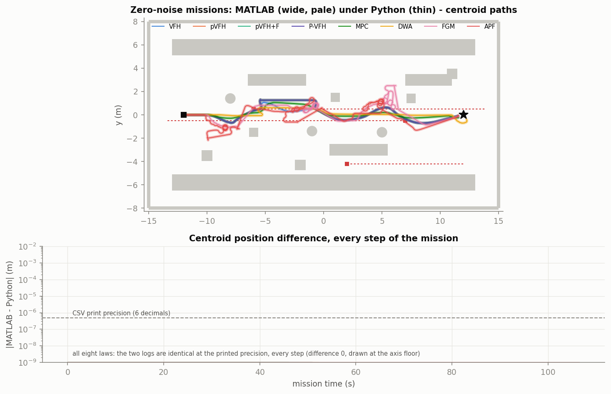

*Figure: top, the centroid path of each law on the study's warehouse (grey:
static obstacles; red dashed: mover routes; square: start; star: goal). The
wide pale line is MATLAB, the thin line on top is Python; they coincide for
all eight laws, including the erratic APF and FGM paths. Bottom, the
position difference at every step: zero at the six decimals the logs print.*

| | all eight laws |
|---|---|
| steps compared | 459 – 1,065 per mission (the whole mission, both phases) |
| largest centroid difference | 7 × 10⁻⁷ m (the rounding of the MATLAB log) |
| step counts, rejection counts | equal |

This is the strongest replication statement the project makes: forming,
slot assignment, scans, histograms, the three external baselines, the range
filter, the gate, escapes and the anti-deadlock layer all match, because a
difference in any of them would compound into a different path within a few
steps. (Table T1a.)

### 7.2 Statistically across the whole grid

With noise, the two stacks draw different random numbers (MATLAB's Mersenne
Twister versus NumPy's PCG64), so runs cannot be paired and the comparison is
per cell.

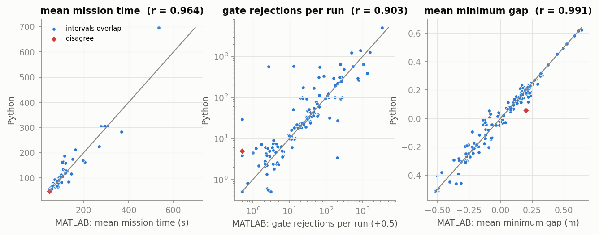

*Figure: each dot is one experiment cell; x is the MATLAB cell mean, y the
Python cell mean, the line is y = x. Dots on the line mean the two stacks
measured the same thing. Blue: the confidence intervals overlap. Red
diamond: the one cell where they do not.*

| | MATLAB | Python |
|---|---|---|
| runs | 2,730 | 2,730 |
| failed to execute | 0 | 0 |
| **static-contact steps** | **0** | **0** |
| reached the goal | 2,626 | 2,613 |
| cells agreeing (of 221) | — | **220** |
| correlation of cell means | — | time 0.96, rejections 0.90, min gap 0.99 |

The one disagreeing cell is MPC with 50 % command loss (minimum gap 0.20 m
vs 0.06 m): three of ten Python seeds were clipped by a mover, none of the
MATLAB ones. With 221 cells and three tests each, a few chance disagreements
are expected; this one was not traced to any code difference.

Two cautions when reading "220 of 221". First, interval overlap is a lenient
test for heavy-tailed cells: where a law fails in some seeds (APF, FGM,
high-noise VFH) the rejection counts have very wide intervals, so they
"agree" even when the means differ by a factor of two. The scatter plot and
the correlation of 0.90 for rejections show the same thing honestly.
Second, ten seeds per cell cannot resolve small effects in either stack.

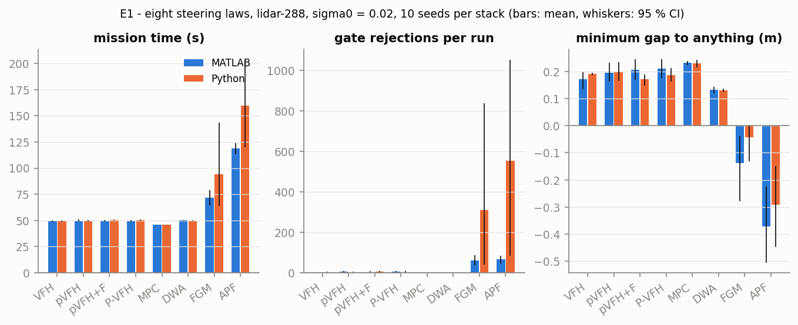

*Figure: E1, each law on both stacks (blue MATLAB, orange Python; whiskers
are 95 % intervals). The five well-behaved laws agree closely. APF and FGM
have long, erratic missions in both stacks and differ in their means because
a single timed-out seed moves a 10-run average a lot.*

### 7.3 What the grid says about the method (both stacks agree on this)

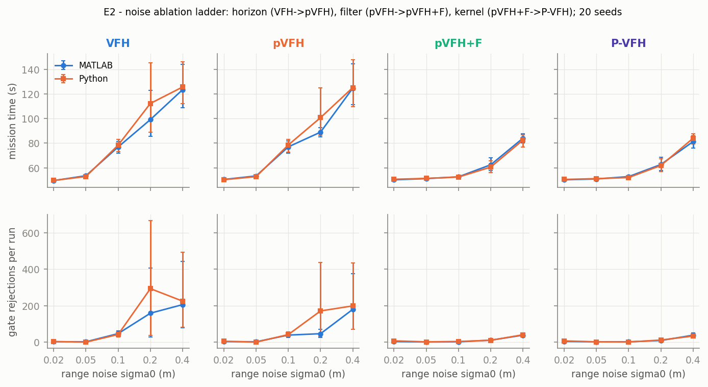

*Figure: E2, the ablation ladder. Columns are the four laws, the top row is
mission time, the bottom row gate rejections, against sensor noise. Read the
columns left to right: VFH → pVFH adds the mover horizon (no change in noise
robustness); pVFH → pVFH+F adds the range filter (the curves flatten: at
σ0 = 0.1 m time drops from 77 s to 53 s and rejections from about 40 to
about 3); pVFH+F → P-VFH adds the expected kernel (the two right-hand columns
are indistinguishable).*

- **The range filter is the effective ingredient.** It removes most of the
  histogram's noise sensitivity, in both stacks.
- **The expected kernel adds nothing measurable.** P-VFH and pVFH+F are
  within each other's intervals in every cell of every experiment. §4.2
  explains why: at realistic noise it shifts the reaction distance by 3 %.
- **MPC is at least as good as the proposal** in clean conditions (46 s vs
  50 s, zero rejections, larger gap) and remains so in most experiments; it
  loses runs only at double mover speed and with six movers.
- **The anti-deadlock layer is necessary** for the line formation: without
  it 1–3 of 40 runs reach the goal.
- **A 60° ToF fan defeats every histogram law**: the formation is run into
  from outside the field of view (about 29 mover-contact steps per run).

These are the reference's own findings (`bundle/reference/RESULTS_LOG.md`);
the contribution here is that an independent implementation reproduces them.

---

## 8. Result 2 — the gate defect and what it changes

§5.3 described the defect. Its effect was measured in two ways.

**At zero noise** (Table T1b): with the corrected gate, VFH, FGM, DWA and
MPC are unchanged to the last digit, because the reference gate never
wrongly refused them. pVFH, pVFH+F and P-VFH diverge from MATLAB at
t = 18.6 s, the first step where the reference refuses a pose that is
0.15 m clear of everything; from then on MATLAB's run has 14 rejections and
takes 50.9 s, the corrected run has **0 rejections** and takes 48.8 s. All 14
rejections in that MATLAB run are artefacts.

**Across the grid**, all 2,730 runs were repeated with the same seeds and
only the gate changed (Table T5). Compared with MATLAB, the corrected-gate
grid still agrees in 196 of 221 cells, and the 25 that now differ are almost
all one thing: **21 are low-noise histogram-law cells where MATLAB reports
3–6 rejections per run and the corrected gate reports 0.0** (E1, E2 and E6
at σ0 = 0.02 m, and the matching rows of E8, E10 and E12). Reach is unchanged
in all 221 cells.

| E2, σ0 = 0.02 m, rejections per run | MATLAB | Python, reference gate | Python, exact gate |
|---|---|---|---|
| VFH | 2.4 | 3.1 | 0.5 |
| pVFH | 3.0 | 4.7 | 0.0 |
| pVFH+F | 3.0 | 7.1 | 0.0 |
| P-VFH | 3.8 | 6.9 | 0.0 |

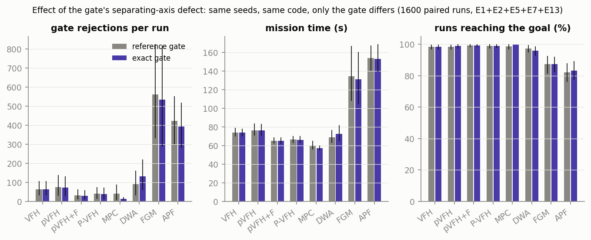

*Figure: the same seeds with the reference gate (grey) and the exact gate
(purple), pooled over E1, E2, E5, E7 and E13. Pooled means move little,
because they are dominated by cells where laws genuinely fail and reject
hundreds of times; the defect shows in the clean cells of the table above.*

Paired by seed over the whole grid, 71–91 % of runs are bit-identical under
the two gates (they never met a falsely refused pose); the rest diverge and,
being chaotic, end up with different counts in either direction. Total
runs reaching the goal: 2,613 with the reference gate, 2,621 with the exact
one.

So the few rejections the reference tables attribute to the histogram laws
under clean conditions are the gate's own false alarms, not steering errors.

What it does **not** change: no safety result (the defect is conservative,
static contact is 0 with both gates), no ranking between laws, and none of
the findings of §7.3. It should be fixed in the MATLAB reference (two
changed corner orders in `formation_clearance_dyn.m`, one for static boxes
and one for box movers) and the grid re-run before publication, because the
headline safety metric is the rejection count.

---

## 9. Result 3 — the validation warehouse

### 9.1 From your MuJoCo scene to one shared scenario

`worlds/aws_warehouse.xml` is your scene (22.7 × 27.5 m, eight rack lines,
3.3 m aisles, a 2.4 m cross-aisle, a dock with staged pallets, a forklift, a
conveyor and an office). `tools/make_validation_world.py` slices its
collision geometry at the robot height band (0.03–0.35 m), exactly as the
MATLAB loader slices an SDF, and writes

- `swarm_world_awswh.sdf` — 463 boxes and 75 cylinders (rack uprights, floor
  pallets and their loads, guards, walls, bollards, forklift, bench and
  conveyor legs). Round-trip error against the MJCF: 2 × 10⁻¹⁵ m.
- `dynamic_obstacles_awswh.json` — three movers, the start point A in the
  dock, and a four-waypoint route to B in the west aisle (29 m).

MATLAB, the Python runner and the MuJoCo validation load these two files,
so the three stacks see identical geometry, traffic and route. MATLAB's own
feasibility check on it: bottleneck 2.43 m, the square formation needs
2.03 m.

The movers are a forklift crossing the dock in front of the start, a cart
working along one side of the first aisle, and a picker in a side aisle next
to the route. One design decision is worth recording: a first version had
the picker walk straight through the cross-aisle. Because movers never yield
and the formation fills that aisle, *every* law, MPC included, was run into
at the intersection. That tests the scenario, not the steering law, so the
picker was moved; the choice was made on feasibility for a generic planner
(MPC as the probe), not on how the proposal fared.

### 9.2 Headless results on the warehouse

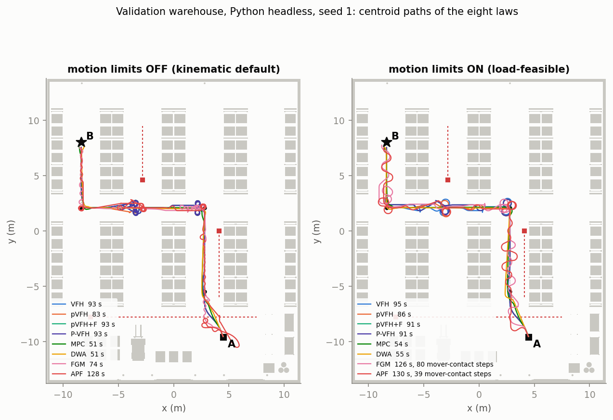

*Figure: centroid paths of the eight laws from the dock (A) to the west
aisle (B), Python, seed 1; grey is the sliced geometry, red dashed lines are
mover routes, dots are waypoints. Left, motion limits off; right, on. The
legend gives each law's mission time and any mover contact. MPC and DWA
follow the route cleanly; the histogram laws hesitate and detour at the
aisle mouths, where their body-inflated histogram sees a 3.3 m aisle as
nearly closed.*

Seed 1, exact gate (all eight laws reach B, zero static contact):

| Law | time, limits off | rejections | time, limits on | rejections | mover contact (on) |
|---|---|---|---|---|---|
| MPC | 50.7 s | 0 | 54.2 s | 0 | 0 |
| DWA | 50.9 s | 0 | 55.2 s | 0 | 0 |
| FGM | 74.2 s | 13 | 126.0 s | 129 | 80 steps |
| pVFH | 83.0 s | 9 | 86.3 s | 10 | 0 |
| P-VFH | 93.3 s | 12 | 90.8 s | 38 | 0 |
| pVFH+F | 93.3 s | 12 | 90.8 s | 38 | 0 |
| VFH | 93.5 s | 13 | 94.6 s | 63 | 0 |
| APF | 128.3 s | 29 | 130.4 s | 52 | 39 steps |

Ten seeds, exact gate (Table T8); every run of every law reaches B and
static contact is zero:

| Law | time, limits off | rejections | time, limits on | rejections | mover contact (on) |
|---|---|---|---|---|---|
| MPC | 50.6 s | 0.0 | 54.9 s | 0.0 | 0 |
| DWA | 50.9 s | 0.0 | 54.7 s | 0.0 | 0 |
| FGM | 81.0 s | 13.1 | 129.1 s | 110.3 | 51.9 steps/run |
| pVFH | 86.8 s | 11.6 | 88.0 s | 24.2 | 0 |
| pVFH+F | 89.3 s | 12.8 | 90.8 s | 39.8 | 0 |
| VFH | 90.3 s | 14.1 | 91.0 s | 35.4 | 0 |
| P-VFH | 91.1 s | 15.9 | 88.2 s | 28.7 | 0 |
| APF | 137.8 s | 49.9 | 148.7 s | 89.2 | 54.4 steps/run |

In narrow aisles the trajectory-optimising baselines are almost twice as
fast as the histogram family and never rejected. This matches the
reference's plaza result (E7) and is the clearest statement of where the
proposal stands.

### 9.3 A caveat that applies to the whole study: mover timing is fixed

The movers follow a fixed timetable. A *seed* changes the sensor noise, not
when the forklift arrives, so the ten seeds of a cell all meet the traffic
at the same moment. To see how much that matters, the mission start was
delayed relative to the movers (seed 1, limits on;
`results/warehouse_mover_timing.csv`):

| mover-contact steps | delay 0 s | 2 s | 4 s | 6 s | 8 s | 10 s |
|---|---|---|---|---|---|---|
| MPC | 0 | 0 | 0 | 34 | 34 | 0 |
| DWA | 0 | 0 | 0 | 33 | 34 | 0 |
| pVFH | 0 | 0 | 32 | 35 | 34 | 0 |
| P-VFH | 0 | 0 | 32 | 35 | 34 | 0 |

"Zero mover contact" in the table above is therefore true for one traffic
phase, not in general. A 4 s shift is enough for the histogram laws to be
run into; at 6–8 s every law is, MPC included. This is the most important
methodological limitation found: mover-contact statistics in this study
(both stacks, all worlds) are conditional on a single timetable per world.
A sound evaluation must randomise the mover phase per run. It also explains
the physics results of §10, where forming takes about 4 s longer than in
the kinematic model.

### 9.4 MATLAB on the warehouse

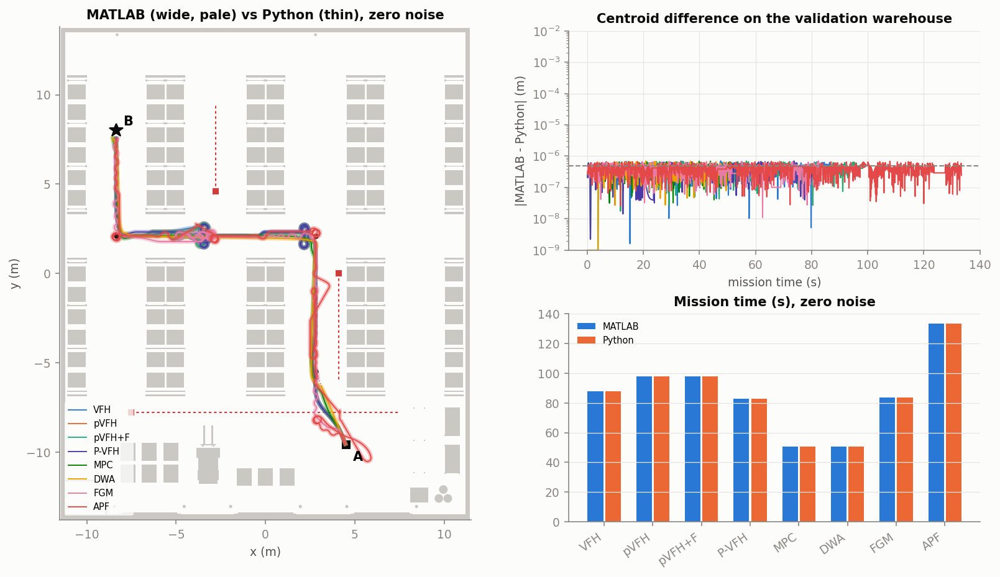

*Figure: left, zero-noise paths on the warehouse, MATLAB (pale) under Python
(thin). Top right, their difference per step; bottom right, mission times
side by side.*

MATLAB ran the same scenario file: 8 zero-noise missions and 8 laws × 5
seeds. At zero noise all eight laws again match Python to 7 × 10⁻⁷ m over
the whole mission (Table T9), on a world neither implementation was
developed against. With noise (Table T7, reference gate, limits off):

| Law | time MATLAB | time Python | rejections MATLAB | Python |
|---|---|---|---|---|
| MPC | 50.4 s | 50.7 s | 0.0 | 0.0 |
| DWA | 50.7 s | 50.9 s | 0.0 | 0.0 |
| pVFH | 87.5 s | 86.8 s | 12.4 | 11.4 |
| pVFH+F | 87.0 s | 88.5 s | 12.8 | 12.8 |
| VFH | 87.2 s | 89.2 s | 10.0 | 11.2 |
| P-VFH | 88.8 s | 91.3 s | 16.6 | 12.6 |
| FGM | 68.3 s | 77.8 s | 11.4 | 19.6 |
| APF | 137.4 s | 139.4 s | 40.0 | 65.8 |

All 80 runs reach B with zero static contact.

---

## 10. Result 4 — physics validation in MuJoCo

### 10.1 What is simulated

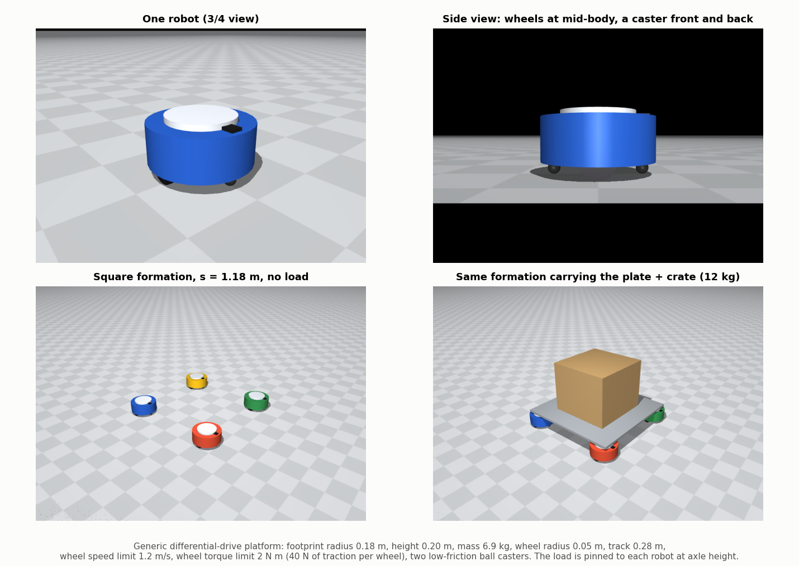

*Figure: the robot (top), the square formation without and with the load
(bottom).*

| Robot parameter | Value |
|---|---|
| footprint radius / height | 0.18 m / 0.20 m |
| mass | 6.9 kg |
| drive | two wheels, radius 0.05 m, track 0.28 m, plus two low-friction casters |
| wheel speed limit | 1.2 m/s |
| wheel torque limit | 2 N m (40 N of traction per wheel) |
| physics step / control step | 2 ms / 100 ms |
| load (carried) | plate 3 kg + crate 9 kg, pinned to each robot by a ball joint at axle height |
| load (towed) | 10 kg sled on casters, hitched to the rear robot |

It is a generic differential-drive platform sized to the study's
`robot_radius`; it is not a model of a commercial robot.

The mission is the MATLAB mission: the robots **start scattered** on a ring
around A, form up with the same forming code, and then transport.

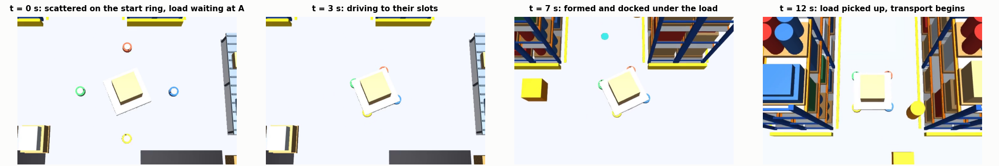

*Figure: frames from the mission video. Scattered start with the load on its
stand; driving to the slots; docked under the load; transport.*

Three things had to be added that the kinematic model does not need:

1. **Docking.** Forming ends at 0.3 m slot error; a load cannot be pinned to
   robots that are 30 cm out of place. A short docking step closes the error
   to 3 cm and aligns the headings.
2. **A slot-tracking law.** Each robot follows its moving slot with
   feed-forward slot velocity plus bounded position feedback. When the load
   is pinned, the robots are rigidly coupled, so each is given `v + ω × r` of
   *one* rigid-body twist computed from the plate's pose error; independent
   per-robot corrections make the wheels fight each other.
3. **Formation feedback.** The kinematic frame is a setpoint generator that
   knows nothing about the robots. If they fall more than 0.6 m behind, the
   frame waits, for at most 2 s at a time.

Two findings came from getting the carried load to work, and both are
physical facts the kinematic model cannot show: pinning the load at roof
height (0.20 m) tipped the robots over as soon as they pushed against each
other, so the pin sits at axle height; and position feedback large enough to
saturate both wheels removes all steering authority, so it is bounded.

### 10.2 Does the kinematic model hold under physics?

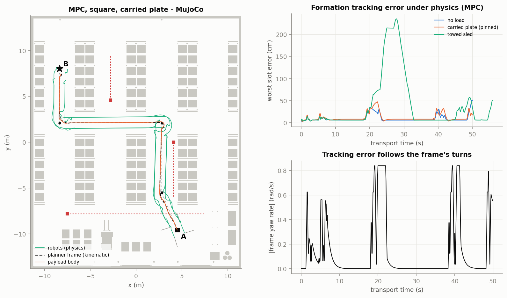

*Figure: left, MPC with the carried plate: dashed black is the planner's
kinematic frame, green the four physical robots, orange the load. Top right,
the worst slot error over time for the three payload modes. Bottom right,
the frame's yaw rate: the error peaks line up with the turns.*

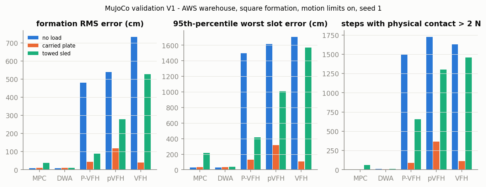

*Figure: formation error and contact steps by law and payload mode.*

Seed 1, motion limits on (Table T10-V1; "load at B" requires the *robots*,
not only the planner frame, to arrive):

| Law | Payload | Load at B | Time | Formation RMS | Worst slot error | Contact steps static / mover |
|---|---|---|---|---|---|---|
| MPC | none | yes | 57.8 s | 9.0 cm | 52 cm | 0 / 0 |
| MPC | carried | yes | 57.8 s | 11.3 cm | 48 cm | 0 / 0 |
| MPC | towed | yes | 64.1 s | 37 cm | 235 cm | 62 / 0 |
| DWA | none | yes | 59.3 s | 8.7 cm | 42 cm | 0 / 9 |
| DWA | carried | yes | 59.3 s | 10.9 cm | 38 cm | 0 / 7 |
| DWA | towed | yes | 59.7 s | 10.5 cm | 62 cm | 0 / 9 |
| P-VFH, pVFH, VFH | none or towed | **no** (6 of 6) | 153–194 s | 2.8–7.3 m | > 10 m | > 1,000 / > 100 |
| P-VFH, pVFH, VFH | carried | yes, damaged | 99–118 s | 39–119 cm | 1.7–4.1 m | 64–319 / 43–49, plate tilted 25–56° |

What this establishes:

- **For a planner that keeps its margins (MPC), the kinematic prediction
  transfers.** Same route, 7 s longer than the headless prediction (forming
  and docking under physics), about 10 cm RMS formation error, pins holding
  to 0.7 mm, no contact.
- **The kinematic model is optimistic near movers.** DWA's planner frame
  never touches anything (minimum gap 0.21 m), yet the physical robots,
  lagging their slots by up to 40 cm in a turn, are clipped by the forklift
  for 7–9 steps. A 0.2 m planned gap is smaller than the tracking error.
- **A towed load outside the planned footprint snags.** The sled cuts the
  corner at the cross-aisle and catches a rack guard (62 contact steps with
  MPC), as the kinematic model's footprint assumption implies it could.
- **The histogram laws fail this mission under physics.** Their
  frame is hit by a mover (30–40 planner contact steps); under physics that
  is a real shove. Unattached robots are scattered and never rejoin the
  frame (it reaches B without them). Pinned to the plate they stay together
  and arrive, but the plate is wrenched (pin gaps of 25–32 cm, tilt up to
  56°): the load would have been dropped. Seeds 2–5 repeat it (Table
  T10-V4): the planner frame is hit for 30–50 steps in every seed and the
  formation error is 26–144 cm RMS, against 11–13 cm and no contact for MPC
  in all five seeds. **The cause is the timing shift of §9.3, not physics as
  such:** forming and docking take about 4 s longer under physics, and at
  that delay the kinematic model alone already shows the histogram laws
  being hit while MPC and DWA are not. MPC is more robust to traffic timing
  on this scenario, but not immune (it is hit at 6–8 s).
- **Without the motion limits tracking is about 1.7 times worse** (MPC,
  carried: RMS 18 cm vs 11 cm, worst 83 cm vs 48 cm), because the frame asks
  a corner robot for 3 m/s and the robots have 1.2.
- **Other shapes** (Table T10-V2, MPC): diamond, triangle and line at
  s = 0.6 m carry the load with 9–10 cm RMS error and no contact.
- **On the MATLAB study's own warehouse** (Table T10-V5) the limits-on
  mission is hit by a mover even with MPC (28 planner contact steps with the
  carried plate, and the unattached formation is scattered). This agrees
  with the reference's E14, where switching the limits on makes MPC's
  minimum gap negative: the slower, load-feasible formation is still in the
  main aisle when the head-on forklift arrives.
- **Formation feedback** (Table T10-V6) never triggered for MPC (0 hold
  steps; identical results with it off). It only acts after a formation has
  already been disturbed.

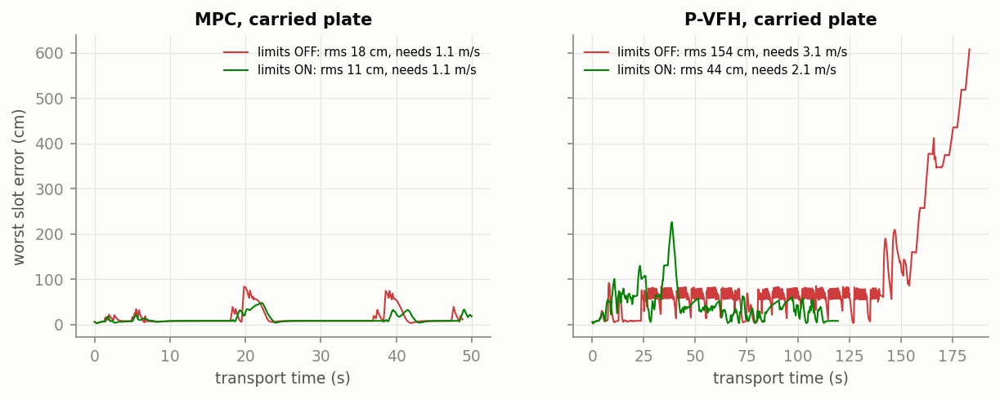

*Figure: worst slot error over time with the motion limits off (red) and on
(green), carried plate. Left MPC, right P-VFH.*

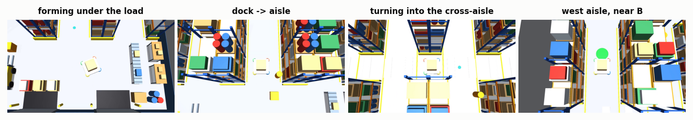

*Figure: four frames of the MPC carried-plate mission video.*

### 10.3 The same run through ROS 2

`mujoco_plant` (physics) and `formation_controller` (mission) are two ROS 2
nodes that exchange one message per control tick, in lockstep: the physics
waits for the command before advancing. The plant also publishes
`/robotN/odom`, `/payload/pose`, `/dynamic_obstacles` and `/clock`; the
controller publishes `/robotN/cmd_vel` and `/swarm/phase`.

| MPC, carried plate | ROS 2 lockstep | in-process |
|---|---|---|
| reached, time | yes, 57.8 s | yes, 57.8 s |
| formation RMS / worst | 11.27 cm / 47.5 cm | 11.27 cm / 47.5 cm |
| contact steps | 0 / 0 | 0 / 0 |
| pin gap | 0.72 mm | 0.72 mm |

The two are identical, as they must be: both use the same
`MissionController` and `MujocoPlant` objects.

---

## 11. What is established, and what is not

**Established**

- The Python stack is a faithful, independent re-implementation of the
  MATLAB reference: identical trajectories at zero noise for all eight laws,
  agreement in 220 of 221 cells with noise, zero static contact in 5,460
  runs across the two stacks.
- The reference's collision test has a conservative defect that inflates
  rejection counts; it is characterised, a corrected mode exists, and it
  does not change any ranking.
- The range filter, not the expected kernel, is what makes the histogram
  law robust to noise.
- For a planner that keeps its margins, the kinematic model predicts the
  physical mission well (11–13 cm formation error with a 12 kg pinned load,
  five seeds, four shapes, no contact).
- The same holds on a world neither stack was developed on: MATLAB and
  Python match step for step on the AWS warehouse.
- The mission runs through ROS 2 with physics in the loop.

**Not established**

- That P-VFH is better than existing local planners. In every environment
  with narrow passages MPC and DWA are faster and at least as safe.
- Anything about hardware. All three stacks are simulations.
- **Robustness to traffic timing.** Movers run a fixed timetable, so the
  mover-contact figures of the whole study hold for one traffic phase per
  world; shifting it by 4–8 s changes who is hit (§9.3).
- Robustness of the physics results across robot parameters, and across
  seeds beyond the five run for the carried plate.
- Performance of tuned baselines: FGM, DWA and MPC use default parameters.
- The gate uses true geometry. A real system would need a sensor-based
  safety supervisor.

---

## 12. File map

| Path | What |
|---|---|
| `src/ros2_swarm_transport/ros2_swarm_transport/geometry.py` | world model, signed distance, raycast, movers, collision test (both gates) |
| `…/vfh.py` | sensing front end, range filter, the eight steering laws |
| `…/transport.py` | forming, transport leader, tracking laws, `MissionController` |
| `…/headless_runner.py` | kinematic mission, CSV log, run summary |
| `…/mjcf_world.py` | MuJoCo scene → 2D world → SDF |
| `…/mujoco_validation.py` | `MujocoPlant`, logging, the in-process physics run |
| `…/formation_controller.py`, `mujoco_plant.py`, `ros_common.py` | the ROS 2 nodes |
| `…/worlds/` | all worlds and contracts, `aws_warehouse.xml` |
| `…/test/` | 52 tests |
| `tools/run_headless_grid.py` | the grid |
| `tools/cross_stack.py` | cell-by-cell comparison |
| `tools/deterministic_xcheck.py` | zero-noise comparison |
| `tools/make_validation_world.py`, `run_warehouse_headless.py` | the warehouse scenario |
| `tools/run_mujoco_batch.py`, `ros_lockstep_test.sh`, `ros_node_selftest.py` | physics and ROS runs |
| `tools/make_doc_figures.py`, `make_tables.py`, `render_platform.py` | figures and tables |
| `matlab_ref/` | MATLAB reference copy + `xcheck.m`, `run_wh.m`, `wh_batch.m` |
| `results/` | all outputs |
| `backup_preaudit/` | the Python modules before this work |
