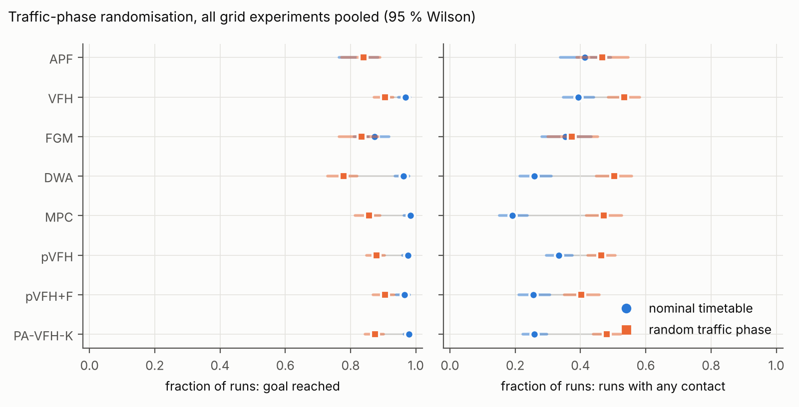
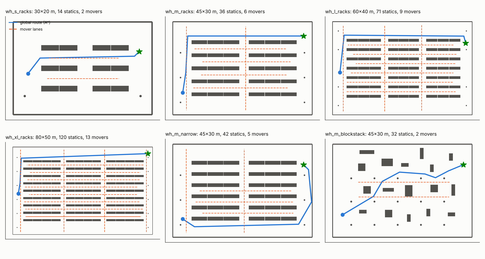
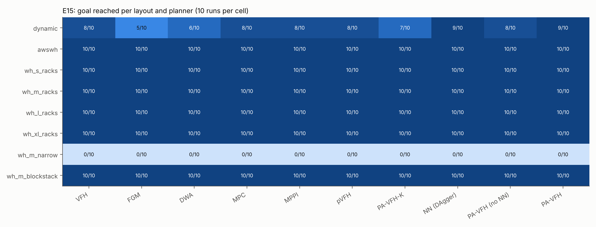
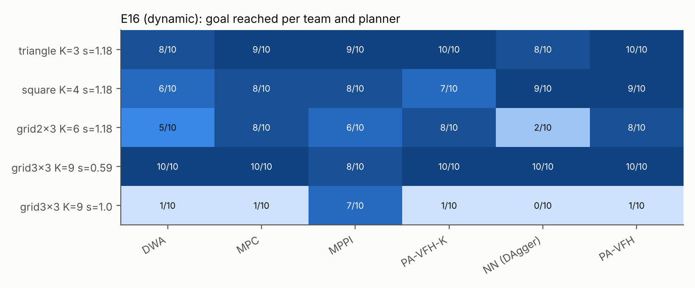
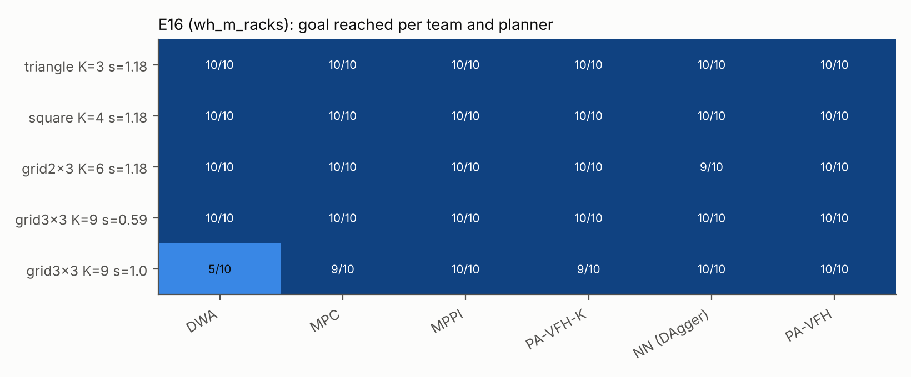
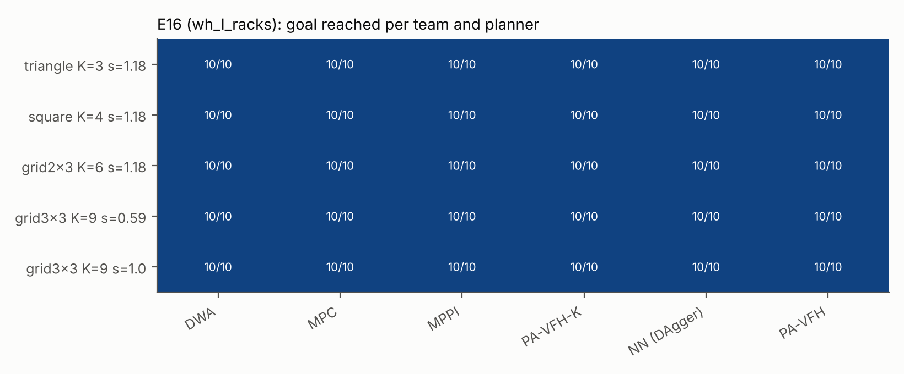
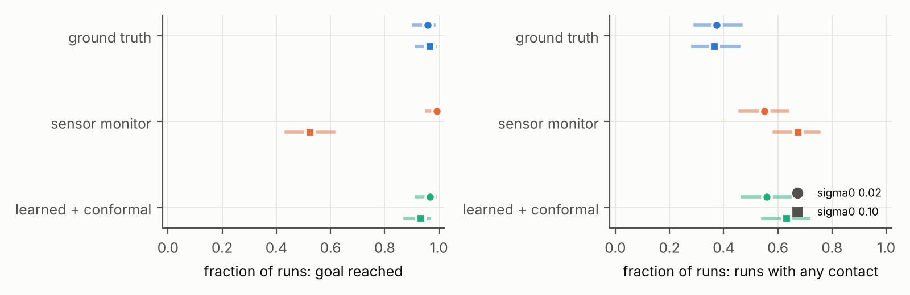

# Extended results (auto-generated by tools/make_extended_report.py)

Every number below is computed from the files under `results/`. Rates carry Wilson 95 % intervals, means a bootstrap 95 % interval. All runs, failed ones included, are counted.

## R1. MATLAB reference with the corrected gate (review step 1)

Zero-noise run, every law, MATLAB (fixed gate, Octave 8.4) vs Python (exact gate):

| law | steps | max_centroid_diff | first_diff_over_1mm | rejections |
|---|---|---|---|---|
| APF | 3053 / 3053 | 6.9e-07 m | never | 2095 / 2095 |
| VFH | 482 / 482 | 7.0e-07 m | never | 0 / 0 |
| FGM | 856 / 856 | 6.9e-07 m | never | 31 / 31 |
| DWA | 522 / 522 | 7.0e-07 m | never | 26 / 26 |
| MPC | 459 / 459 | 6.7e-07 m | never | 0 / 0 |
| pVFH | 488 / 488 | 6.9e-07 m | never | 0 / 0 |
| pVFH+F | 488 / 488 | 6.9e-07 m | never | 0 / 0 |
| PA-VFH-K | 488 / 488 | 6.9e-07 m | never | 0 / 0 |

## R2. Randomised traffic phase (review step 2)

The full grid re-run with a random release time per mover and run (2730 of 2730 rows complete). Same cells, seeds and sensor noise as the nominal-timetable grid (exact gate); only the traffic phase differs. `contact runs` = runs with at least one contact step.

### All experiments pooled, per law

| law | traffic | n | reach | contact_runs | contact_steps | min_gap | time |
|---|---|---|---|---|---|---|---|
| APF | nominal | 150 | 125/150 [0.77, 0.88] | 62/150 [0.34, 0.49] | 18.3 [13.7, 23.4] | -0.17 [-0.22, -0.13] | 116.3 [110.0, 123.1] |
| APF | random phase | 150 | 126/150 [0.77, 0.89] | 70/150 [0.39, 0.55] | 24.4 [15.8, 37.1] | -0.20 [-0.24, -0.17] | 125.6 [117.3, 134.7] |
| VFH | nominal | 410 | 397/410 [0.95, 0.98] | 161/410 [0.35, 0.44] | 14.9 [12.5, 17.6] | -0.04 [-0.08, -0.01] | 63.9 [62.0, 66.0] |
| VFH | random phase | 410 | 371/410 [0.87, 0.93] | 219/410 [0.49, 0.58] | 22.4 [19.8, 25.0] | -0.17 [-0.21, -0.14] | 85.6 [79.4, 92.2] |
| FGM | nominal | 150 | 131/150 [0.81, 0.92] | 53/150 [0.28, 0.43] | 18.0 [12.5, 24.4] | -0.08 [-0.14, -0.03] | 74.3 [70.4, 78.5] |
| FGM | random phase | 150 | 125/150 [0.77, 0.88] | 56/150 [0.30, 0.45] | 19.8 [12.2, 28.6] | -0.13 [-0.18, -0.09] | 81.7 [76.0, 87.8] |
| DWA | nominal | 320 | 308/320 [0.94, 0.98] | 83/320 [0.21, 0.31] | 15.7 [9.3, 23.6] | -0.01 [-0.04, 0.02] | 56.7 [54.8, 58.9] |
| DWA | random phase | 320 | 249/320 [0.73, 0.82] | 161/320 [0.45, 0.56] | 20.0 [15.3, 26.4] | -0.17 [-0.21, -0.14] | 77.4 [70.8, 84.2] |
| MPC | nominal | 320 | 315/320 [0.96, 0.99] | 61/320 [0.15, 0.24] | 6.4 [4.8, 8.2] | 0.12 [0.09, 0.16] | 52.3 [51.0, 53.6] |
| MPC | random phase | 320 | 274/320 [0.81, 0.89] | 151/320 [0.42, 0.53] | 16.7 [13.8, 20.0] | -0.13 [-0.17, -0.10] | 64.4 [61.2, 68.3] |
| pVFH | nominal | 530 | 517/530 [0.96, 0.99] | 177/530 [0.30, 0.38] | 10.7 [9.1, 12.6] | -0.02 [-0.05, 0.01] | 61.9 [60.1, 63.7] |
| pVFH | random phase | 530 | 466/530 [0.85, 0.90] | 246/530 [0.42, 0.51] | 18.5 [16.1, 21.0] | -0.14 [-0.17, -0.11] | 85.9 [80.5, 92.3] |
| pVFH+F | nominal | 320 | 309/320 [0.94, 0.98] | 82/320 [0.21, 0.31] | 9.5 [6.7, 13.1] | 0.05 [0.00, 0.08] | 61.2 [59.1, 63.5] |
| pVFH+F | random phase | 320 | 290/320 [0.87, 0.93] | 129/320 [0.35, 0.46] | 14.5 [12.1, 17.1] | -0.09 [-0.13, -0.05] | 78.3 [72.5, 84.6] |
| PA-VFH-K | nominal | 530 | 519/530 [0.96, 0.99] | 137/530 [0.22, 0.30] | 8.9 [7.1, 11.1] | 0.03 [0.00, 0.06] | 57.7 [56.2, 59.4] |
| PA-VFH-K | random phase | 530 | 464/530 [0.84, 0.90] | 255/530 [0.44, 0.52] | 21.0 [17.6, 25.4] | -0.14 [-0.17, -0.11] | 81.1 [76.1, 86.4] |

### Per experiment

| exp | runs | reach_nominal | reach_phase | contact_runs_nominal | contact_runs_phase |
|---|---|---|---|---|---|
| E1 | 80 | 78/80 [0.91, 0.99] | 58/80 [0.62, 0.81] | 10/80 [0.07, 0.22] | 48/80 [0.49, 0.70] |
| E2 | 400 | 396/400 [0.97, 1.00] | 347/400 [0.83, 0.90] | 102/400 [0.21, 0.30] | 173/400 [0.38, 0.48] |
| E3 | 80 | 80/80 [0.95, 1.00] | 76/80 [0.88, 0.98] | 67/80 [0.74, 0.90] | 69/80 [0.77, 0.92] |
| E5 | 320 | 309/320 [0.94, 0.98] | 295/320 [0.89, 0.95] | 43/320 [0.10, 0.18] | 148/320 [0.41, 0.52] |
| E6 | 240 | 240/240 [0.98, 1.00] | 222/240 [0.88, 0.95] | 174/240 [0.67, 0.78] | 202/240 [0.79, 0.88] |
| E7 | 320 | 305/320 [0.92, 0.97] | 305/320 [0.92, 0.97] | 72/320 [0.18, 0.27] | 85/320 [0.22, 0.32] |
| E8 | 200 | 200/200 [0.98, 1.00] | 151/200 [0.69, 0.81] | 100/200 [0.43, 0.57] | 100/200 [0.43, 0.57] |
| E9 | 40 | 4/40 [0.04, 0.23] | 6/40 [0.07, 0.29] | 9/40 [0.12, 0.38] | 8/40 [0.10, 0.35] |
| E10 | 160 | 160/160 [0.98, 1.00] | 120/160 [0.68, 0.81] | 0/160 [0.00, 0.02] | 101/160 [0.55, 0.70] |
| E11 | 200 | 189/200 [0.90, 0.97] | 157/200 [0.72, 0.84] | 30/200 [0.11, 0.21] | 75/200 [0.31, 0.44] |
| E12 | 160 | 160/160 [0.98, 1.00] | 119/160 [0.67, 0.81] | 12/160 [0.04, 0.13] | 105/160 [0.58, 0.73] |
| E13 | 480 | 450/480 [0.91, 0.96] | 461/480 [0.94, 0.97] | 173/480 [0.32, 0.40] | 125/480 [0.22, 0.30] |
| E14 | 50 | 50/50 [0.93, 1.00] | 48/50 [0.87, 0.99] | 24/50 [0.35, 0.61] | 48/50 [0.87, 0.99] |

Failed runs under the random phase: 365; timeout with contact: 80, timeout, no contact (deadlock/livelock): 285

## R3. E15: larger and structurally different warehouses

Generated by `tools/make_warehouse_layouts.py` (seeded; A*-feasible route for the reference 2x2 block):

| layout | size | kind | statics | movers | route |
|---|---|---|---|---|---|
| wh_s_racks | 30 x 20 m | 3 rack rows, 3.2 m aisles | 14 | 2 | 26.1 m |
| wh_m_racks | 45 x 30 m | 5 rack rows, 3.0 m aisles, 1 cross-aisle | 36 | 6 | 55.8 m |
| wh_l_racks | 60 x 40 m | 7 rack rows, 2.8 m aisles, 2 cross-aisles | 71 | 9 | 70.6 m |
| wh_xl_racks | 80 x 50 m | 9 rack rows, 3.0 m aisles, 2 cross-aisles | 120 | 13 | 92.8 m |
| wh_m_narrow | 45 x 30 m | 6 rack rows, 2.4 m narrow aisles, 1 cross-aisle | 42 | 5 | 59.2 m |
| wh_m_blockstack | 45 x 30 m | block-stacked pallets + column grid | 32 | 2 | 45.3 m |

E15 results (800 runs, 10 seeds per cell, random traffic phase):

| world | law | n | reach | contact_runs | contact_steps | min_gap | time |
|---|---|---|---|---|---|---|---|
| dynamic | VFH | 10 | 8/10 [0.49, 0.94] | 7/10 [0.40, 0.89] | 36.3 [17.6, 55.9] | -0.32 [-0.51, -0.12] | 90.2 [56.3, 151.8] |
| dynamic | FGM | 10 | 5/10 [0.24, 0.76] | 5/10 [0.24, 0.76] | 16.9 [5.8, 30.2] | -0.23 [-0.39, -0.10] | 76.6 [67.6, 82.7] |
| dynamic | DWA | 10 | 6/10 [0.31, 0.83] | 6/10 [0.31, 0.83] | 19.0 [8.2, 29.6] | -0.29 [-0.44, -0.14] | 93.5 [56.2, 161.8] |
| dynamic | MPC | 10 | 8/10 [0.49, 0.94] | 8/10 [0.49, 0.94] | 24.7 [16.4, 32.7] | -0.41 [-0.51, -0.25] | 60.7 [53.9, 68.5] |
| dynamic | MPPI | 10 | 8/10 [0.49, 0.94] | 8/10 [0.49, 0.94] | 24.4 [16.3, 32.5] | -0.41 [-0.51, -0.25] | 63.6 [57.8, 69.3] |
| dynamic | pVFH | 10 | 8/10 [0.49, 0.94] | 5/10 [0.24, 0.76] | 23.6 [5.4, 50.4] | -0.17 [-0.38, 0.03] | 94.2 [59.8, 157.9] |
| dynamic | PA-VFH-K | 10 | 7/10 [0.40, 0.89] | 6/10 [0.31, 0.83] | 29.2 [9.8, 56.7] | -0.25 [-0.43, -0.06] | 99.1 [58.9, 172.3] |
| dynamic | NN (DAgger) | 10 | 9/10 [0.60, 0.98] | 9/10 [0.60, 0.98] | 25.4 [19.6, 28.6] | -0.46 [-0.52, -0.36] | 61.6 [55.8, 67.4] |
| dynamic | PA-VFH (no NN) | 10 | 8/10 [0.49, 0.94] | 7/10 [0.40, 0.89] | 28.7 [15.2, 42.0] | -0.31 [-0.51, -0.10] | 89.8 [56.9, 149.2] |
| dynamic | PA-VFH | 10 | 9/10 [0.60, 0.98] | 7/10 [0.40, 0.89] | 28.2 [15.0, 40.8] | -0.32 [-0.51, -0.13] | 86.9 [57.7, 140.6] |
| awswh | VFH | 10 | 10/10 [0.72, 1.00] | 1/10 [0.02, 0.40] | 3.4 [0.0, 10.2] | -0.04 [-0.15, 0.01] | 101.0 [86.5, 126.1] |
| awswh | FGM | 10 | 10/10 [0.72, 1.00] | 2/10 [0.06, 0.51] | 11.3 [0.0, 28.5] | -0.07 [-0.19, 0.01] | 100.1 [84.0, 117.6] |
| awswh | DWA | 10 | 10/10 [0.72, 1.00] | 0/10 [0.00, 0.28] | 0.0 [0.0, 0.0] | 0.16 [0.11, 0.21] | 64.9 [50.8, 89.3] |
| awswh | MPC | 10 | 10/10 [0.72, 1.00] | 1/10 [0.02, 0.40] | 3.2 [0.0, 9.6] | 0.28 [0.10, 0.37] | 58.2 [50.6, 72.8] |
| awswh | MPPI | 10 | 10/10 [0.72, 1.00] | 1/10 [0.02, 0.40] | 3.2 [0.0, 9.6] | 0.18 [0.02, 0.30] | 67.5 [56.8, 81.4] |
| awswh | pVFH | 10 | 10/10 [0.72, 1.00] | 0/10 [0.00, 0.28] | 0.0 [0.0, 0.0] | 0.01 [0.00, 0.01] | 97.8 [85.6, 114.1] |
| awswh | PA-VFH-K | 10 | 10/10 [0.72, 1.00] | 0/10 [0.00, 0.28] | 0.0 [0.0, 0.0] | 0.00 [0.00, 0.01] | 95.7 [85.7, 112.2] |
| awswh | NN (DAgger) | 10 | 10/10 [0.72, 1.00] | 2/10 [0.06, 0.51] | 6.2 [0.0, 15.4] | 0.18 [-0.07, 0.36] | 60.1 [50.8, 75.0] |
| awswh | PA-VFH (no NN) | 10 | 10/10 [0.72, 1.00] | 1/10 [0.02, 0.40] | 3.4 [0.0, 10.2] | -0.05 [-0.15, 0.01] | 100.8 [85.8, 125.8] |
| awswh | PA-VFH | 10 | 10/10 [0.72, 1.00] | 1/10 [0.02, 0.40] | 3.4 [0.0, 10.2] | -0.04 [-0.15, 0.01] | 101.0 [87.3, 125.5] |
| wh_s_racks | VFH | 10 | 10/10 [0.72, 1.00] | 2/10 [0.06, 0.51] | 7.2 [0.0, 17.3] | -0.04 [-0.19, 0.08] | 83.4 [77.2, 88.8] |
| wh_s_racks | FGM | 10 | 10/10 [0.72, 1.00] | 10/10 [0.72, 1.00] | 67.9 [44.8, 93.7] | -0.57 [-0.57, -0.56] | 79.5 [71.5, 87.1] |
| wh_s_racks | DWA | 10 | 10/10 [0.72, 1.00] | 9/10 [0.60, 0.98] | 69.5 [42.2, 97.3] | -0.50 [-0.57, -0.36] | 69.1 [62.6, 75.3] |
| wh_s_racks | MPC | 10 | 10/10 [0.72, 1.00] | 9/10 [0.60, 0.98] | 53.6 [33.7, 78.3] | -0.52 [-0.58, -0.40] | 71.2 [65.9, 76.4] |
| wh_s_racks | MPPI | 10 | 10/10 [0.72, 1.00] | 7/10 [0.40, 0.89] | 37.6 [18.1, 58.0] | -0.35 [-0.52, -0.13] | 69.3 [63.1, 75.3] |
| wh_s_racks | pVFH | 10 | 10/10 [0.72, 1.00] | 3/10 [0.11, 0.60] | 8.2 [0.0, 16.4] | -0.04 [-0.16, 0.09] | 83.0 [77.3, 88.2] |
| wh_s_racks | PA-VFH-K | 10 | 10/10 [0.72, 1.00] | 3/10 [0.11, 0.60] | 8.2 [0.0, 16.4] | -0.04 [-0.16, 0.09] | 83.0 [77.0, 88.4] |
| wh_s_racks | NN (DAgger) | 10 | 10/10 [0.72, 1.00] | 9/10 [0.60, 0.98] | 69.7 [46.4, 94.1] | -0.49 [-0.57, -0.32] | 72.8 [65.0, 80.4] |
| wh_s_racks | PA-VFH (no NN) | 10 | 10/10 [0.72, 1.00] | 1/10 [0.02, 0.40] | 4.3 [0.0, 12.9] | -0.01 [-0.16, 0.12] | 83.4 [77.2, 88.4] |
| wh_s_racks | PA-VFH | 10 | 10/10 [0.72, 1.00] | 3/10 [0.11, 0.60] | 10.2 [0.0, 20.5] | -0.08 [-0.23, 0.08] | 83.5 [77.7, 88.9] |
| wh_m_racks | VFH | 10 | 10/10 [0.72, 1.00] | 4/10 [0.17, 0.69] | 12.0 [3.1, 21.1] | 0.08 [-0.22, 0.35] | 102.5 [100.8, 104.4] |
| wh_m_racks | FGM | 10 | 10/10 [0.72, 1.00] | 7/10 [0.40, 0.89] | 21.4 [12.3, 28.3] | -0.23 [-0.45, 0.01] | 108.5 [104.7, 114.2] |
| wh_m_racks | DWA | 10 | 10/10 [0.72, 1.00] | 6/10 [0.31, 0.83] | 14.4 [7.0, 21.9] | -0.14 [-0.34, 0.08] | 106.7 [103.9, 109.4] |
| wh_m_racks | MPC | 10 | 10/10 [0.72, 1.00] | 3/10 [0.11, 0.60] | 7.4 [0.0, 14.8] | 0.06 [-0.16, 0.28] | 101.4 [99.3, 103.7] |
| wh_m_racks | MPPI | 10 | 10/10 [0.72, 1.00] | 4/10 [0.17, 0.69] | 10.4 [2.6, 18.3] | 0.03 [-0.24, 0.29] | 102.3 [100.2, 104.5] |
| wh_m_racks | pVFH | 10 | 10/10 [0.72, 1.00] | 3/10 [0.11, 0.60] | 8.9 [0.0, 17.8] | 0.19 [-0.10, 0.44] | 104.5 [101.8, 107.3] |
| wh_m_racks | PA-VFH-K | 10 | 10/10 [0.72, 1.00] | 3/10 [0.11, 0.60] | 8.7 [0.0, 17.4] | 0.19 [-0.09, 0.43] | 104.3 [101.6, 107.3] |
| wh_m_racks | NN (DAgger) | 10 | 10/10 [0.72, 1.00] | 2/10 [0.06, 0.51] | 5.2 [0.0, 13.0] | 0.18 [-0.06, 0.39] | 101.4 [99.5, 103.5] |
| wh_m_racks | PA-VFH (no NN) | 10 | 10/10 [0.72, 1.00] | 4/10 [0.17, 0.69] | 12.0 [2.9, 21.1] | 0.08 [-0.23, 0.35] | 102.5 [100.7, 104.5] |
| wh_m_racks | PA-VFH | 10 | 10/10 [0.72, 1.00] | 4/10 [0.17, 0.69] | 12.2 [3.1, 21.6] | 0.08 [-0.23, 0.38] | 102.3 [100.7, 104.3] |
| wh_l_racks | VFH | 10 | 10/10 [0.72, 1.00] | 0/10 [0.00, 0.28] | 0.0 [0.0, 0.0] | 0.41 [0.23, 0.58] | 127.2 [123.5, 132.0] |
| wh_l_racks | FGM | 10 | 10/10 [0.72, 1.00] | 0/10 [0.00, 0.28] | 0.0 [0.0, 0.0] | 0.40 [0.22, 0.56] | 128.8 [125.2, 133.4] |
| wh_l_racks | DWA | 10 | 10/10 [0.72, 1.00] | 1/10 [0.02, 0.40] | 2.8 [0.0, 8.4] | 0.21 [0.05, 0.32] | 139.6 [126.2, 157.3] |
| wh_l_racks | MPC | 10 | 10/10 [0.72, 1.00] | 2/10 [0.06, 0.51] | 4.4 [0.0, 10.6] | 0.12 [-0.05, 0.30] | 136.5 [123.5, 154.5] |
| wh_l_racks | MPPI | 10 | 10/10 [0.72, 1.00] | 3/10 [0.11, 0.60] | 7.0 [0.0, 16.0] | 0.18 [-0.10, 0.45] | 139.5 [123.8, 161.8] |
| wh_l_racks | pVFH | 10 | 10/10 [0.72, 1.00] | 0/10 [0.00, 0.28] | 0.0 [0.0, 0.0] | 0.47 [0.32, 0.62] | 126.5 [123.5, 130.1] |
| wh_l_racks | PA-VFH-K | 10 | 10/10 [0.72, 1.00] | 0/10 [0.00, 0.28] | 0.0 [0.0, 0.0] | 0.47 [0.32, 0.62] | 126.5 [123.6, 130.5] |
| wh_l_racks | NN (DAgger) | 10 | 10/10 [0.72, 1.00] | 2/10 [0.06, 0.51] | 4.7 [0.0, 12.6] | 0.17 [-0.05, 0.37] | 135.8 [123.1, 153.2] |
| wh_l_racks | PA-VFH (no NN) | 10 | 10/10 [0.72, 1.00] | 0/10 [0.00, 0.28] | 0.0 [0.0, 0.0] | 0.41 [0.23, 0.58] | 127.3 [123.6, 132.4] |
| wh_l_racks | PA-VFH | 10 | 10/10 [0.72, 1.00] | 0/10 [0.00, 0.28] | 0.0 [0.0, 0.0] | 0.41 [0.24, 0.59] | 127.3 [123.6, 132.7] |
| wh_xl_racks | VFH | 10 | 10/10 [0.72, 1.00] | 2/10 [0.06, 0.51] | 8.7 [0.0, 23.2] | 0.31 [0.06, 0.54] | 163.5 [160.7, 167.3] |
| wh_xl_racks | FGM | 10 | 10/10 [0.72, 1.00] | 3/10 [0.11, 0.60] | 9.4 [0.0, 22.8] | 0.13 [-0.10, 0.34] | 167.3 [163.9, 171.1] |
| wh_xl_racks | DWA | 10 | 10/10 [0.72, 1.00] | 0/10 [0.00, 0.28] | 0.0 [0.0, 0.0] | 0.25 [0.17, 0.32] | 165.8 [162.9, 169.1] |
| wh_xl_racks | MPC | 10 | 10/10 [0.72, 1.00] | 0/10 [0.00, 0.28] | 0.0 [0.0, 0.0] | 0.31 [0.22, 0.39] | 161.5 [159.2, 164.6] |
| wh_xl_racks | MPPI | 10 | 10/10 [0.72, 1.00] | 2/10 [0.06, 0.51] | 6.1 [0.0, 14.9] | 0.27 [-0.02, 0.51] | 164.2 [161.0, 168.1] |
| wh_xl_racks | pVFH | 10 | 10/10 [0.72, 1.00] | 0/10 [0.00, 0.28] | 0.0 [0.0, 0.0] | 0.48 [0.41, 0.54] | 164.0 [160.8, 167.9] |
| wh_xl_racks | PA-VFH-K | 10 | 10/10 [0.72, 1.00] | 1/10 [0.02, 0.40] | 2.7 [0.0, 8.1] | 0.39 [0.18, 0.53] | 163.8 [160.8, 167.5] |
| wh_xl_racks | NN (DAgger) | 10 | 10/10 [0.72, 1.00] | 0/10 [0.00, 0.28] | 0.0 [0.0, 0.0] | 0.38 [0.22, 0.52] | 161.2 [159.2, 163.6] |
| wh_xl_racks | PA-VFH (no NN) | 10 | 10/10 [0.72, 1.00] | 2/10 [0.06, 0.51] | 8.8 [0.0, 23.2] | 0.31 [0.03, 0.54] | 163.5 [160.7, 167.4] |
| wh_xl_racks | PA-VFH | 10 | 10/10 [0.72, 1.00] | 2/10 [0.06, 0.51] | 8.9 [0.0, 23.2] | 0.29 [0.02, 0.53] | 163.4 [160.6, 167.1] |
| wh_m_narrow | VFH | 10 | 0/10 [0.00, 0.28] | 1/10 [0.02, 0.40] | 2.3 [0.0, 6.9] | -0.03 [-0.09, 0.00] | - |
| wh_m_narrow | FGM | 10 | 0/10 [0.00, 0.28] | 2/10 [0.06, 0.51] | 5.7 [0.0, 13.7] | -0.04 [-0.09, 0.00] | - |
| wh_m_narrow | DWA | 10 | 0/10 [0.00, 0.28] | 1/10 [0.02, 0.40] | 0.5 [0.0, 1.5] | -0.01 [-0.05, 0.01] | - |
| wh_m_narrow | MPC | 10 | 0/10 [0.00, 0.28] | 2/10 [0.06, 0.51] | 28.7 [0.0, 85.1] | -0.07 [-0.21, 0.00] | - |
| wh_m_narrow | MPPI | 10 | 0/10 [0.00, 0.28] | 2/10 [0.06, 0.51] | 11.6 [0.0, 34.4] | -0.07 [-0.18, 0.00] | - |
| wh_m_narrow | pVFH | 10 | 0/10 [0.00, 0.28] | 1/10 [0.02, 0.40] | 3.9 [0.0, 11.7] | -0.04 [-0.14, 0.00] | - |
| wh_m_narrow | PA-VFH-K | 10 | 0/10 [0.00, 0.28] | 1/10 [0.02, 0.40] | 3.9 [0.0, 11.7] | -0.04 [-0.13, 0.00] | - |
| wh_m_narrow | NN (DAgger) | 10 | 0/10 [0.00, 0.28] | 1/10 [0.02, 0.40] | 0.5 [0.0, 1.5] | -0.02 [-0.05, 0.00] | - |
| wh_m_narrow | PA-VFH (no NN) | 10 | 0/10 [0.00, 0.28] | 1/10 [0.02, 0.40] | 2.3 [0.0, 6.9] | -0.03 [-0.09, 0.00] | - |
| wh_m_narrow | PA-VFH | 10 | 0/10 [0.00, 0.28] | 1/10 [0.02, 0.40] | 2.3 [0.0, 6.9] | -0.03 [-0.09, 0.00] | - |
| wh_m_blockstack | VFH | 10 | 10/10 [0.72, 1.00] | 2/10 [0.06, 0.51] | 5.7 [0.0, 13.2] | 0.14 [-0.06, 0.29] | 85.1 [82.7, 87.7] |
| wh_m_blockstack | FGM | 10 | 10/10 [0.72, 1.00] | 3/10 [0.11, 0.60] | 9.7 [0.0, 19.4] | -0.11 [-0.31, 0.05] | 96.5 [91.5, 101.6] |
| wh_m_blockstack | DWA | 10 | 10/10 [0.72, 1.00] | 4/10 [0.17, 0.69] | 12.6 [3.1, 22.1] | -0.13 [-0.36, 0.11] | 86.5 [84.7, 88.3] |
| wh_m_blockstack | MPC | 10 | 10/10 [0.72, 1.00] | 5/10 [0.24, 0.76] | 19.4 [6.2, 33.3] | -0.14 [-0.42, 0.15] | 87.4 [82.6, 94.7] |
| wh_m_blockstack | MPPI | 10 | 10/10 [0.72, 1.00] | 4/10 [0.17, 0.69] | 15.8 [3.1, 28.7] | -0.09 [-0.35, 0.16] | 86.8 [83.7, 90.2] |
| wh_m_blockstack | pVFH | 10 | 10/10 [0.72, 1.00] | 1/10 [0.02, 0.40] | 2.6 [0.0, 7.8] | 0.27 [0.09, 0.39] | 85.1 [82.6, 87.8] |
| wh_m_blockstack | PA-VFH-K | 10 | 10/10 [0.72, 1.00] | 1/10 [0.02, 0.40] | 2.6 [0.0, 7.8] | 0.24 [0.05, 0.37] | 85.2 [82.7, 87.8] |
| wh_m_blockstack | NN (DAgger) | 10 | 10/10 [0.72, 1.00] | 4/10 [0.17, 0.69] | 16.3 [3.1, 32.5] | -0.05 [-0.32, 0.22] | 83.1 [80.4, 86.4] |
| wh_m_blockstack | PA-VFH (no NN) | 10 | 10/10 [0.72, 1.00] | 2/10 [0.06, 0.51] | 5.7 [0.0, 13.2] | 0.14 [-0.06, 0.29] | 85.1 [82.6, 87.6] |
| wh_m_blockstack | PA-VFH | 10 | 10/10 [0.72, 1.00] | 3/10 [0.11, 0.60] | 7.2 [1.5, 15.3] | 0.11 [-0.10, 0.28] | 85.0 [82.7, 87.6] |

Pooled over the six generated layouts:

| law | n | reach | contact_runs | contact_steps | min_gap | time |
|---|---|---|---|---|---|---|
| VFH | 60 | 50/60 [0.72, 0.91] | 11/60 [0.11, 0.30] | 6.0 [2.9, 9.4] | 0.14 [0.05, 0.23] | 112.3 [103.7, 121.0] |
| FGM | 60 | 50/60 [0.72, 0.91] | 25/60 [0.30, 0.54] | 19.0 [12.2, 27.4] | -0.07 [-0.17, 0.04] | 116.1 [107.1, 125.0] |
| DWA | 60 | 50/60 [0.72, 0.91] | 21/60 [0.24, 0.48] | 16.6 [9.5, 25.7] | -0.05 [-0.14, 0.03] | 113.5 [103.1, 124.1] |
| MPC | 60 | 50/60 [0.72, 0.91] | 21/60 [0.24, 0.48] | 18.9 [9.5, 31.4] | -0.04 [-0.14, 0.06] | 111.6 [102.0, 121.5] |
| MPPI | 60 | 50/60 [0.72, 0.91] | 22/60 [0.26, 0.49] | 14.8 [9.0, 21.5] | -0.01 [-0.12, 0.10] | 112.4 [102.0, 123.0] |
| pVFH | 60 | 50/60 [0.72, 0.91] | 8/60 [0.07, 0.24] | 3.9 [1.5, 6.7] | 0.22 [0.14, 0.30] | 112.6 [104.3, 121.6] |
| PA-VFH-K | 60 | 50/60 [0.72, 0.91] | 9/60 [0.08, 0.26] | 4.3 [1.8, 7.3] | 0.20 [0.11, 0.28] | 112.6 [104.4, 120.8] |
| NN (DAgger) | 60 | 50/60 [0.72, 0.91] | 18/60 [0.20, 0.43] | 16.1 [8.5, 24.7] | 0.03 [-0.08, 0.14] | 110.9 [101.3, 120.3] |
| PA-VFH (no NN) | 60 | 50/60 [0.72, 0.91] | 10/60 [0.09, 0.28] | 5.5 [2.3, 9.0] | 0.15 [0.05, 0.24] | 112.3 [104.3, 121.0] |
| PA-VFH | 60 | 50/60 [0.72, 0.91] | 13/60 [0.13, 0.34] | 6.8 [3.4, 10.4] | 0.13 [0.04, 0.22] | 112.3 [104.3, 120.9] |

## R4. E16: team size

Fixed ~1.2 m payload with 3, 4 and 9 robots (triangle and square at s = 1.18 m, 3x3 grid at s = 0.59 m) and larger payloads (2x3 grid at 1.18 m: 2.36 x 1.18 m; 3x3 grid at 1.0 m: 2.0 x 2.0 m). The learned policy was trained on 3, 4 and 6 robots (6 only at s = 0.59 m), so K = 9 and both large payloads are unseen.

| world | team | law | n | reach | contact_runs | min_gap | time |
|---|---|---|---|---|---|---|---|
| dynamic | triangle K=3 s=1.18 | DWA | 10 | 8/10 [0.49, 0.94] | 10/10 [0.72, 1.00] | -0.30 [-0.36, -0.24] | 67.6 [55.5, 87.3] |
| dynamic | triangle K=3 s=1.18 | MPC | 10 | 9/10 [0.60, 0.98] | 9/10 [0.60, 0.98] | -0.27 [-0.34, -0.19] | 59.2 [54.6, 63.2] |
| dynamic | triangle K=3 s=1.18 | MPPI | 10 | 9/10 [0.60, 0.98] | 8/10 [0.49, 0.94] | -0.31 [-0.41, -0.20] | 59.2 [53.9, 65.2] |
| dynamic | triangle K=3 s=1.18 | PA-VFH-K | 10 | 10/10 [0.72, 1.00] | 5/10 [0.24, 0.76] | -0.13 [-0.28, 0.03] | 76.3 [65.1, 91.5] |
| dynamic | triangle K=3 s=1.18 | NN (DAgger) | 10 | 8/10 [0.49, 0.94] | 8/10 [0.49, 0.94] | -0.22 [-0.29, -0.14] | 59.6 [55.2, 63.7] |
| dynamic | triangle K=3 s=1.18 | PA-VFH | 10 | 10/10 [0.72, 1.00] | 8/10 [0.49, 0.94] | -0.20 [-0.32, -0.07] | 87.1 [57.9, 138.2] |
| dynamic | square K=4 s=1.18 | DWA | 10 | 6/10 [0.31, 0.83] | 6/10 [0.31, 0.83] | -0.29 [-0.44, -0.14] | 93.5 [56.4, 161.7] |
| dynamic | square K=4 s=1.18 | MPC | 10 | 8/10 [0.49, 0.94] | 8/10 [0.49, 0.94] | -0.41 [-0.51, -0.25] | 60.7 [53.9, 68.3] |
| dynamic | square K=4 s=1.18 | MPPI | 10 | 8/10 [0.49, 0.94] | 8/10 [0.49, 0.94] | -0.41 [-0.51, -0.25] | 63.6 [57.7, 69.3] |
| dynamic | square K=4 s=1.18 | PA-VFH-K | 10 | 7/10 [0.40, 0.89] | 6/10 [0.31, 0.83] | -0.25 [-0.43, -0.04] | 99.1 [58.9, 171.9] |
| dynamic | square K=4 s=1.18 | NN (DAgger) | 10 | 9/10 [0.60, 0.98] | 9/10 [0.60, 0.98] | -0.46 [-0.52, -0.36] | 61.6 [55.8, 67.7] |
| dynamic | square K=4 s=1.18 | PA-VFH | 10 | 9/10 [0.60, 0.98] | 7/10 [0.40, 0.89] | -0.32 [-0.51, -0.13] | 86.9 [57.5, 140.4] |
| dynamic | grid2x3 K=6 s=1.18 | DWA | 10 | 5/10 [0.24, 0.76] | 9/10 [0.60, 0.98] | -0.43 [-0.51, -0.31] | 159.3 [104.5, 254.0] |
| dynamic | grid2x3 K=6 s=1.18 | MPC | 10 | 8/10 [0.49, 0.94] | 6/10 [0.31, 0.83] | -0.30 [-0.46, -0.15] | 144.5 [79.9, 234.5] |
| dynamic | grid2x3 K=6 s=1.18 | MPPI | 10 | 6/10 [0.31, 0.83] | 5/10 [0.24, 0.76] | -0.21 [-0.39, -0.03] | 122.2 [75.2, 206.9] |
| dynamic | grid2x3 K=6 s=1.18 | PA-VFH-K | 10 | 8/10 [0.49, 0.94] | 10/10 [0.72, 1.00] | -0.51 [-0.51, -0.50] | 146.6 [100.3, 205.8] |
| dynamic | grid2x3 K=6 s=1.18 | NN (DAgger) | 10 | 2/10 [0.06, 0.51] | 7/10 [0.40, 0.89] | -0.33 [-0.46, -0.17] | 210.4 [91.4, 329.5] |
| dynamic | grid2x3 K=6 s=1.18 | PA-VFH | 10 | 8/10 [0.49, 0.94] | 10/10 [0.72, 1.00] | -0.51 [-0.52, -0.51] | 152.9 [105.8, 224.9] |
| dynamic | grid3x3 K=9 s=0.59 | DWA | 10 | 10/10 [0.72, 1.00] | 3/10 [0.11, 0.60] | -0.06 [-0.25, 0.13] | 123.4 [102.1, 146.9] |
| dynamic | grid3x3 K=9 s=0.59 | MPC | 10 | 10/10 [0.72, 1.00] | 7/10 [0.40, 0.89] | -0.29 [-0.51, -0.07] | 154.8 [110.9, 202.4] |
| dynamic | grid3x3 K=9 s=0.59 | MPPI | 10 | 8/10 [0.49, 0.94] | 6/10 [0.31, 0.83] | -0.19 [-0.39, 0.02] | 165.7 [109.0, 221.2] |
| dynamic | grid3x3 K=9 s=0.59 | PA-VFH-K | 10 | 10/10 [0.72, 1.00] | 0/10 [0.00, 0.28] | 0.15 [0.08, 0.23] | 123.7 [94.6, 157.2] |
| dynamic | grid3x3 K=9 s=0.59 | NN (DAgger) | 10 | 10/10 [0.72, 1.00] | 5/10 [0.24, 0.76] | -0.15 [-0.37, 0.06] | 155.4 [111.3, 202.1] |
| dynamic | grid3x3 K=9 s=0.59 | PA-VFH | 10 | 10/10 [0.72, 1.00] | 3/10 [0.11, 0.60] | -0.03 [-0.11, 0.05] | 107.0 [87.1, 129.5] |
| dynamic | grid3x3 K=9 s=1.0 | DWA | 10 | 1/10 [0.02, 0.40] | 7/10 [0.40, 0.89] | -0.32 [-0.46, -0.18] | 422.3 [422.3, 422.3] |
| dynamic | grid3x3 K=9 s=1.0 | MPC | 10 | 1/10 [0.02, 0.40] | 9/10 [0.60, 0.98] | -0.40 [-0.49, -0.29] | 430.6 [430.6, 430.6] |
| dynamic | grid3x3 K=9 s=1.0 | MPPI | 10 | 7/10 [0.40, 0.89] | 10/10 [0.72, 1.00] | -0.52 [-0.54, -0.51] | 307.7 [272.9, 340.8] |
| dynamic | grid3x3 K=9 s=1.0 | PA-VFH-K | 10 | 1/10 [0.02, 0.40] | 10/10 [0.72, 1.00] | -0.51 [-0.52, -0.51] | 323.9 [323.9, 323.9] |
| dynamic | grid3x3 K=9 s=1.0 | NN (DAgger) | 10 | 0/10 [0.00, 0.28] | 7/10 [0.40, 0.89] | -0.36 [-0.50, -0.20] | - |
| dynamic | grid3x3 K=9 s=1.0 | PA-VFH | 10 | 1/10 [0.02, 0.40] | 10/10 [0.72, 1.00] | -0.52 [-0.52, -0.51] | 365.8 [365.8, 365.8] |
| wh_m_racks | triangle K=3 s=1.18 | DWA | 10 | 10/10 [0.72, 1.00] | 2/10 [0.06, 0.51] | 0.04 [-0.11, 0.18] | 104.9 [102.6, 107.6] |
| wh_m_racks | triangle K=3 s=1.18 | MPC | 10 | 10/10 [0.72, 1.00] | 3/10 [0.11, 0.60] | 0.05 [-0.12, 0.19] | 101.5 [99.3, 103.8] |
| wh_m_racks | triangle K=3 s=1.18 | MPPI | 10 | 10/10 [0.72, 1.00] | 3/10 [0.11, 0.60] | 0.12 [-0.09, 0.32] | 103.5 [100.6, 106.5] |
| wh_m_racks | triangle K=3 s=1.18 | PA-VFH-K | 10 | 10/10 [0.72, 1.00] | 3/10 [0.11, 0.60] | 0.28 [0.03, 0.50] | 103.3 [101.0, 105.8] |
| wh_m_racks | triangle K=3 s=1.18 | NN (DAgger) | 10 | 10/10 [0.72, 1.00] | 1/10 [0.02, 0.40] | 0.18 [0.02, 0.31] | 100.5 [99.1, 102.0] |
| wh_m_racks | triangle K=3 s=1.18 | PA-VFH | 10 | 10/10 [0.72, 1.00] | 4/10 [0.17, 0.69] | 0.09 [-0.19, 0.37] | 102.3 [100.5, 104.4] |
| wh_m_racks | square K=4 s=1.18 | DWA | 10 | 10/10 [0.72, 1.00] | 6/10 [0.31, 0.83] | -0.14 [-0.33, 0.07] | 106.7 [103.9, 109.5] |
| wh_m_racks | square K=4 s=1.18 | MPC | 10 | 10/10 [0.72, 1.00] | 3/10 [0.11, 0.60] | 0.06 [-0.17, 0.27] | 101.4 [99.2, 103.9] |
| wh_m_racks | square K=4 s=1.18 | MPPI | 10 | 10/10 [0.72, 1.00] | 4/10 [0.17, 0.69] | 0.03 [-0.22, 0.29] | 102.3 [100.3, 104.4] |
| wh_m_racks | square K=4 s=1.18 | PA-VFH-K | 10 | 10/10 [0.72, 1.00] | 3/10 [0.11, 0.60] | 0.19 [-0.10, 0.43] | 104.3 [101.7, 107.2] |
| wh_m_racks | square K=4 s=1.18 | NN (DAgger) | 10 | 10/10 [0.72, 1.00] | 2/10 [0.06, 0.51] | 0.18 [-0.04, 0.38] | 101.4 [99.5, 103.4] |
| wh_m_racks | square K=4 s=1.18 | PA-VFH | 10 | 10/10 [0.72, 1.00] | 4/10 [0.17, 0.69] | 0.08 [-0.20, 0.37] | 102.3 [100.7, 104.3] |
| wh_m_racks | grid2x3 K=6 s=1.18 | DWA | 10 | 10/10 [0.72, 1.00] | 9/10 [0.60, 0.98] | -0.41 [-0.53, -0.25] | 309.6 [225.5, 382.1] |
| wh_m_racks | grid2x3 K=6 s=1.18 | MPC | 10 | 10/10 [0.72, 1.00] | 7/10 [0.40, 0.89] | -0.19 [-0.42, 0.07] | 284.5 [205.7, 354.5] |
| wh_m_racks | grid2x3 K=6 s=1.18 | MPPI | 10 | 10/10 [0.72, 1.00] | 7/10 [0.40, 0.89] | -0.22 [-0.47, 0.04] | 283.2 [205.7, 350.8] |
| wh_m_racks | grid2x3 K=6 s=1.18 | PA-VFH-K | 10 | 10/10 [0.72, 1.00] | 8/10 [0.49, 0.94] | -0.33 [-0.45, -0.20] | 381.1 [379.0, 383.1] |
| wh_m_racks | grid2x3 K=6 s=1.18 | NN (DAgger) | 10 | 9/10 [0.60, 0.98] | 6/10 [0.31, 0.83] | -0.13 [-0.39, 0.17] | 283.8 [196.1, 363.3] |
| wh_m_racks | grid2x3 K=6 s=1.18 | PA-VFH | 10 | 10/10 [0.72, 1.00] | 8/10 [0.49, 0.94] | -0.36 [-0.46, -0.23] | 372.2 [366.3, 378.2] |
| wh_m_racks | grid3x3 K=9 s=0.59 | DWA | 10 | 10/10 [0.72, 1.00] | 3/10 [0.11, 0.60] | -0.03 [-0.24, 0.14] | 355.4 [350.1, 361.0] |
| wh_m_racks | grid3x3 K=9 s=0.59 | MPC | 10 | 10/10 [0.72, 1.00] | 1/10 [0.02, 0.40] | 0.15 [-0.04, 0.30] | 352.4 [343.4, 364.9] |
| wh_m_racks | grid3x3 K=9 s=0.59 | MPPI | 10 | 10/10 [0.72, 1.00] | 2/10 [0.06, 0.51] | 0.13 [-0.09, 0.33] | 346.1 [344.7, 347.6] |
| wh_m_racks | grid3x3 K=9 s=0.59 | PA-VFH-K | 10 | 10/10 [0.72, 1.00] | 4/10 [0.17, 0.69] | 0.10 [-0.20, 0.41] | 307.9 [237.9, 362.5] |
| wh_m_racks | grid3x3 K=9 s=0.59 | NN (DAgger) | 10 | 10/10 [0.72, 1.00] | 1/10 [0.02, 0.40] | 0.25 [0.07, 0.42] | 345.1 [343.4, 347.1] |
| wh_m_racks | grid3x3 K=9 s=0.59 | PA-VFH | 10 | 10/10 [0.72, 1.00] | 5/10 [0.24, 0.76] | -0.02 [-0.30, 0.25] | 299.5 [231.0, 347.1] |
| wh_m_racks | grid3x3 K=9 s=1.0 | DWA | 10 | 5/10 [0.24, 0.76] | 10/10 [0.72, 1.00] | -0.52 [-0.56, -0.49] | 144.6 [126.9, 162.3] |
| wh_m_racks | grid3x3 K=9 s=1.0 | MPC | 10 | 9/10 [0.60, 0.98] | 5/10 [0.24, 0.76] | -0.13 [-0.34, 0.07] | 109.5 [107.4, 112.0] |
| wh_m_racks | grid3x3 K=9 s=1.0 | MPPI | 10 | 10/10 [0.72, 1.00] | 7/10 [0.40, 0.89] | -0.22 [-0.39, -0.01] | 116.0 [112.9, 119.4] |
| wh_m_racks | grid3x3 K=9 s=1.0 | PA-VFH-K | 10 | 9/10 [0.60, 0.98] | 7/10 [0.40, 0.89] | -0.32 [-0.46, -0.18] | 177.6 [145.9, 230.5] |
| wh_m_racks | grid3x3 K=9 s=1.0 | NN (DAgger) | 10 | 10/10 [0.72, 1.00] | 6/10 [0.31, 0.83] | -0.21 [-0.40, -0.01] | 111.9 [109.1, 115.3] |
| wh_m_racks | grid3x3 K=9 s=1.0 | PA-VFH | 10 | 10/10 [0.72, 1.00] | 10/10 [0.72, 1.00] | -0.46 [-0.47, -0.45] | 137.4 [130.4, 144.5] |
| wh_l_racks | triangle K=3 s=1.18 | DWA | 10 | 10/10 [0.72, 1.00] | 1/10 [0.02, 0.40] | 0.27 [0.06, 0.45] | 133.2 [126.6, 142.4] |
| wh_l_racks | triangle K=3 s=1.18 | MPC | 10 | 10/10 [0.72, 1.00] | 0/10 [0.00, 0.28] | 0.31 [0.17, 0.45] | 135.7 [123.3, 153.1] |
| wh_l_racks | triangle K=3 s=1.18 | MPPI | 10 | 10/10 [0.72, 1.00] | 0/10 [0.00, 0.28] | 0.46 [0.26, 0.64] | 124.5 [123.6, 125.5] |
| wh_l_racks | triangle K=3 s=1.18 | PA-VFH-K | 10 | 10/10 [0.72, 1.00] | 0/10 [0.00, 0.28] | 0.50 [0.32, 0.63] | 129.1 [123.7, 136.6] |
| wh_l_racks | triangle K=3 s=1.18 | NN (DAgger) | 10 | 10/10 [0.72, 1.00] | 1/10 [0.02, 0.40] | 0.38 [0.19, 0.54] | 128.2 [122.2, 139.3] |
| wh_l_racks | triangle K=3 s=1.18 | PA-VFH | 10 | 10/10 [0.72, 1.00] | 0/10 [0.00, 0.28] | 0.44 [0.27, 0.59] | 128.8 [123.7, 135.7] |
| wh_l_racks | square K=4 s=1.18 | DWA | 10 | 10/10 [0.72, 1.00] | 1/10 [0.02, 0.40] | 0.21 [0.04, 0.32] | 139.6 [126.2, 157.4] |
| wh_l_racks | square K=4 s=1.18 | MPC | 10 | 10/10 [0.72, 1.00] | 2/10 [0.06, 0.51] | 0.12 [-0.06, 0.29] | 136.5 [123.6, 154.3] |
| wh_l_racks | square K=4 s=1.18 | MPPI | 10 | 10/10 [0.72, 1.00] | 3/10 [0.11, 0.60] | 0.18 [-0.10, 0.44] | 139.5 [123.7, 161.9] |
| wh_l_racks | square K=4 s=1.18 | PA-VFH-K | 10 | 10/10 [0.72, 1.00] | 0/10 [0.00, 0.28] | 0.47 [0.32, 0.62] | 126.5 [123.5, 130.4] |
| wh_l_racks | square K=4 s=1.18 | NN (DAgger) | 10 | 10/10 [0.72, 1.00] | 2/10 [0.06, 0.51] | 0.17 [-0.04, 0.37] | 135.8 [123.2, 153.1] |
| wh_l_racks | square K=4 s=1.18 | PA-VFH | 10 | 10/10 [0.72, 1.00] | 0/10 [0.00, 0.28] | 0.41 [0.24, 0.58] | 127.3 [123.6, 132.3] |
| wh_l_racks | grid2x3 K=6 s=1.18 | DWA | 10 | 10/10 [0.72, 1.00] | 3/10 [0.11, 0.60] | -0.02 [-0.25, 0.17] | 151.6 [126.1, 187.2] |
| wh_l_racks | grid2x3 K=6 s=1.18 | MPC | 10 | 10/10 [0.72, 1.00] | 2/10 [0.06, 0.51] | 0.28 [0.01, 0.51] | 126.7 [124.0, 129.8] |
| wh_l_racks | grid2x3 K=6 s=1.18 | MPPI | 10 | 10/10 [0.72, 1.00] | 3/10 [0.11, 0.60] | 0.24 [-0.08, 0.52] | 128.2 [125.9, 131.1] |
| wh_l_racks | grid2x3 K=6 s=1.18 | PA-VFH-K | 10 | 10/10 [0.72, 1.00] | 2/10 [0.06, 0.51] | 0.10 [-0.11, 0.29] | 139.5 [137.3, 141.8] |
| wh_l_racks | grid2x3 K=6 s=1.18 | NN (DAgger) | 10 | 10/10 [0.72, 1.00] | 2/10 [0.06, 0.51] | 0.26 [-0.01, 0.52] | 126.2 [123.4, 129.4] |
| wh_l_racks | grid2x3 K=6 s=1.18 | PA-VFH | 10 | 10/10 [0.72, 1.00] | 5/10 [0.24, 0.76] | -0.22 [-0.36, -0.07] | 134.7 [131.5, 137.8] |
| wh_l_racks | grid3x3 K=9 s=0.59 | DWA | 10 | 10/10 [0.72, 1.00] | 4/10 [0.17, 0.69] | -0.00 [-0.25, 0.21] | 134.0 [128.0, 141.1] |
| wh_l_racks | grid3x3 K=9 s=0.59 | MPC | 10 | 10/10 [0.72, 1.00] | 3/10 [0.11, 0.60] | 0.12 [-0.12, 0.34] | 137.5 [124.3, 156.2] |
| wh_l_racks | grid3x3 K=9 s=0.59 | MPPI | 10 | 10/10 [0.72, 1.00] | 3/10 [0.11, 0.60] | 0.20 [-0.12, 0.49] | 138.2 [124.8, 156.5] |
| wh_l_racks | grid3x3 K=9 s=0.59 | PA-VFH-K | 10 | 10/10 [0.72, 1.00] | 0/10 [0.00, 0.28] | 0.50 [0.35, 0.65] | 128.6 [125.0, 132.6] |
| wh_l_racks | grid3x3 K=9 s=0.59 | NN (DAgger) | 10 | 10/10 [0.72, 1.00] | 2/10 [0.06, 0.51] | 0.24 [-0.01, 0.43] | 124.6 [123.5, 125.8] |
| wh_l_racks | grid3x3 K=9 s=0.59 | PA-VFH | 10 | 10/10 [0.72, 1.00] | 1/10 [0.02, 0.40] | 0.32 [0.09, 0.54] | 127.7 [124.8, 131.0] |
| wh_l_racks | grid3x3 K=9 s=1.0 | DWA | 10 | 10/10 [0.72, 1.00] | 5/10 [0.24, 0.76] | -0.16 [-0.34, 0.03] | 130.1 [126.5, 133.8] |
| wh_l_racks | grid3x3 K=9 s=1.0 | MPC | 10 | 10/10 [0.72, 1.00] | 3/10 [0.11, 0.60] | 0.05 [-0.16, 0.25] | 127.9 [125.8, 130.1] |
| wh_l_racks | grid3x3 K=9 s=1.0 | MPPI | 10 | 10/10 [0.72, 1.00] | 4/10 [0.17, 0.69] | -0.07 [-0.27, 0.14] | 132.2 [129.5, 135.2] |
| wh_l_racks | grid3x3 K=9 s=1.0 | PA-VFH-K | 10 | 10/10 [0.72, 1.00] | 1/10 [0.02, 0.40] | 0.01 [-0.04, 0.06] | 146.9 [141.8, 152.0] |
| wh_l_racks | grid3x3 K=9 s=1.0 | NN (DAgger) | 10 | 10/10 [0.72, 1.00] | 2/10 [0.06, 0.51] | 0.08 [-0.12, 0.25] | 127.4 [125.0, 130.0] |
| wh_l_racks | grid3x3 K=9 s=1.0 | PA-VFH | 10 | 10/10 [0.72, 1.00] | 5/10 [0.24, 0.76] | -0.22 [-0.37, -0.08] | 142.6 [136.1, 149.2] |

## R5. E17: ground-truth screening vs deployable safety monitors (review step 5)

`audit`: the ground truth decides every pose commit (the reference behaviour); the geometric sensor monitor is scored in the shadow on the same candidates. `sensor`: the geometric monitor (instantaneous noisy scan, Kalman range filter, inflation 3 sigma + 1.0 m/s x 0.2 s) decides, with no access to the map or the mover contract; the escape probe and the slow-down use it too. `learned`: the learned monitor with its split-conformal margin (alpha = 0.05) decides. Contacts are always measured by the ground truth. A false accept is a candidate the deciding monitor admitted that the ground truth rejects.

| gate | sigma0 | n | reach | contact_runs | contact_steps | min_gap | time | checks | false_accept_per_1000 | false_reject_pct |
|---|---|---|---|---|---|---|---|---|---|---|
| audit | 0.02 | 120 | 115/120 [0.91, 0.98] | 45/120 [0.29, 0.46] | 12.5 [9.3, 16.0] | -0.02 [-0.09, 0.05] | 80.8 [73.1, 89.8] | 114994 | 0.00 | 8.4 % |
| audit | 0.1 | 120 | 116/120 [0.92, 0.99] | 44/120 [0.29, 0.46] | 13.9 [10.1, 18.1] | -0.01 [-0.08, 0.06] | 83.7 [75.7, 92.8] | 108401 | 0.00 | 19.5 % |
| sensor | 0.02 | 120 | 119/120 [0.95, 1.00] | 66/120 [0.46, 0.64] | 23.3 [17.6, 30.5] | -0.08 [-0.16, -0.00] | 85.9 [78.2, 94.6] | 99324 | 0.00 | 11.8 % |
| sensor | 0.1 | 120 | 63/120 [0.44, 0.61] | 81/120 [0.59, 0.75] | 50.0 [39.0, 61.4] | -0.19 [-0.26, -0.11] | 91.4 [81.8, 101.1] | 512293 | 0.00 | 70.0 % |
| learned | 0.02 | 120 | 116/120 [0.92, 0.99] | 67/120 [0.47, 0.64] | 27.3 [19.4, 36.0] | -0.10 [-0.18, -0.03] | 88.4 [80.2, 97.2] | 113711 | 2.88 | 9.3 % |
| learned | 0.1 | 120 | 112/120 [0.87, 0.97] | 76/120 [0.54, 0.71] | 141.2 [55.0, 244.1] | -0.17 [-0.24, -0.10] | 100.4 [91.2, 110.5] | 207646 | 5.37 | 21.5 % |

Per law (both noise levels, four worlds):

| gate | law | n | reach | contact_runs | min_gap | time |
|---|---|---|---|---|---|---|
| audit | DWA | 48 | 45/48 [0.83, 0.98] | 19/48 [0.27, 0.54] | -0.09 [-0.19, 0.01] | 85.9 [71.1, 103.8] |
| audit | MPC | 48 | 46/48 [0.86, 0.99] | 18/48 [0.25, 0.52] | 0.02 [-0.10, 0.14] | 70.8 [62.8, 79.1] |
| audit | MPPI | 48 | 46/48 [0.86, 0.99] | 20/48 [0.29, 0.56] | -0.00 [-0.12, 0.13] | 73.4 [65.6, 81.7] |
| audit | PA-VFH-K | 48 | 46/48 [0.86, 0.99] | 11/48 [0.13, 0.37] | 0.07 [-0.03, 0.17] | 90.2 [77.4, 104.4] |
| audit | PA-VFH | 48 | 48/48 [0.93, 1.00] | 21/48 [0.31, 0.58] | -0.07 [-0.18, 0.04] | 90.8 [75.8, 108.2] |
| sensor | DWA | 48 | 36/48 [0.61, 0.85] | 34/48 [0.57, 0.82] | -0.23 [-0.33, -0.13] | 100.0 [85.8, 117.0] |
| sensor | MPC | 48 | 36/48 [0.61, 0.85] | 29/48 [0.46, 0.73] | -0.14 [-0.25, -0.02] | 79.4 [70.4, 88.1] |
| sensor | MPPI | 48 | 35/48 [0.59, 0.83] | 30/48 [0.48, 0.75] | -0.11 [-0.24, 0.02] | 78.6 [69.4, 88.1] |
| sensor | PA-VFH-K | 48 | 37/48 [0.63, 0.87] | 27/48 [0.42, 0.69] | -0.10 [-0.21, 0.03] | 90.3 [76.0, 109.1] |
| sensor | PA-VFH | 48 | 38/48 [0.66, 0.88] | 27/48 [0.42, 0.69] | -0.11 [-0.23, 0.02] | 90.4 [75.1, 108.8] |
| learned | DWA | 48 | 45/48 [0.83, 0.98] | 36/48 [0.61, 0.85] | -0.29 [-0.38, -0.20] | 118.4 [99.7, 139.3] |
| learned | MPC | 48 | 45/48 [0.83, 0.98] | 25/48 [0.38, 0.66] | -0.08 [-0.20, 0.04] | 83.4 [75.1, 92.5] |
| learned | MPPI | 48 | 46/48 [0.86, 0.99] | 26/48 [0.40, 0.67] | -0.06 [-0.20, 0.07] | 83.3 [74.1, 92.4] |
| learned | PA-VFH-K | 48 | 45/48 [0.83, 0.98] | 26/48 [0.40, 0.67] | -0.10 [-0.20, 0.01] | 90.4 [78.1, 104.7] |
| learned | PA-VFH | 48 | 47/48 [0.89, 1.00] | 30/48 [0.48, 0.75] | -0.15 [-0.26, -0.04] | 96.0 [80.8, 114.1] |

Sensor-monitor margin sweep (MPC, sigma0 = 0.10, dynamic + awswh, 6 seeds):

| k_sigma | v_obs | n | reach | contact_runs | min_gap | time | false_accept_per_1000 |
|---|---|---|---|---|---|---|---|
| 1 | 0.5 | 12 | 11/12 [0.65, 0.99] | 6/12 [0.25, 0.75] | -0.11 [-0.33, 0.14] | 75.9 [62.0, 95.4] | 0.00 |
| 1 | 1.0 | 12 | 12/12 [0.76, 1.00] | 6/12 [0.25, 0.75] | -0.09 [-0.30, 0.12] | 88.0 [75.5, 104.3] | 0.00 |
| 2 | 0.5 | 12 | 12/12 [0.76, 1.00] | 6/12 [0.25, 0.75] | -0.11 [-0.33, 0.11] | 83.7 [70.9, 99.7] | 0.00 |
| 2 | 1.0 | 12 | 6/12 [0.25, 0.75] | 7/12 [0.32, 0.81] | -0.08 [-0.29, 0.14] | 94.8 [77.4, 121.6] | 0.00 |
| 3 | 0.5 | 12 | 11/12 [0.65, 0.99] | 7/12 [0.32, 0.81] | -0.10 [-0.32, 0.12] | 131.1 [103.8, 159.8] | 0.00 |
| 3 | 1.0 | 12 | 0/12 [0.00, 0.24] | 7/12 [0.32, 0.81] | -0.16 [-0.38, 0.06] | - | 0.00 |
| 4 | 0.5 | 12 | 5/12 [0.19, 0.68] | 7/12 [0.32, 0.81] | -0.16 [-0.38, 0.06] | 161.2 [142.2, 187.8] | 0.00 |
| 4 | 1.0 | 12 | 0/12 [0.00, 0.24] | 9/12 [0.47, 0.91] | -0.24 [-0.42, -0.01] | - | 0.00 |

## R6. Equal-budget tuning and held-out evaluation (review step 4)

`tools/tune_baselines.py`: per law, 24 configurations (configuration 0 = the defaults) x 7 training missions (common random numbers, random phase, sigma0 = 0.05). Training-set objective (s): completion time (300 if not reached) + 20 x contact time + 1 x rejected-step time.

| law | default | tuned | params |
|---|---|---|---|
| VFH | 102.6 | 94.3 | {"react_gap": 1.1631, "threshold": 0.3359, "hysteresis_weight": 0.9299, "smooth_window": 3, "danger_dist_base": 0.834} |
| PA-VFH-K | 126.1 | 121.7 | {"react_gap": 0.7875, "threshold": 0.3983, "hysteresis_weight": 0.3565, "smooth_window": 7, "danger_dist_base": 1.7746, "rfilter_q": 0.1316} |
| FGM | 271.1 | 97.1 | {"fgm_alpha": 5.6577, "react_gap": 0.4181} |
| DWA | 89.0 | 61.9 | {"w_max": 1.0223, "T": 1.8184, "a_h": 0.4797, "a_c": 0.4969, "tau": 1.3062, "clr_cap": 1.3811, "T_adm": 1.3579} |
| MPC | 123.1 | 79.1 | {"seg_T": 1.1127, "d_safe": 0.2747, "w_obs": 4.1258, "lev": 1.3489, "T_hard": 1.344, "tau": 0.5386} |
| MPPI | 119.0 | 84.3 | {"sigma_w": 1.3907, "lam": 0.8866, "T": 3.5814, "d_safe": 0.6345, "w_obs": 6.4308, "w_head": 0.5444, "tau": 0.8499} |
| PA-VFH | 127.8 | 96.1 | {"react_gap": 0.5767, "threshold": 0.2898, "hysteresis_weight": 0.8584, "smooth_window": 5, "danger_dist_base": 1.6163, "rfilter_q": 0.0875} |

Held-out evaluation (700 runs: rand06-10, maze, awswh, three generated warehouses; seeds 1-5; none seen by the tuner):

| law | reach_default | reach_tuned | cost_default | cost_tuned | paired_cost_change | contact_runs_tuned |
|---|---|---|---|---|---|---|
| VFH | 50/50 [0.93, 1.00] | 50/50 [0.93, 1.00] | 89.7 [78.8, 101.6] | 94.1 [82.9, 105.5] | 4.3 [-0.9, 9.8] | 11/50 [0.13, 0.35] |
| FGM | 45/50 [0.79, 0.96] | 48/50 [0.87, 0.99] | 146.1 [106.8, 196.1] | 109.5 [91.0, 131.7] | -36.6 [-86.3, 1.6] | 8/50 [0.08, 0.29] |
| DWA | 49/50 [0.90, 1.00] | 50/50 [0.93, 1.00] | 113.8 [83.6, 155.7] | 90.7 [78.4, 104.7] | -23.1 [-67.3, 4.4] | 12/50 [0.14, 0.37] |
| MPC | 50/50 [0.93, 1.00] | 50/50 [0.93, 1.00] | 92.9 [79.1, 109.5] | 89.6 [77.8, 100.9] | -3.4 [-13.9, 6.5] | 12/50 [0.14, 0.37] |
| MPPI | 48/50 [0.87, 0.99] | 49/50 [0.90, 1.00] | 107.0 [87.1, 133.2] | 111.9 [87.2, 152.4] | 4.8 [-31.1, 46.8] | 11/50 [0.13, 0.35] |
| PA-VFH-K | 50/50 [0.93, 1.00] | 50/50 [0.93, 1.00] | 81.0 [72.8, 89.9] | 82.0 [73.0, 92.0] | 1.0 [-1.3, 4.5] | 3/50 [0.02, 0.16] |
| PA-VFH | 50/50 [0.93, 1.00] | 50/50 [0.93, 1.00] | 91.2 [80.0, 103.7] | 91.6 [79.4, 104.5] | 0.5 [-3.3, 4.9] | 9/50 [0.10, 0.31] |

## R7. Learned components

DAgger training of the steering policy (expert: lattice MPC; train worlds rand01, rand02, rand03, rand04, rand05, dynamic, plaza; teams square@1.18, triangle@1.18, grid2x3@0.59):

| iteration | beta | rollouts | rollout_reach | new_samples | total_samples | val_acc |
|---|---|---|---|---|---|---|
| 0 | 1.0 | 42 | 0.9285714285714286 | 19385 | 19385 | 0.8544891640866873 |
| 1 | 0.5 | 42 | 0.9285714285714286 | 20339 | 39724 | 0.8658106747230614 |
| 2 | 0.25 | 42 | 0.9523809523809523 | 19267 | 58991 | 0.8735378877775895 |
| 3 | 0.125 | 42 | 0.9047619047619048 | 19419 | 78410 | 0.8896824384644816 |

Policy vs its expert and the other laws, E15 (layouts), all cells pooled:

| law | n | reach | contact_runs | min_gap | time |
|---|---|---|---|---|---|
| NN (DAgger) | 80 | 69/80 [0.77, 0.92] | 29/80 [0.27, 0.47] | -0.01 [-0.10, 0.08] | 97.1 [88.1, 106.0] |
| MPC | 80 | 68/80 [0.76, 0.91] | 30/80 [0.28, 0.48] | -0.04 [-0.13, 0.04] | 97.8 [88.8, 107.5] |
| MPPI | 80 | 68/80 [0.76, 0.91] | 31/80 [0.29, 0.50] | -0.03 [-0.13, 0.06] | 100.1 [90.8, 109.7] |
| DWA | 80 | 66/80 [0.73, 0.89] | 27/80 [0.24, 0.45] | -0.06 [-0.13, 0.02] | 104.3 [93.7, 115.6] |
| PA-VFH-K | 80 | 67/80 [0.74, 0.90] | 15/80 [0.12, 0.29] | 0.12 [0.04, 0.20] | 108.7 [99.5, 119.1] |

Policy vs its expert and the other laws, E16 (team size), all cells pooled:

| law | n | reach | contact_runs | min_gap | time |
|---|---|---|---|---|---|
| NN (DAgger) | 150 | 128/150 [0.79, 0.90] | 61/150 [0.33, 0.49] | -0.01 [-0.07, 0.06] | 145.1 [130.4, 161.5] |
| MPC | 150 | 135/150 [0.84, 0.94] | 68/150 [0.38, 0.53] | -0.06 [-0.12, 0.01] | 149.5 [134.9, 165.7] |
| MPPI | 150 | 138/150 [0.87, 0.95] | 73/150 [0.41, 0.57] | -0.05 [-0.12, 0.02] | 155.0 [139.5, 171.1] |
| DWA | 150 | 125/150 [0.77, 0.88] | 79/150 [0.45, 0.60] | -0.15 [-0.20, -0.09] | 159.4 [143.2, 176.9] |
| PA-VFH-K | 150 | 135/150 [0.84, 0.94] | 59/150 [0.32, 0.47] | 0.02 [-0.05, 0.09] | 159.0 [143.2, 175.7] |

Learned monitor: 89763 training / 26572 calibration / 32832 test gate checks (split by run), test MAE 0.039 m, unsafe fraction 0.082. In-distribution test:

| alpha | q | coverage | admit_rate | false_accept_rate | false_accept_given_unsafe |
|---|---|---|---|---|---|
| 0.010 | 0.177 m | 0.997 | 0.829 | 0.0000 | 0.000 |
| 0.050 | 0.097 m | 0.976 | 0.882 | 0.0003 | 0.003 |
| 0.100 | 0.067 m | 0.944 | 0.890 | 0.0004 | 0.004 |

PA-VFH predictive occupancy network (label: oracle danger exp(-d^2/2 sigma_h^2) of the true sector range minimum over the prediction horizon (0.5 s); train worlds rand01, rand02, rand03, rand04, rand05, dynamic, plaza; teams square@1.18, triangle@1.18, grid2x3@0.59). `block_agree` is the fraction of validation sectors where the network and the oracle agree on blocked/free at the histogram threshold; `missed_block` is the fraction of oracle-blocked sectors the network calls free:

| round | driver | rollouts | rollout_reach | samples | val_mae | val_block_agree | val_missed_block |
|---|---|---|---|---|---|---|---|
| 0 | pavfh_nonn | 42 | 1.0000 | 22532 | 0.0183 | 0.9835 | 0.0932 |
| 1 | pavfh | 42 | 1.0000 | 44064 | 0.0150 | 0.9857 | 0.0690 |

## R8. Physics replication and robot-parameter sweep (review step 3)

MuJoCo, AWS-style warehouse, motion limits on, random traffic phase. 300 completed simulations, 0 that raised an exception. A run *succeeds* if the load reaches the goal with no static contact and no mover contact in the physics engine.

| batch | law | payload | robot | runs | success | reached | mover_contact_runs | static_contact_runs | formation_rms_cm | tilt_max_deg | time |
|---|---|---|---|---|---|---|---|---|---|---|---|
| P1 | DWA | behind | nominal | 10 | 0/10 [0.00, 0.28] | 10/10 [0.72, 1.00] | 8/10 [0.49, 0.94] | 9/10 [0.60, 0.98] | 74.7 [28.0, 133.5] | 0.1 [0.0, 0.2] | 88.7 [68.6, 123.2] |
| P1 | DWA | on_top | nominal | 10 | 9/10 [0.60, 0.98] | 10/10 [0.72, 1.00] | 1/10 [0.02, 0.40] | 0/10 [0.00, 0.28] | 13.4 [11.7, 16.0] | 0.0 [0.0, 0.0] | 85.3 [58.7, 136.7] |
| P1 | DWA | virtual | nominal | 10 | 9/10 [0.60, 0.98] | 10/10 [0.72, 1.00] | 1/10 [0.02, 0.40] | 1/10 [0.02, 0.40] | 52.9 [8.1, 141.8] | 0.0 [0.0, 0.0] | 89.7 [58.8, 150.1] |
| P1 | MPC | behind | nominal | 10 | 2/10 [0.06, 0.51] | 10/10 [0.72, 1.00] | 4/10 [0.17, 0.69] | 7/10 [0.40, 0.89] | 122.3 [56.1, 190.6] | 0.1 [0.0, 0.1] | 88.9 [67.7, 123.4] |
| P1 | MPC | on_top | nominal | 10 | 10/10 [0.72, 1.00] | 10/10 [0.72, 1.00] | 0/10 [0.00, 0.28] | 0/10 [0.00, 0.28] | 12.2 [11.8, 12.6] | 0.0 [0.0, 0.0] | 66.0 [58.4, 80.3] |
| P1 | MPC | virtual | nominal | 10 | 10/10 [0.72, 1.00] | 10/10 [0.72, 1.00] | 0/10 [0.00, 0.28] | 0/10 [0.00, 0.28] | 9.7 [9.4, 10.0] | 0.0 [0.0, 0.0] | 66.0 [58.4, 80.2] |
| P1 | MPPI | behind | nominal | 10 | 0/10 [0.00, 0.28] | 10/10 [0.72, 1.00] | 7/10 [0.40, 0.89] | 10/10 [0.72, 1.00] | 147.1 [53.9, 271.9] | 0.2 [0.1, 0.2] | 124.4 [82.5, 184.3] |
| P1 | MPPI | on_top | nominal | 10 | 7/10 [0.40, 0.89] | 10/10 [0.72, 1.00] | 2/10 [0.06, 0.51] | 3/10 [0.11, 0.60] | 18.8 [14.5, 24.4] | 0.0 [0.0, 0.0] | 77.8 [65.5, 92.6] |
| P1 | MPPI | virtual | nominal | 10 | 8/10 [0.49, 0.94] | 10/10 [0.72, 1.00] | 2/10 [0.06, 0.51] | 2/10 [0.06, 0.51] | 81.0 [9.5, 197.8] | 0.0 [0.0, 0.0] | 85.6 [67.2, 106.4] |
| P1 | NN (DAgger) | behind | nominal | 10 | 6/10 [0.31, 0.83] | 10/10 [0.72, 1.00] | 2/10 [0.06, 0.51] | 3/10 [0.11, 0.60] | 103.9 [12.7, 215.4] | 0.1 [0.1, 0.1] | 85.0 [59.1, 125.2] |
| P1 | NN (DAgger) | on_top | nominal | 10 | 10/10 [0.72, 1.00] | 10/10 [0.72, 1.00] | 0/10 [0.00, 0.28] | 0/10 [0.00, 0.28] | 9.3 [8.9, 9.9] | 0.0 [0.0, 0.0] | 64.3 [56.9, 78.1] |
| P1 | NN (DAgger) | virtual | nominal | 10 | 10/10 [0.72, 1.00] | 10/10 [0.72, 1.00] | 0/10 [0.00, 0.28] | 0/10 [0.00, 0.28] | 7.0 [6.8, 7.2] | 0.0 [0.0, 0.0] | 64.3 [56.9, 78.6] |
| P1 | PA-VFH | behind | nominal | 10 | 0/10 [0.00, 0.28] | 10/10 [0.72, 1.00] | 9/10 [0.60, 0.98] | 10/10 [0.72, 1.00] | 135.8 [118.0, 157.4] | 0.2 [0.1, 0.3] | 167.6 [137.2, 219.5] |
| P1 | PA-VFH | on_top | nominal | 10 | 0/10 [0.00, 0.28] | 10/10 [0.72, 1.00] | 0/10 [0.00, 0.28] | 10/10 [0.72, 1.00] | 24.6 [23.6, 25.7] | 0.0 [0.0, 0.1] | 123.8 [96.1, 174.2] |
| P1 | PA-VFH | virtual | nominal | 10 | 0/10 [0.00, 0.28] | 10/10 [0.72, 1.00] | 0/10 [0.00, 0.28] | 10/10 [0.72, 1.00] | 109.8 [75.9, 143.0] | 0.0 [0.0, 0.0] | 148.6 [116.4, 198.5] |
| P1 | PA-VFH-K | behind | nominal | 10 | 0/10 [0.00, 0.28] | 10/10 [0.72, 1.00] | 7/10 [0.40, 0.89] | 10/10 [0.72, 1.00] | 106.8 [73.5, 151.6] | 0.2 [0.1, 0.3] | 148.8 [123.0, 190.0] |
| P1 | PA-VFH-K | on_top | nominal | 10 | 1/10 [0.02, 0.40] | 10/10 [0.72, 1.00] | 0/10 [0.00, 0.28] | 9/10 [0.60, 0.98] | 24.4 [23.2, 25.8] | 0.0 [0.0, 0.0] | 119.4 [92.4, 169.2] |
| P1 | PA-VFH-K | virtual | nominal | 10 | 0/10 [0.00, 0.28] | 10/10 [0.72, 1.00] | 0/10 [0.00, 0.28] | 10/10 [0.72, 1.00] | 88.3 [73.2, 102.5] | 0.0 [0.0, 0.0] | 135.9 [105.8, 187.7] |
| P2 | MPC | on_top | force1 | 5 | 5/5 [0.57, 1.00] | 5/5 [0.57, 1.00] | 0/5 [0.00, 0.43] | 0/5 [0.00, 0.43] | 16.9 [15.0, 19.2] | 0.0 [0.0, 0.0] | 93.9 [58.8, 161.2] |
| P2 | MPC | on_top | fric06 | 5 | 5/5 [0.57, 1.00] | 5/5 [0.57, 1.00] | 0/5 [0.00, 0.43] | 0/5 [0.00, 0.43] | 11.3 [10.6, 11.8] | 0.0 [0.0, 0.0] | 93.7 [58.3, 161.6] |
| P2 | MPC | on_top | load05 | 5 | 5/5 [0.57, 1.00] | 5/5 [0.57, 1.00] | 0/5 [0.00, 0.43] | 0/5 [0.00, 0.43] | 12.4 [12.0, 12.7] | 0.0 [0.0, 0.0] | 73.4 [58.3, 101.5] |
| P2 | MPC | on_top | load20 | 5 | 5/5 [0.57, 1.00] | 5/5 [0.57, 1.00] | 0/5 [0.00, 0.43] | 0/5 [0.00, 0.43] | 13.0 [12.4, 13.5] | 0.0 [0.0, 0.0] | 73.4 [58.3, 101.5] |
| P2 | MPC | on_top | mass12 | 5 | 5/5 [0.57, 1.00] | 5/5 [0.57, 1.00] | 0/5 [0.00, 0.43] | 0/5 [0.00, 0.43] | 14.6 [13.5, 15.9] | 0.0 [0.0, 0.0] | 109.3 [58.6, 208.8] |
| P2 | MPC | on_top | mass3 | 5 | 5/5 [0.57, 1.00] | 5/5 [0.57, 1.00] | 0/5 [0.00, 0.43] | 0/5 [0.00, 0.43] | 10.7 [10.4, 11.1] | 0.0 [0.0, 0.0] | 72.8 [58.1, 100.2] |
| P2 | MPC | on_top | vmax08 | 5 | 5/5 [0.57, 1.00] | 5/5 [0.57, 1.00] | 0/5 [0.00, 0.43] | 0/5 [0.00, 0.43] | 25.0 [23.6, 27.4] | 0.0 [0.0, 0.0] | 110.8 [59.4, 210.5] |
| P2 | MPC | on_top | vmax16 | 5 | 4/5 [0.38, 0.96] | 5/5 [0.57, 1.00] | 1/5 [0.04, 0.62] | 0/5 [0.00, 0.43] | 21.4 [12.0, 40.1] | 0.0 [0.0, 0.0] | 109.3 [58.3, 209.2] |
| P2 | PA-VFH | on_top | force1 | 5 | 0/5 [0.00, 0.43] | 5/5 [0.57, 1.00] | 0/5 [0.00, 0.43] | 5/5 [0.57, 1.00] | 203.1 [120.4, 257.5] | 0.1 [0.0, 0.1] | 152.1 [125.4, 198.3] |
| P2 | PA-VFH | on_top | fric06 | 5 | 0/5 [0.00, 0.43] | 5/5 [0.57, 1.00] | 0/5 [0.00, 0.43] | 5/5 [0.57, 1.00] | 20.8 [19.2, 22.1] | 0.0 [0.0, 0.0] | 139.0 [93.0, 222.8] |
| P2 | PA-VFH | on_top | load05 | 5 | 0/5 [0.00, 0.43] | 5/5 [0.57, 1.00] | 0/5 [0.00, 0.43] | 5/5 [0.57, 1.00] | 23.4 [22.4, 24.5] | 0.1 [0.1, 0.1] | 145.3 [92.0, 244.7] |
| P2 | PA-VFH | on_top | load20 | 5 | 0/5 [0.00, 0.43] | 5/5 [0.57, 1.00] | 0/5 [0.00, 0.43] | 5/5 [0.57, 1.00] | 62.3 [26.2, 128.2] | 0.0 [0.0, 0.0] | 150.4 [97.7, 247.0] |
| P2 | PA-VFH | on_top | mass12 | 5 | 0/5 [0.00, 0.43] | 5/5 [0.57, 1.00] | 1/5 [0.04, 0.62] | 5/5 [0.57, 1.00] | 342.8 [76.8, 827.2] | 13.9 [0.0, 41.7] | 182.7 [109.3, 320.3] |
| P2 | PA-VFH | on_top | mass3 | 5 | 0/5 [0.00, 0.43] | 5/5 [0.57, 1.00] | 1/5 [0.04, 0.62] | 5/5 [0.57, 1.00] | 37.4 [20.4, 70.0] | 0.1 [0.0, 0.1] | 148.1 [92.6, 249.6] |
| P2 | PA-VFH | on_top | vmax08 | 5 | 0/5 [0.00, 0.43] | 5/5 [0.57, 1.00] | 0/5 [0.00, 0.43] | 5/5 [0.57, 1.00] | 38.0 [37.5, 38.4] | 0.0 [0.0, 0.0] | 167.7 [113.8, 266.5] |
| P2 | PA-VFH | on_top | vmax16 | 5 | 0/5 [0.00, 0.43] | 5/5 [0.57, 1.00] | 0/5 [0.00, 0.43] | 5/5 [0.57, 1.00] | 23.9 [22.6, 25.5] | 0.0 [0.0, 0.0] | 146.5 [91.7, 248.4] |
| P2 | PA-VFH-K | on_top | force1 | 5 | 0/5 [0.00, 0.43] | 5/5 [0.57, 1.00] | 0/5 [0.00, 0.43] | 5/5 [0.57, 1.00] | 256.9 [97.9, 422.1] | 0.0 [0.0, 0.0] | 155.7 [124.0, 196.3] |
| P2 | PA-VFH-K | on_top | fric06 | 5 | 0/5 [0.00, 0.43] | 5/5 [0.57, 1.00] | 1/5 [0.04, 0.62] | 5/5 [0.57, 1.00] | 22.0 [20.9, 23.1] | 3.4 [0.0, 10.2] | 92.8 [88.1, 96.8] |
| P2 | PA-VFH-K | on_top | load05 | 5 | 1/5 [0.04, 0.62] | 5/5 [0.57, 1.00] | 0/5 [0.00, 0.43] | 4/5 [0.38, 0.96] | 22.8 [22.1, 23.5] | 0.0 [0.0, 0.0] | 141.9 [89.5, 241.3] |
| P2 | PA-VFH-K | on_top | load20 | 5 | 1/5 [0.04, 0.62] | 5/5 [0.57, 1.00] | 0/5 [0.00, 0.43] | 4/5 [0.38, 0.96] | 36.0 [25.1, 54.7] | 0.0 [0.0, 0.0] | 143.9 [92.9, 242.2] |
| P2 | PA-VFH-K | on_top | mass12 | 5 | 0/5 [0.00, 0.43] | 5/5 [0.57, 1.00] | 0/5 [0.00, 0.43] | 5/5 [0.57, 1.00] | 61.5 [32.5, 114.5] | 0.0 [0.0, 0.0] | 157.5 [103.6, 258.6] |
| P2 | PA-VFH-K | on_top | mass3 | 5 | 1/5 [0.04, 0.62] | 5/5 [0.57, 1.00] | 0/5 [0.00, 0.43] | 4/5 [0.38, 0.96] | 20.7 [19.7, 21.4] | 0.0 [0.0, 0.0] | 141.2 [88.1, 240.8] |
| P2 | PA-VFH-K | on_top | vmax08 | 5 | 0/5 [0.00, 0.43] | 5/5 [0.57, 1.00] | 0/5 [0.00, 0.43] | 5/5 [0.57, 1.00] | 62.7 [37.6, 106.5] | 0.0 [0.0, 0.0] | 162.0 [110.4, 260.3] |
| P2 | PA-VFH-K | on_top | vmax16 | 5 | 0/5 [0.00, 0.43] | 5/5 [0.57, 1.00] | 0/5 [0.00, 0.43] | 5/5 [0.57, 1.00] | 22.7 [22.1, 23.2] | 0.0 [0.0, 0.0] | 142.0 [90.2, 240.9] |

### Every physics run

| name | reached_goal | total_time | contact_steps_static | contact_steps_mover | contact_force_max | formation_rms | formation_err_max | payload_tilt_max_deg | pin_gap_max | t0_offset |
|---|---|---|---|---|---|---|---|---|---|---|
| P1_dwa_square_behind_s1 | True | 82.300 | 473 | 42 | 687.994 | 2.381 | 8.693 | 0.054 | 0.002 | -46.074;-11.298;-10.535 |
| P1_dwa_square_behind_s10 | True | 81.400 | 22 | 120 | 924.699 | 0.673 | 4.092 | 0.067 | 0.003 | -41.588;-8.236;-16.345 |
| P1_dwa_square_behind_s2 | True | 235.400 | 26 | 1 | 632.666 | 0.175 | 0.908 | 0.018 | 0.003 | -16.721;-30.387;-12.238 |
| P1_dwa_square_behind_s3 | True | 72.200 | 5 | 3 | 1242.670 | 0.193 | 0.925 | 0.109 | 0.003 | -21.808;-12.518;-18.553 |
| P1_dwa_square_behind_s4 | True | 77.600 | 143 | 0 | 531.171 | 0.778 | 4.051 | 0.026 | 0.002 | -11.796;-18.694;-10.427 |
| P1_dwa_square_behind_s5 | True | 61.600 | 0 | 2 | 367.545 | 0.146 | 1.161 | 0.064 | 0.003 | -34.225;-14.885;-1.008 |
| P1_dwa_square_behind_s6 | True | 64.100 | 135 | 0 | 939.018 | 0.359 | 2.106 | 0.039 | 0.004 | -33.535;-7.688;-2.863 |
| P1_dwa_square_behind_s7 | True | 64.300 | 1 | 61 | 504.356 | 0.190 | 1.166 | 0.145 | 0.003 | -38.420;-9.143;-3.297 |
| P1_dwa_square_behind_s8 | True | 84.500 | 502 | 5 | 492.337 | 2.405 | 8.293 | 0.075 | 0.002 | -37.779;-17.715;-9.267 |
| P1_dwa_square_behind_s9 | True | 63.900 | 19 | 2 | 998.208 | 0.169 | 0.782 | 0.446 | 0.002 | -37.660;-4.493;-13.628 |
| P1_dwa_square_on_top_s1 | True | 58.300 | 0 | 0 | 0.000 | 0.111 | 0.456 | 0.033 | 0.001 | -46.074;-11.298;-10.535 |
| P1_dwa_square_on_top_s10 | True | 59.100 | 0 | 0 | 0.000 | 0.121 | 0.441 | 0.033 | 0.001 | -41.588;-8.236;-16.345 |
| P1_dwa_square_on_top_s2 | True | 315.000 | 0 | 68 | 2020.291 | 0.244 | 1.743 | 0.044 | 0.001 | -16.721;-30.387;-12.238 |
| P1_dwa_square_on_top_s3 | True | 66.300 | 0 | 0 | 0.000 | 0.148 | 0.504 | 0.031 | 0.001 | -21.808;-12.518;-18.553 |
| P1_dwa_square_on_top_s4 | True | 58.500 | 0 | 0 | 0.000 | 0.112 | 0.399 | 0.047 | 0.001 | -11.796;-18.694;-10.427 |
| P1_dwa_square_on_top_s5 | True | 59.000 | 0 | 0 | 0.000 | 0.118 | 0.446 | 0.033 | 0.001 | -34.225;-14.885;-1.008 |
| P1_dwa_square_on_top_s6 | True | 58.100 | 0 | 0 | 0.000 | 0.112 | 0.436 | 0.027 | 0.001 | -33.535;-7.688;-2.863 |
| P1_dwa_square_on_top_s7 | True | 58.800 | 0 | 0 | 0.000 | 0.120 | 0.492 | 0.034 | 0.001 | -38.420;-9.143;-3.297 |
| P1_dwa_square_on_top_s8 | True | 60.500 | 0 | 0 | 0.000 | 0.131 | 0.518 | 0.032 | 0.001 | -37.779;-17.715;-9.267 |
| P1_dwa_square_on_top_s9 | True | 59.000 | 0 | 0 | 0.000 | 0.122 | 0.483 | 0.028 | 0.001 | -37.660;-4.493;-13.628 |
| P1_dwa_square_virtual_s1 | True | 58.300 | 0 | 0 | 0.000 | 0.080 | 0.363 | 0.000 | 0.000 | -46.074;-11.298;-10.535 |
| P1_dwa_square_virtual_s10 | True | 59.100 | 0 | 0 | 0.000 | 0.082 | 0.342 | 0.000 | 0.000 | -41.588;-8.236;-16.345 |
| P1_dwa_square_virtual_s2 | True | 359.400 | 790 | 160 | 5809.265 | 4.529 | 15.191 | 0.000 | 0.000 | -16.721;-30.387;-12.238 |
| P1_dwa_square_virtual_s3 | True | 66.300 | 0 | 0 | 0.000 | 0.103 | 0.533 | 0.000 | 0.000 | -21.808;-12.518;-18.553 |
| P1_dwa_square_virtual_s4 | True | 58.500 | 0 | 0 | 0.000 | 0.080 | 0.333 | 0.000 | 0.000 | -11.796;-18.694;-10.427 |
| P1_dwa_square_virtual_s5 | True | 59.000 | 0 | 0 | 0.000 | 0.082 | 0.370 | 0.000 | 0.000 | -34.225;-14.885;-1.008 |
| P1_dwa_square_virtual_s6 | True | 58.100 | 0 | 0 | 0.000 | 0.076 | 0.264 | 0.000 | 0.000 | -33.535;-7.688;-2.863 |
| P1_dwa_square_virtual_s7 | True | 58.800 | 0 | 0 | 0.000 | 0.083 | 0.362 | 0.000 | 0.000 | -38.420;-9.143;-3.297 |
| P1_dwa_square_virtual_s8 | True | 60.500 | 0 | 0 | 0.000 | 0.086 | 0.349 | 0.000 | 0.000 | -37.779;-17.715;-9.267 |
| P1_dwa_square_virtual_s9 | True | 59.000 | 0 | 0 | 0.000 | 0.087 | 0.397 | 0.000 | 0.000 | -37.660;-4.493;-13.628 |
| P1_mpc_square_behind_s1 | True | 80.800 | 470 | 0 | 492.807 | 2.323 | 8.207 | 0.099 | 0.003 | -46.074;-11.298;-10.535 |
| P1_mpc_square_behind_s10 | True | 81.900 | 468 | 0 | 526.545 | 2.310 | 8.219 | 0.022 | 0.001 | -41.588;-8.236;-16.345 |
| P1_mpc_square_behind_s2 | True | 232.800 | 0 | 0 | 0.000 | 0.121 | 0.662 | 0.024 | 0.003 | -16.721;-30.387;-12.238 |
| P1_mpc_square_behind_s3 | True | 63.400 | 3 | 0 | 859.182 | 0.129 | 0.632 | 0.052 | 0.002 | -21.808;-12.518;-18.553 |
| P1_mpc_square_behind_s4 | True | 59.400 | 2 | 0 | 561.032 | 0.149 | 0.648 | 0.039 | 0.003 | -11.796;-18.694;-10.427 |
| P1_mpc_square_behind_s5 | True | 85.600 | 0 | 11 | 222.899 | 2.685 | 8.502 | 0.062 | 0.003 | -34.225;-14.885;-1.008 |
| P1_mpc_square_behind_s6 | True | 83.700 | 409 | 3 | 841.917 | 1.987 | 8.006 | 0.184 | 0.003 | -33.535;-7.688;-2.863 |
| P1_mpc_square_behind_s7 | True | 81.100 | 469 | 1 | 530.948 | 2.265 | 8.273 | 0.037 | 0.002 | -38.420;-9.143;-3.297 |
| P1_mpc_square_behind_s8 | True | 58.700 | 0 | 0 | 0.000 | 0.125 | 0.629 | 0.024 | 0.003 | -37.779;-17.715;-9.267 |
| P1_mpc_square_behind_s9 | True | 62.000 | 1 | 2 | 270.829 | 0.135 | 0.642 | 0.093 | 0.003 | -37.660;-4.493;-13.628 |
| P1_mpc_square_on_top_s1 | True | 58.300 | 0 | 0 | 0.000 | 0.120 | 0.483 | 0.025 | 0.001 | -46.074;-11.298;-10.535 |
| P1_mpc_square_on_top_s10 | True | 58.100 | 0 | 0 | 0.000 | 0.114 | 0.475 | 0.025 | 0.001 | -41.588;-8.236;-16.345 |
| P1_mpc_square_on_top_s2 | True | 128.800 | 0 | 0 | 0.000 | 0.132 | 0.524 | 0.028 | 0.001 | -16.721;-30.387;-12.238 |
| P1_mpc_square_on_top_s3 | True | 63.000 | 0 | 0 | 0.000 | 0.126 | 0.461 | 0.024 | 0.001 | -21.808;-12.518;-18.553 |
| P1_mpc_square_on_top_s4 | True | 58.500 | 0 | 0 | 0.000 | 0.125 | 0.471 | 0.025 | 0.001 | -11.796;-18.694;-10.427 |
| P1_mpc_square_on_top_s5 | True | 58.200 | 0 | 0 | 0.000 | 0.118 | 0.457 | 0.040 | 0.001 | -34.225;-14.885;-1.008 |
| P1_mpc_square_on_top_s6 | True | 59.700 | 0 | 0 | 0.000 | 0.128 | 0.496 | 0.032 | 0.001 | -33.535;-7.688;-2.863 |
| P1_mpc_square_on_top_s7 | True | 57.900 | 0 | 0 | 0.000 | 0.110 | 0.471 | 0.030 | 0.001 | -38.420;-9.143;-3.297 |
| P1_mpc_square_on_top_s8 | True | 58.200 | 0 | 0 | 0.000 | 0.118 | 0.465 | 0.032 | 0.001 | -37.779;-17.715;-9.267 |
| P1_mpc_square_on_top_s9 | True | 59.400 | 0 | 0 | 0.000 | 0.126 | 0.496 | 0.022 | 0.001 | -37.660;-4.493;-13.628 |
| P1_mpc_square_virtual_s1 | True | 58.300 | 0 | 0 | 0.000 | 0.098 | 0.519 | 0.000 | 0.000 | -46.074;-11.298;-10.535 |
| P1_mpc_square_virtual_s10 | True | 58.100 | 0 | 0 | 0.000 | 0.093 | 0.519 | 0.000 | 0.000 | -41.588;-8.236;-16.345 |
| P1_mpc_square_virtual_s2 | True | 128.800 | 0 | 0 | 0.000 | 0.103 | 0.445 | 0.000 | 0.000 | -16.721;-30.387;-12.238 |
| P1_mpc_square_virtual_s3 | True | 63.000 | 0 | 0 | 0.000 | 0.104 | 0.519 | 0.000 | 0.000 | -21.808;-12.518;-18.553 |
| P1_mpc_square_virtual_s4 | True | 58.500 | 0 | 0 | 0.000 | 0.099 | 0.519 | 0.000 | 0.000 | -11.796;-18.694;-10.427 |
| P1_mpc_square_virtual_s5 | True | 58.200 | 0 | 0 | 0.000 | 0.097 | 0.519 | 0.000 | 0.000 | -34.225;-14.885;-1.008 |
| P1_mpc_square_virtual_s6 | True | 59.700 | 0 | 0 | 0.000 | 0.100 | 0.503 | 0.000 | 0.000 | -33.535;-7.688;-2.863 |
| P1_mpc_square_virtual_s7 | True | 57.900 | 0 | 0 | 0.000 | 0.085 | 0.355 | 0.000 | 0.000 | -38.420;-9.143;-3.297 |
| P1_mpc_square_virtual_s8 | True | 58.200 | 0 | 0 | 0.000 | 0.098 | 0.518 | 0.000 | 0.000 | -37.779;-17.715;-9.267 |
| P1_mpc_square_virtual_s9 | True | 59.400 | 0 | 0 | 0.000 | 0.095 | 0.453 | 0.000 | 0.000 | -37.660;-4.493;-13.628 |
| P1_mppi_square_behind_s1 | True | 80.400 | 170 | 0 | 499.331 | 0.972 | 5.014 | 0.079 | 0.002 | -46.074;-11.298;-10.535 |
| P1_mppi_square_behind_s10 | True | 141.800 | 977 | 111 | 5944.960 | 5.881 | 20.086 | 0.255 | 0.004 | -41.588;-8.236;-16.345 |
| P1_mppi_square_behind_s2 | True | 359.400 | 1076 | 121 | 1091.416 | 3.567 | 16.239 | 0.358 | 0.003 | -16.721;-30.387;-12.238 |
| P1_mppi_square_behind_s3 | True | 102.000 | 480 | 10 | 770.233 | 2.138 | 9.402 | 0.311 | 0.002 | -21.808;-12.518;-18.553 |
| P1_mppi_square_behind_s4 | True | 88.600 | 122 | 0 | 664.093 | 0.624 | 3.492 | 0.079 | 0.002 | -11.796;-18.694;-10.427 |
| P1_mppi_square_behind_s5 | True | 59.800 | 1 | 0 | 401.703 | 0.134 | 0.576 | 0.072 | 0.003 | -34.225;-14.885;-1.008 |
| P1_mppi_square_behind_s6 | True | 88.400 | 118 | 25 | 1080.041 | 0.408 | 3.262 | 0.058 | 0.003 | -33.535;-7.688;-2.863 |
| P1_mppi_square_behind_s7 | True | 73.700 | 27 | 4 | 763.116 | 0.193 | 1.145 | 0.089 | 0.002 | -38.420;-9.143;-3.297 |
| P1_mppi_square_behind_s8 | True | 74.800 | 3 | 31 | 991.568 | 0.343 | 1.560 | 0.086 | 0.003 | -37.779;-17.715;-9.267 |
| P1_mppi_square_behind_s9 | True | 174.800 | 286 | 58 | 35495.478 | 0.449 | 2.572 | 0.132 | 0.004 | -37.660;-4.493;-13.628 |
| P1_mppi_square_on_top_s1 | True | 61.400 | 0 | 0 | 0.000 | 0.147 | 0.518 | 0.029 | 0.001 | -46.074;-11.298;-10.535 |
| P1_mppi_square_on_top_s10 | True | 85.900 | 4 | 31 | 1190.786 | 0.375 | 1.905 | 0.029 | 0.002 | -41.588;-8.236;-16.345 |
| P1_mppi_square_on_top_s2 | True | 128.900 | 0 | 0 | 0.000 | 0.128 | 0.482 | 0.030 | 0.001 | -16.721;-30.387;-12.238 |
| P1_mppi_square_on_top_s3 | True | 70.500 | 0 | 0 | 0.000 | 0.189 | 0.595 | 0.037 | 0.001 | -21.808;-12.518;-18.553 |
| P1_mppi_square_on_top_s4 | True | 59.500 | 0 | 0 | 0.000 | 0.113 | 0.429 | 0.029 | 0.001 | -11.796;-18.694;-10.427 |
| P1_mppi_square_on_top_s5 | True | 59.800 | 0 | 0 | 0.000 | 0.130 | 0.451 | 0.029 | 0.001 | -34.225;-14.885;-1.008 |
| P1_mppi_square_on_top_s6 | True | 77.600 | 1 | 0 | 374.054 | 0.223 | 0.602 | 0.034 | 0.001 | -33.535;-7.688;-2.863 |
| P1_mppi_square_on_top_s7 | True | 67.700 | 0 | 0 | 0.000 | 0.193 | 0.604 | 0.026 | 0.001 | -38.420;-9.143;-3.297 |
| P1_mppi_square_on_top_s8 | True | 60.100 | 0 | 0 | 0.000 | 0.123 | 0.450 | 0.028 | 0.001 | -37.779;-17.715;-9.267 |
| P1_mppi_square_on_top_s9 | True | 106.700 | 26 | 94 | 1450.276 | 0.262 | 0.980 | 0.042 | 0.001 | -37.660;-4.493;-13.628 |
| P1_mppi_square_virtual_s1 | True | 61.400 | 0 | 0 | 0.000 | 0.104 | 0.521 | 0.000 | 0.000 | -46.074;-11.298;-10.535 |
| P1_mppi_square_virtual_s10 | True | 141.800 | 975 | 111 | 6058.399 | 5.913 | 20.109 | 0.000 | 0.000 | -41.588;-8.236;-16.345 |
| P1_mppi_square_virtual_s2 | True | 128.900 | 0 | 0 | 0.000 | 0.089 | 0.356 | 0.000 | 0.000 | -16.721;-30.387;-12.238 |
| P1_mppi_square_virtual_s3 | True | 70.500 | 0 | 0 | 0.000 | 0.118 | 0.459 | 0.000 | 0.000 | -21.808;-12.518;-18.553 |
| P1_mppi_square_virtual_s4 | True | 59.500 | 0 | 0 | 0.000 | 0.079 | 0.306 | 0.000 | 0.000 | -11.796;-18.694;-10.427 |
| P1_mppi_square_virtual_s5 | True | 59.800 | 0 | 0 | 0.000 | 0.091 | 0.482 | 0.000 | 0.000 | -34.225;-14.885;-1.008 |
| P1_mppi_square_virtual_s6 | True | 77.400 | 0 | 0 | 0.000 | 0.121 | 0.416 | 0.000 | 0.000 | -33.535;-7.688;-2.863 |
| P1_mppi_square_virtual_s7 | True | 67.400 | 0 | 0 | 0.000 | 0.102 | 0.463 | 0.000 | 0.000 | -38.420;-9.143;-3.297 |
| P1_mppi_square_virtual_s8 | True | 60.100 | 0 | 0 | 0.000 | 0.082 | 0.360 | 0.000 | 0.000 | -37.779;-17.715;-9.267 |
| P1_mppi_square_virtual_s9 | True | 129.300 | 442 | 176 | 35184.808 | 1.397 | 6.304 | 0.000 | 0.000 | -37.660;-4.493;-13.628 |
| P1_nn_square_behind_s1 | True | 59.700 | 0 | 1 | 299.967 | 0.128 | 0.737 | 0.195 | 0.002 | -46.074;-11.298;-10.535 |
| P1_nn_square_behind_s10 | True | 60.700 | 0 | 0 | 0.000 | 0.145 | 0.674 | 0.027 | 0.004 | -41.588;-8.236;-16.345 |
| P1_nn_square_behind_s2 | True | 257.500 | 0 | 0 | 0.000 | 4.784 | 12.842 | 0.120 | 0.003 | -16.721;-30.387;-12.238 |
| P1_nn_square_behind_s3 | True | 92.100 | 307 | 0 | 570.642 | 0.929 | 4.973 | 0.143 | 0.002 | -21.808;-12.518;-18.553 |
| P1_nn_square_behind_s4 | True | 59.500 | 0 | 0 | 0.000 | 0.136 | 0.756 | 0.064 | 0.003 | -11.796;-18.694;-10.427 |
| P1_nn_square_behind_s5 | True | 59.000 | 0 | 0 | 0.000 | 0.131 | 0.651 | 0.121 | 0.003 | -34.225;-14.885;-1.008 |
| P1_nn_square_behind_s6 | True | 57.300 | 3 | 1 | 545.021 | 0.091 | 0.628 | 0.016 | 0.002 | -33.535;-7.688;-2.863 |
| P1_nn_square_behind_s7 | True | 57.700 | 0 | 0 | 0.000 | 0.100 | 0.670 | 0.038 | 0.002 | -38.420;-9.143;-3.297 |
| P1_nn_square_behind_s8 | True | 88.500 | 141 | 0 | 530.609 | 3.824 | 11.253 | 0.076 | 0.003 | -37.779;-17.715;-9.267 |
| P1_nn_square_behind_s9 | True | 57.800 | 0 | 0 | 0.000 | 0.117 | 0.695 | 0.055 | 0.003 | -37.660;-4.493;-13.628 |
| P1_nn_square_on_top_s1 | True | 56.900 | 0 | 0 | 0.000 | 0.089 | 0.359 | 0.026 | 0.001 | -46.074;-11.298;-10.535 |
| P1_nn_square_on_top_s10 | True | 56.900 | 0 | 0 | 0.000 | 0.087 | 0.348 | 0.039 | 0.001 | -41.588;-8.236;-16.345 |
| P1_nn_square_on_top_s2 | True | 125.900 | 0 | 0 | 0.000 | 0.088 | 0.385 | 0.027 | 0.001 | -16.721;-30.387;-12.238 |
| P1_nn_square_on_top_s3 | True | 61.800 | 0 | 0 | 0.000 | 0.115 | 0.383 | 0.047 | 0.001 | -21.808;-12.518;-18.553 |
| P1_nn_square_on_top_s4 | True | 56.800 | 0 | 0 | 0.000 | 0.096 | 0.356 | 0.033 | 0.001 | -11.796;-18.694;-10.427 |
| P1_nn_square_on_top_s5 | True | 57.000 | 0 | 0 | 0.000 | 0.095 | 0.407 | 0.033 | 0.001 | -34.225;-14.885;-1.008 |
| P1_nn_square_on_top_s6 | True | 57.100 | 0 | 0 | 0.000 | 0.093 | 0.361 | 0.028 | 0.001 | -33.535;-7.688;-2.863 |
| P1_nn_square_on_top_s7 | True | 56.800 | 0 | 0 | 0.000 | 0.087 | 0.368 | 0.029 | 0.001 | -38.420;-9.143;-3.297 |
| P1_nn_square_on_top_s8 | True | 57.000 | 0 | 0 | 0.000 | 0.094 | 0.360 | 0.029 | 0.001 | -37.779;-17.715;-9.267 |
| P1_nn_square_on_top_s9 | True | 56.900 | 0 | 0 | 0.000 | 0.089 | 0.346 | 0.026 | 0.001 | -37.660;-4.493;-13.628 |
| P1_nn_square_virtual_s1 | True | 56.900 | 0 | 0 | 0.000 | 0.070 | 0.323 | 0.000 | 0.000 | -46.074;-11.298;-10.535 |
| P1_nn_square_virtual_s10 | True | 56.900 | 0 | 0 | 0.000 | 0.068 | 0.278 | 0.000 | 0.000 | -41.588;-8.236;-16.345 |
| P1_nn_square_virtual_s2 | True | 125.900 | 0 | 0 | 0.000 | 0.069 | 0.247 | 0.000 | 0.000 | -16.721;-30.387;-12.238 |
| P1_nn_square_virtual_s3 | True | 61.800 | 0 | 0 | 0.000 | 0.078 | 0.321 | 0.000 | 0.000 | -21.808;-12.518;-18.553 |
| P1_nn_square_virtual_s4 | True | 56.800 | 0 | 0 | 0.000 | 0.069 | 0.230 | 0.000 | 0.000 | -11.796;-18.694;-10.427 |
| P1_nn_square_virtual_s5 | True | 57.000 | 0 | 0 | 0.000 | 0.068 | 0.249 | 0.000 | 0.000 | -34.225;-14.885;-1.008 |
| P1_nn_square_virtual_s6 | True | 57.100 | 0 | 0 | 0.000 | 0.066 | 0.241 | 0.000 | 0.000 | -33.535;-7.688;-2.863 |
| P1_nn_square_virtual_s7 | True | 56.800 | 0 | 0 | 0.000 | 0.066 | 0.260 | 0.000 | 0.000 | -38.420;-9.143;-3.297 |
| P1_nn_square_virtual_s8 | True | 57.000 | 0 | 0 | 0.000 | 0.070 | 0.232 | 0.000 | 0.000 | -37.779;-17.715;-9.267 |
| P1_nn_square_virtual_s9 | True | 56.900 | 0 | 0 | 0.000 | 0.076 | 0.403 | 0.000 | 0.000 | -37.660;-4.493;-13.628 |
| P1_pavfh_square_behind_s1 | True | 133.200 | 734 | 2 | 2293.697 | 1.408 | 5.771 | 0.055 | 0.003 | -46.074;-11.298;-10.535 |
| P1_pavfh_square_behind_s10 | True | 139.400 | 641 | 1 | 916.727 | 1.510 | 8.615 | 0.112 | 0.003 | -41.588;-8.236;-16.345 |
| P1_pavfh_square_behind_s2 | True | 388.800 | 699 | 2 | 764.578 | 1.269 | 5.915 | 0.311 | 0.003 | -16.721;-30.387;-12.238 |
| P1_pavfh_square_behind_s3 | True | 151.100 | 646 | 38 | 1175.661 | 1.284 | 5.503 | 0.163 | 0.003 | -21.808;-12.518;-18.553 |
| P1_pavfh_square_behind_s4 | True | 137.100 | 580 | 2 | 988.752 | 0.923 | 4.858 | 0.245 | 0.003 | -11.796;-18.694;-10.427 |
| P1_pavfh_square_behind_s5 | True | 150.000 | 654 | 1 | 857.850 | 1.119 | 5.504 | 0.320 | 0.004 | -34.225;-14.885;-1.008 |
| P1_pavfh_square_behind_s6 | True | 156.500 | 739 | 1 | 1222.080 | 1.137 | 5.489 | 0.163 | 0.003 | -33.535;-7.688;-2.863 |
| P1_pavfh_square_behind_s7 | True | 162.800 | 1093 | 1 | 1044.899 | 2.171 | 8.261 | 0.333 | 0.002 | -38.420;-9.143;-3.297 |
| P1_pavfh_square_behind_s8 | True | 131.900 | 523 | 4 | 1523.177 | 1.499 | 8.664 | 0.155 | 0.003 | -37.779;-17.715;-9.267 |
| P1_pavfh_square_behind_s9 | True | 125.200 | 499 | 0 | 779.920 | 1.263 | 5.216 | 0.109 | 0.003 | -37.660;-4.493;-13.628 |
| P1_pavfh_square_on_top_s1 | True | 89.200 | 28 | 0 | 1790.393 | 0.229 | 0.638 | 0.031 | 0.001 | -46.074;-11.298;-10.535 |
| P1_pavfh_square_on_top_s10 | True | 98.000 | 43 | 0 | 586.810 | 0.239 | 0.685 | 0.038 | 0.001 | -41.588;-8.236;-16.345 |
| P1_pavfh_square_on_top_s2 | True | 342.400 | 11 | 0 | 1131.815 | 0.230 | 0.604 | 0.036 | 0.001 | -16.721;-30.387;-12.238 |
| P1_pavfh_square_on_top_s3 | True | 92.700 | 10 | 0 | 571.233 | 0.225 | 0.603 | 0.030 | 0.001 | -21.808;-12.518;-18.553 |
| P1_pavfh_square_on_top_s4 | True | 94.800 | 47 | 0 | 1452.896 | 0.251 | 0.658 | 0.040 | 0.001 | -11.796;-18.694;-10.427 |
| P1_pavfh_square_on_top_s5 | True | 103.800 | 45 | 0 | 1506.626 | 0.248 | 0.668 | 0.030 | 0.001 | -34.225;-14.885;-1.008 |
| P1_pavfh_square_on_top_s6 | True | 101.700 | 46 | 0 | 1498.095 | 0.249 | 0.662 | 0.036 | 0.001 | -33.535;-7.688;-2.863 |
| P1_pavfh_square_on_top_s7 | True | 115.800 | 116 | 0 | 1521.793 | 0.279 | 0.683 | 0.042 | 0.002 | -38.420;-9.143;-3.297 |
| P1_pavfh_square_on_top_s8 | True | 103.800 | 65 | 0 | 1609.980 | 0.268 | 0.813 | 0.034 | 0.001 | -37.779;-17.715;-9.267 |
| P1_pavfh_square_on_top_s9 | True | 96.000 | 52 | 0 | 1407.909 | 0.242 | 0.654 | 0.091 | 0.002 | -37.660;-4.493;-13.628 |
| P1_pavfh_square_virtual_s1 | True | 110.800 | 402 | 0 | 724.211 | 0.949 | 5.523 | 0.000 | 0.000 | -46.074;-11.298;-10.535 |
| P1_pavfh_square_virtual_s10 | True | 129.000 | 587 | 0 | 361.600 | 1.552 | 8.631 | 0.000 | 0.000 | -41.588;-8.236;-16.345 |
| P1_pavfh_square_virtual_s2 | True | 355.000 | 180 | 0 | 597.386 | 0.453 | 3.445 | 0.000 | 0.000 | -16.721;-30.387;-12.238 |
| P1_pavfh_square_virtual_s3 | True | 92.600 | 2 | 0 | 551.873 | 0.135 | 0.485 | 0.000 | 0.000 | -21.808;-12.518;-18.553 |
| P1_pavfh_square_virtual_s4 | True | 133.100 | 709 | 0 | 697.553 | 1.599 | 5.826 | 0.000 | 0.000 | -11.796;-18.694;-10.427 |
| P1_pavfh_square_virtual_s5 | True | 144.000 | 630 | 0 | 691.488 | 1.165 | 5.560 | 0.000 | 0.000 | -34.225;-14.885;-1.008 |
| P1_pavfh_square_virtual_s6 | True | 131.200 | 478 | 0 | 626.734 | 0.914 | 4.418 | 0.000 | 0.000 | -33.535;-7.688;-2.863 |
| P1_pavfh_square_virtual_s7 | True | 160.900 | 990 | 0 | 1044.897 | 2.022 | 8.279 | 0.000 | 0.000 | -38.420;-9.143;-3.297 |
| P1_pavfh_square_virtual_s8 | True | 105.900 | 167 | 0 | 449.447 | 0.877 | 4.680 | 0.000 | 0.000 | -37.779;-17.715;-9.267 |
| P1_pavfh_square_virtual_s9 | True | 123.900 | 526 | 0 | 511.350 | 1.315 | 5.976 | 0.000 | 0.000 | -37.660;-4.493;-13.628 |
| P1_pvfh_prob_square_behind_s1 | True | 137.300 | 937 | 1 | 972.283 | 2.857 | 9.431 | 0.510 | 0.003 | -46.074;-11.298;-10.535 |
| P1_pvfh_prob_square_behind_s10 | True | 145.700 | 462 | 0 | 706.655 | 0.986 | 4.394 | 0.051 | 0.003 | -41.588;-8.236;-16.345 |
| P1_pvfh_prob_square_behind_s2 | True | 321.200 | 371 | 1 | 788.973 | 0.986 | 4.492 | 0.081 | 0.004 | -16.721;-30.387;-12.238 |
| P1_pvfh_prob_square_behind_s3 | True | 119.400 | 58 | 0 | 1134.166 | 0.462 | 2.009 | 0.127 | 0.003 | -21.808;-12.518;-18.553 |
| P1_pvfh_prob_square_behind_s4 | True | 115.400 | 301 | 3 | 1370.757 | 1.028 | 4.836 | 0.200 | 0.003 | -11.796;-18.694;-10.427 |
| P1_pvfh_prob_square_behind_s5 | True | 132.600 | 491 | 3 | 879.938 | 0.925 | 5.312 | 0.132 | 0.004 | -34.225;-14.885;-1.008 |
| P1_pvfh_prob_square_behind_s6 | True | 120.900 | 239 | 1 | 1180.235 | 0.475 | 2.410 | 0.058 | 0.003 | -33.535;-7.688;-2.863 |
| P1_pvfh_prob_square_behind_s7 | True | 105.200 | 218 | 3 | 981.656 | 0.531 | 2.517 | 0.389 | 0.003 | -38.420;-9.143;-3.297 |
| P1_pvfh_prob_square_behind_s8 | True | 153.200 | 559 | 2 | 631.100 | 1.174 | 5.470 | 0.277 | 0.004 | -37.779;-17.715;-9.267 |
| P1_pvfh_prob_square_behind_s9 | True | 137.100 | 629 | 0 | 874.676 | 1.258 | 5.632 | 0.095 | 0.002 | -37.660;-4.493;-13.628 |
| P1_pvfh_prob_square_on_top_s1 | True | 86.000 | 11 | 0 | 1287.239 | 0.218 | 0.645 | 0.042 | 0.001 | -46.074;-11.298;-10.535 |
| P1_pvfh_prob_square_on_top_s10 | True | 98.400 | 40 | 0 | 1086.629 | 0.280 | 1.242 | 0.066 | 0.001 | -41.588;-8.236;-16.345 |
| P1_pvfh_prob_square_on_top_s2 | True | 339.600 | 0 | 0 | 0.000 | 0.238 | 0.602 | 0.047 | 0.001 | -16.721;-30.387;-12.238 |
| P1_pvfh_prob_square_on_top_s3 | True | 96.300 | 6 | 0 | 381.654 | 0.241 | 0.603 | 0.030 | 0.001 | -21.808;-12.518;-18.553 |
| P1_pvfh_prob_square_on_top_s4 | True | 93.800 | 18 | 0 | 1021.101 | 0.231 | 0.664 | 0.049 | 0.001 | -11.796;-18.694;-10.427 |
| P1_pvfh_prob_square_on_top_s5 | True | 97.600 | 59 | 0 | 1042.153 | 0.290 | 1.439 | 0.047 | 0.001 | -34.225;-14.885;-1.008 |
| P1_pvfh_prob_square_on_top_s6 | True | 98.400 | 16 | 0 | 1313.332 | 0.233 | 0.632 | 0.039 | 0.002 | -33.535;-7.688;-2.863 |
| P1_pvfh_prob_square_on_top_s7 | True | 85.500 | 58 | 0 | 1107.323 | 0.228 | 0.749 | 0.042 | 0.001 | -38.420;-9.143;-3.297 |
| P1_pvfh_prob_square_on_top_s8 | True | 100.500 | 20 | 0 | 1587.012 | 0.236 | 0.620 | 0.039 | 0.001 | -37.779;-17.715;-9.267 |
| P1_pvfh_prob_square_on_top_s9 | True | 97.600 | 34 | 0 | 1253.543 | 0.241 | 0.659 | 0.030 | 0.001 | -37.660;-4.493;-13.628 |
| P1_pvfh_prob_square_virtual_s1 | True | 109.300 | 432 | 0 | 445.492 | 1.111 | 5.536 | 0.000 | 0.000 | -46.074;-11.298;-10.535 |
| P1_pvfh_prob_square_virtual_s10 | True | 123.400 | 369 | 0 | 555.257 | 1.024 | 4.188 | 0.000 | 0.000 | -41.588;-8.236;-16.345 |
| P1_pvfh_prob_square_virtual_s2 | True | 352.500 | 162 | 0 | 508.117 | 0.915 | 4.686 | 0.000 | 0.000 | -16.721;-30.387;-12.238 |
| P1_pvfh_prob_square_virtual_s3 | True | 125.800 | 509 | 0 | 480.846 | 1.192 | 5.639 | 0.000 | 0.000 | -21.808;-12.518;-18.553 |
| P1_pvfh_prob_square_virtual_s4 | True | 101.300 | 150 | 0 | 414.214 | 0.785 | 4.475 | 0.000 | 0.000 | -11.796;-18.694;-10.427 |
| P1_pvfh_prob_square_virtual_s5 | True | 107.700 | 207 | 0 | 396.924 | 0.765 | 4.431 | 0.000 | 0.000 | -34.225;-14.885;-1.008 |
| P1_pvfh_prob_square_virtual_s6 | True | 112.600 | 239 | 0 | 563.061 | 0.705 | 4.231 | 0.000 | 0.000 | -33.535;-7.688;-2.863 |
| P1_pvfh_prob_square_virtual_s7 | True | 89.900 | 126 | 0 | 622.997 | 0.382 | 2.325 | 0.000 | 0.000 | -38.420;-9.143;-3.297 |
| P1_pvfh_prob_square_virtual_s8 | True | 105.600 | 176 | 0 | 599.185 | 0.779 | 4.947 | 0.000 | 0.000 | -37.779;-17.715;-9.267 |
| P1_pvfh_prob_square_virtual_s9 | True | 131.300 | 566 | 0 | 560.300 | 1.173 | 5.586 | 0.000 | 0.000 | -37.660;-4.493;-13.628 |
| P2_mpc_square_on_top_s1_force1 | True | 58.900 | 0 | 0 | 0.000 | 0.170 | 0.664 | 0.021 | 0.001 | -46.074;-11.298;-10.535 |
| P2_mpc_square_on_top_s1_fric06 | True | 58.300 | 0 | 0 | 0.000 | 0.115 | 0.442 | 0.022 | 0.001 | -46.074;-11.298;-10.535 |
| P2_mpc_square_on_top_s1_load05 | True | 58.300 | 0 | 0 | 0.000 | 0.119 | 0.466 | 0.036 | 0.001 | -46.074;-11.298;-10.535 |
| P2_mpc_square_on_top_s1_load20 | True | 58.300 | 0 | 0 | 0.000 | 0.124 | 0.508 | 0.027 | 0.001 | -46.074;-11.298;-10.535 |
| P2_mpc_square_on_top_s1_mass12 | True | 58.600 | 0 | 0 | 0.000 | 0.140 | 0.611 | 0.035 | 0.001 | -46.074;-11.298;-10.535 |
| P2_mpc_square_on_top_s1_mass3 | True | 58.200 | 0 | 0 | 0.000 | 0.109 | 0.434 | 0.022 | 0.001 | -46.074;-11.298;-10.535 |
| P2_mpc_square_on_top_s1_vmax08 | True | 59.400 | 0 | 0 | 0.000 | 0.237 | 0.643 | 0.021 | 0.001 | -46.074;-11.298;-10.535 |
| P2_mpc_square_on_top_s1_vmax16 | True | 58.300 | 0 | 0 | 0.000 | 0.119 | 0.480 | 0.027 | 0.001 | -46.074;-11.298;-10.535 |
| P2_mpc_square_on_top_s2_force1 | True | 229.400 | 0 | 0 | 0.000 | 0.138 | 0.605 | 0.040 | 0.001 | -16.721;-30.387;-12.238 |
| P2_mpc_square_on_top_s2_fric06 | True | 230.400 | 0 | 0 | 0.000 | 0.098 | 0.421 | 0.020 | 0.001 | -16.721;-30.387;-12.238 |
| P2_mpc_square_on_top_s2_load05 | True | 128.800 | 0 | 0 | 0.000 | 0.130 | 0.521 | 0.045 | 0.001 | -16.721;-30.387;-12.238 |
| P2_mpc_square_on_top_s2_load20 | True | 128.800 | 0 | 0 | 0.000 | 0.139 | 0.575 | 0.032 | 0.001 | -16.721;-30.387;-12.238 |
| P2_mpc_square_on_top_s2_mass12 | True | 307.600 | 0 | 0 | 0.000 | 0.128 | 0.608 | 0.032 | 0.001 | -16.721;-30.387;-12.238 |
| P2_mpc_square_on_top_s2_mass3 | True | 126.600 | 0 | 0 | 0.000 | 0.101 | 0.401 | 0.041 | 0.001 | -16.721;-30.387;-12.238 |
| P2_mpc_square_on_top_s2_vmax08 | True | 308.800 | 0 | 0 | 0.000 | 0.242 | 0.653 | 0.029 | 0.001 | -16.721;-30.387;-12.238 |
| P2_mpc_square_on_top_s2_vmax16 | True | 308.300 | 0 | 49 | 1003.769 | 0.587 | 3.138 | 0.033 | 0.001 | -16.721;-30.387;-12.238 |
| P2_mpc_square_on_top_s3_force1 | True | 63.800 | 0 | 0 | 0.000 | 0.213 | 0.674 | 0.026 | 0.001 | -21.808;-12.518;-18.553 |
| P2_mpc_square_on_top_s3_fric06 | True | 63.000 | 0 | 0 | 0.000 | 0.120 | 0.435 | 0.022 | 0.001 | -21.808;-12.518;-18.553 |
| P2_mpc_square_on_top_s3_load05 | True | 63.000 | 0 | 0 | 0.000 | 0.126 | 0.456 | 0.047 | 0.001 | -21.808;-12.518;-18.553 |
| P2_mpc_square_on_top_s3_load20 | True | 63.000 | 0 | 0 | 0.000 | 0.134 | 0.479 | 0.024 | 0.001 | -21.808;-12.518;-18.553 |
| P2_mpc_square_on_top_s3_mass12 | True | 62.900 | 0 | 0 | 0.000 | 0.170 | 0.614 | 0.038 | 0.001 | -21.808;-12.518;-18.553 |
| P2_mpc_square_on_top_s3_mass3 | True | 63.300 | 0 | 0 | 0.000 | 0.113 | 0.409 | 0.027 | 0.001 | -21.808;-12.518;-18.553 |
| P2_mpc_square_on_top_s3_vmax08 | True | 66.800 | 0 | 0 | 0.000 | 0.298 | 0.660 | 0.023 | 0.001 | -21.808;-12.518;-18.553 |
| P2_mpc_square_on_top_s3_vmax16 | True | 63.000 | 0 | 0 | 0.000 | 0.125 | 0.455 | 0.032 | 0.001 | -21.808;-12.518;-18.553 |
| P2_mpc_square_on_top_s4_force1 | True | 58.800 | 0 | 0 | 0.000 | 0.153 | 0.627 | 0.029 | 0.001 | -11.796;-18.694;-10.427 |
| P2_mpc_square_on_top_s4_fric06 | True | 58.500 | 0 | 0 | 0.000 | 0.117 | 0.426 | 0.031 | 0.001 | -11.796;-18.694;-10.427 |
| P2_mpc_square_on_top_s4_load05 | True | 58.500 | 0 | 0 | 0.000 | 0.124 | 0.478 | 0.037 | 0.001 | -11.796;-18.694;-10.427 |
| P2_mpc_square_on_top_s4_load20 | True | 58.500 | 0 | 0 | 0.000 | 0.129 | 0.505 | 0.025 | 0.001 | -11.796;-18.694;-10.427 |
| P2_mpc_square_on_top_s4_mass12 | True | 58.700 | 0 | 0 | 0.000 | 0.146 | 0.592 | 0.022 | 0.001 | -11.796;-18.694;-10.427 |
| P2_mpc_square_on_top_s4_mass3 | True | 58.000 | 0 | 0 | 0.000 | 0.107 | 0.417 | 0.025 | 0.001 | -11.796;-18.694;-10.427 |
| P2_mpc_square_on_top_s4_vmax08 | True | 59.500 | 0 | 0 | 0.000 | 0.236 | 0.647 | 0.023 | 0.001 | -11.796;-18.694;-10.427 |
| P2_mpc_square_on_top_s4_vmax16 | True | 58.500 | 0 | 0 | 0.000 | 0.122 | 0.458 | 0.033 | 0.001 | -11.796;-18.694;-10.427 |
| P2_mpc_square_on_top_s5_force1 | True | 58.800 | 0 | 0 | 0.000 | 0.169 | 0.649 | 0.024 | 0.001 | -34.225;-14.885;-1.008 |
| P2_mpc_square_on_top_s5_fric06 | True | 58.200 | 0 | 0 | 0.000 | 0.115 | 0.437 | 0.025 | 0.001 | -34.225;-14.885;-1.008 |
| P2_mpc_square_on_top_s5_load05 | True | 58.200 | 0 | 0 | 0.000 | 0.120 | 0.463 | 0.035 | 0.001 | -34.225;-14.885;-1.008 |
| P2_mpc_square_on_top_s5_load20 | True | 58.200 | 0 | 0 | 0.000 | 0.123 | 0.488 | 0.027 | 0.001 | -34.225;-14.885;-1.008 |
| P2_mpc_square_on_top_s5_mass12 | True | 58.500 | 0 | 0 | 0.000 | 0.145 | 0.605 | 0.037 | 0.001 | -34.225;-14.885;-1.008 |
| P2_mpc_square_on_top_s5_mass3 | True | 58.100 | 0 | 0 | 0.000 | 0.107 | 0.416 | 0.025 | 0.001 | -34.225;-14.885;-1.008 |
| P2_mpc_square_on_top_s5_vmax08 | True | 59.300 | 0 | 0 | 0.000 | 0.236 | 0.631 | 0.028 | 0.001 | -34.225;-14.885;-1.008 |
| P2_mpc_square_on_top_s5_vmax16 | True | 58.200 | 0 | 0 | 0.000 | 0.120 | 0.470 | 0.030 | 0.001 | -34.225;-14.885;-1.008 |
| P2_pavfh_square_on_top_s1_force1 | True | 129.800 | 544 | 0 | 1461.287 | 2.748 | 7.027 | 0.045 | 0.002 | -46.074;-11.298;-10.535 |
| P2_pavfh_square_on_top_s1_fric06 | True | 88.500 | 18 | 0 | 1144.624 | 0.201 | 0.604 | 0.053 | 0.002 | -46.074;-11.298;-10.535 |
| P2_pavfh_square_on_top_s1_load05 | True | 89.700 | 33 | 0 | 1935.845 | 0.228 | 0.638 | 0.070 | 0.001 | -46.074;-11.298;-10.535 |
| P2_pavfh_square_on_top_s1_load20 | True | 109.400 | 296 | 0 | 1314.458 | 1.927 | 6.396 | 0.030 | 0.001 | -46.074;-11.298;-10.535 |
| P2_pavfh_square_on_top_s1_mass12 | True | 124.400 | 419 | 0 | 2214.905 | 1.431 | 3.965 | 0.031 | 0.002 | -46.074;-11.298;-10.535 |
| P2_pavfh_square_on_top_s1_mass3 | True | 88.600 | 23 | 0 | 779.017 | 0.194 | 0.618 | 0.053 | 0.002 | -46.074;-11.298;-10.535 |
| P2_pavfh_square_on_top_s1_vmax08 | True | 116.700 | 129 | 0 | 928.703 | 0.385 | 0.683 | 0.029 | 0.001 | -46.074;-11.298;-10.535 |
| P2_pavfh_square_on_top_s1_vmax16 | True | 89.300 | 29 | 0 | 1860.860 | 0.227 | 0.636 | 0.036 | 0.001 | -46.074;-11.298;-10.535 |
| P2_pavfh_square_on_top_s2_force1 | True | 243.900 | 70 | 0 | 997.161 | 0.441 | 1.941 | 0.034 | 0.001 | -16.721;-30.387;-12.238 |
| P2_pavfh_square_on_top_s2_fric06 | True | 305.700 | 17 | 0 | 1098.312 | 0.180 | 0.624 | 0.032 | 0.001 | -16.721;-30.387;-12.238 |
| P2_pavfh_square_on_top_s2_load05 | True | 342.400 | 17 | 0 | 1095.262 | 0.228 | 0.621 | 0.052 | 0.001 | -16.721;-30.387;-12.238 |
| P2_pavfh_square_on_top_s2_load20 | True | 343.000 | 17 | 0 | 1232.786 | 0.255 | 0.645 | 0.027 | 0.001 | -16.721;-30.387;-12.238 |
| P2_pavfh_square_on_top_s2_mass12 | True | 456.700 | 1703 | 182 | 273449.292 | 12.974 | 22.562 | 69.421 | 0.384 | -16.721;-30.387;-12.238 |
| P2_pavfh_square_on_top_s2_mass3 | True | 350.400 | 92 | 104 | 1170.738 | 1.022 | 3.285 | 0.069 | 0.002 | -16.721;-30.387;-12.238 |
| P2_pavfh_square_on_top_s2_vmax08 | True | 362.800 | 87 | 0 | 993.041 | 0.374 | 0.677 | 0.034 | 0.001 | -16.721;-30.387;-12.238 |
| P2_pavfh_square_on_top_s2_vmax16 | True | 348.500 | 25 | 0 | 1599.916 | 0.234 | 0.643 | 0.037 | 0.001 | -16.721;-30.387;-12.238 |
| P2_pavfh_square_on_top_s3_force1 | True | 138.000 | 459 | 0 | 989.265 | 2.239 | 7.419 | 0.028 | 0.001 | -21.808;-12.518;-18.553 |
| P2_pavfh_square_on_top_s3_fric06 | True | 104.200 | 15 | 0 | 1346.106 | 0.223 | 0.632 | 0.039 | 0.001 | -21.808;-12.518;-18.553 |
| P2_pavfh_square_on_top_s3_load05 | True | 92.700 | 4 | 0 | 570.517 | 0.219 | 0.602 | 0.050 | 0.001 | -21.808;-12.518;-18.553 |
| P2_pavfh_square_on_top_s3_load20 | True | 93.200 | 4 | 0 | 552.247 | 0.242 | 0.605 | 0.023 | 0.001 | -21.808;-12.518;-18.553 |
| P2_pavfh_square_on_top_s3_mass12 | True | 118.500 | 321 | 0 | 1477.052 | 1.526 | 5.072 | 0.037 | 0.002 | -21.808;-12.518;-18.553 |
| P2_pavfh_square_on_top_s3_mass3 | True | 104.600 | 26 | 0 | 1054.151 | 0.217 | 0.645 | 0.042 | 0.001 | -21.808;-12.518;-18.553 |
| P2_pavfh_square_on_top_s3_vmax08 | True | 114.900 | 41 | 0 | 1742.887 | 0.385 | 0.651 | 0.031 | 0.001 | -21.808;-12.518;-18.553 |
| P2_pavfh_square_on_top_s3_vmax16 | True | 92.700 | 4 | 0 | 622.669 | 0.220 | 0.601 | 0.031 | 0.001 | -21.808;-12.518;-18.553 |
| P2_pavfh_square_on_top_s4_force1 | True | 120.600 | 358 | 0 | 733.939 | 2.460 | 7.630 | 0.031 | 0.001 | -11.796;-18.694;-10.427 |
| P2_pavfh_square_on_top_s4_fric06 | True | 95.100 | 27 | 0 | 1169.660 | 0.219 | 0.634 | 0.030 | 0.001 | -11.796;-18.694;-10.427 |
| P2_pavfh_square_on_top_s4_load05 | True | 95.000 | 46 | 0 | 1384.042 | 0.246 | 0.672 | 0.054 | 0.002 | -11.796;-18.694;-10.427 |
| P2_pavfh_square_on_top_s4_load20 | True | 99.400 | 98 | 0 | 1948.247 | 0.314 | 1.376 | 0.035 | 0.002 | -11.796;-18.694;-10.427 |
| P2_pavfh_square_on_top_s4_mass12 | True | 106.900 | 167 | 0 | 1965.490 | 0.912 | 3.487 | 0.034 | 0.001 | -11.796;-18.694;-10.427 |
| P2_pavfh_square_on_top_s4_mass3 | True | 92.800 | 35 | 0 | 953.056 | 0.215 | 0.648 | 0.057 | 0.002 | -11.796;-18.694;-10.427 |
| P2_pavfh_square_on_top_s4_vmax08 | True | 111.200 | 40 | 0 | 913.182 | 0.372 | 0.666 | 0.025 | 0.001 | -11.796;-18.694;-10.427 |
| P2_pavfh_square_on_top_s4_vmax16 | True | 94.700 | 45 | 0 | 1337.277 | 0.244 | 0.661 | 0.035 | 0.001 | -11.796;-18.694;-10.427 |
| P2_pavfh_square_on_top_s5_force1 | True | 128.000 | 284 | 0 | 1198.085 | 2.271 | 7.023 | 0.143 | 0.002 | -34.225;-14.885;-1.008 |
| P2_pavfh_square_on_top_s5_fric06 | True | 101.600 | 22 | 0 | 1694.546 | 0.218 | 0.615 | 0.024 | 0.001 | -34.225;-14.885;-1.008 |
| P2_pavfh_square_on_top_s5_load05 | True | 106.500 | 65 | 0 | 1295.564 | 0.250 | 0.677 | 0.050 | 0.001 | -34.225;-14.885;-1.008 |
| P2_pavfh_square_on_top_s5_load20 | True | 106.800 | 84 | 0 | 1810.647 | 0.374 | 1.671 | 0.021 | 0.001 | -34.225;-14.885;-1.008 |
| P2_pavfh_square_on_top_s5_mass12 | True | 107.000 | 11 | 0 | 2657.201 | 0.295 | 0.664 | 0.036 | 0.001 | -34.225;-14.885;-1.008 |
| P2_pavfh_square_on_top_s5_mass3 | True | 104.100 | 57 | 0 | 1107.512 | 0.223 | 0.682 | 0.043 | 0.001 | -34.225;-14.885;-1.008 |
| P2_pavfh_square_on_top_s5_vmax08 | True | 132.800 | 144 | 0 | 1014.801 | 0.382 | 0.689 | 0.023 | 0.001 | -34.225;-14.885;-1.008 |
| P2_pavfh_square_on_top_s5_vmax16 | True | 107.300 | 86 | 0 | 1597.271 | 0.269 | 0.929 | 0.037 | 0.001 | -34.225;-14.885;-1.008 |
| P2_pvfh_prob_square_on_top_s1_force1 | True | 139.600 | 1044 | 0 | 690.847 | 5.564 | 11.668 | 0.027 | 0.001 | -46.074;-11.298;-10.535 |
| P2_pvfh_prob_square_on_top_s1_fric06 | True | 84.400 | 28 | 0 | 1094.206 | 0.201 | 0.620 | 0.030 | 0.002 | -46.074;-11.298;-10.535 |
| P2_pvfh_prob_square_on_top_s1_load05 | True | 86.000 | 15 | 0 | 1095.957 | 0.216 | 0.636 | 0.044 | 0.001 | -46.074;-11.298;-10.535 |
| P2_pvfh_prob_square_on_top_s1_load20 | True | 90.000 | 67 | 0 | 1278.025 | 0.305 | 1.465 | 0.024 | 0.002 | -46.074;-11.298;-10.535 |
| P2_pvfh_prob_square_on_top_s1_mass12 | True | 101.200 | 106 | 0 | 1896.283 | 0.393 | 1.585 | 0.048 | 0.002 | -46.074;-11.298;-10.535 |
| P2_pvfh_prob_square_on_top_s1_mass3 | True | 84.800 | 43 | 0 | 747.447 | 0.190 | 0.655 | 0.040 | 0.002 | -46.074;-11.298;-10.535 |
| P2_pvfh_prob_square_on_top_s1_vmax08 | True | 106.200 | 184 | 0 | 1583.566 | 0.533 | 2.012 | 0.033 | 0.001 | -46.074;-11.298;-10.535 |
| P2_pvfh_prob_square_on_top_s1_vmax16 | True | 87.100 | 25 | 0 | 1182.524 | 0.223 | 0.668 | 0.029 | 0.001 | -46.074;-11.298;-10.535 |
| P2_pvfh_prob_square_on_top_s2_force1 | True | 230.000 | 7 | 0 | 1057.811 | 0.467 | 2.098 | 0.027 | 0.001 | -16.721;-30.387;-12.238 |
| P2_pvfh_prob_square_on_top_s2_fric06 | True | 97.500 | 48 | 29 | 142934.240 | 0.234 | 0.673 | 16.971 | 0.233 | -16.721;-30.387;-12.238 |
| P2_pvfh_prob_square_on_top_s2_load05 | True | 339.500 | 0 | 0 | 0.000 | 0.234 | 0.603 | 0.046 | 0.001 | -16.721;-30.387;-12.238 |
| P2_pvfh_prob_square_on_top_s2_load20 | True | 339.800 | 0 | 0 | 0.000 | 0.251 | 0.603 | 0.029 | 0.001 | -16.721;-30.387;-12.238 |
| P2_pvfh_prob_square_on_top_s2_mass12 | True | 356.900 | 21 | 0 | 1714.587 | 0.281 | 0.658 | 0.040 | 0.001 | -16.721;-30.387;-12.238 |
| P2_pvfh_prob_square_on_top_s2_mass3 | True | 339.400 | 0 | 0 | 0.000 | 0.208 | 0.580 | 0.042 | 0.001 | -16.721;-30.387;-12.238 |
| P2_pvfh_prob_square_on_top_s2_vmax08 | True | 356.900 | 402 | 0 | 928.044 | 1.473 | 4.849 | 0.035 | 0.001 | -16.721;-30.387;-12.238 |
| P2_pvfh_prob_square_on_top_s2_vmax16 | True | 338.800 | 11 | 0 | 1108.427 | 0.218 | 0.601 | 0.045 | 0.001 | -16.721;-30.387;-12.238 |
| P2_pvfh_prob_square_on_top_s3_force1 | True | 168.700 | 899 | 0 | 1030.032 | 3.630 | 8.012 | 0.027 | 0.001 | -21.808;-12.518;-18.553 |
| P2_pvfh_prob_square_on_top_s3_fric06 | True | 96.000 | 13 | 0 | 973.716 | 0.234 | 0.604 | 0.028 | 0.001 | -21.808;-12.518;-18.553 |
| P2_pvfh_prob_square_on_top_s3_load05 | True | 96.100 | 11 | 0 | 370.432 | 0.238 | 0.602 | 0.046 | 0.001 | -21.808;-12.518;-18.553 |
| P2_pvfh_prob_square_on_top_s3_load20 | True | 96.600 | 6 | 0 | 323.519 | 0.255 | 0.605 | 0.038 | 0.001 | -21.808;-12.518;-18.553 |
| P2_pvfh_prob_square_on_top_s3_mass12 | True | 118.500 | 350 | 0 | 1681.702 | 1.660 | 5.250 | 0.038 | 0.002 | -21.808;-12.518;-18.553 |
| P2_pvfh_prob_square_on_top_s3_mass3 | True | 95.900 | 8 | 0 | 826.207 | 0.218 | 0.615 | 0.031 | 0.001 | -21.808;-12.518;-18.553 |
| P2_pvfh_prob_square_on_top_s3_vmax08 | True | 115.300 | 42 | 0 | 1005.371 | 0.378 | 0.677 | 0.027 | 0.001 | -21.808;-12.518;-18.553 |
| P2_pvfh_prob_square_on_top_s3_vmax16 | True | 96.100 | 6 | 0 | 317.145 | 0.238 | 0.604 | 0.033 | 0.001 | -21.808;-12.518;-18.553 |
| P2_pvfh_prob_square_on_top_s4_force1 | True | 122.900 | 386 | 0 | 1135.692 | 2.409 | 7.505 | 0.029 | 0.001 | -11.796;-18.694;-10.427 |
| P2_pvfh_prob_square_on_top_s4_fric06 | True | 89.700 | 11 | 0 | 1001.442 | 0.218 | 0.566 | 0.027 | 0.001 | -11.796;-18.694;-10.427 |
| P2_pvfh_prob_square_on_top_s4_load05 | True | 93.600 | 21 | 0 | 1055.986 | 0.224 | 0.638 | 0.052 | 0.001 | -11.796;-18.694;-10.427 |
| P2_pvfh_prob_square_on_top_s4_load20 | True | 97.900 | 113 | 0 | 474.694 | 0.742 | 2.744 | 0.025 | 0.001 | -11.796;-18.694;-10.427 |
| P2_pvfh_prob_square_on_top_s4_mass12 | True | 103.900 | 57 | 0 | 2046.930 | 0.353 | 1.631 | 0.040 | 0.001 | -11.796;-18.694;-10.427 |
| P2_pvfh_prob_square_on_top_s4_mass3 | True | 89.800 | 8 | 0 | 724.786 | 0.212 | 0.609 | 0.029 | 0.001 | -11.796;-18.694;-10.427 |
| P2_pvfh_prob_square_on_top_s4_vmax08 | True | 113.600 | 50 | 0 | 954.235 | 0.372 | 0.671 | 0.025 | 0.001 | -11.796;-18.694;-10.427 |
| P2_pvfh_prob_square_on_top_s4_vmax16 | True | 93.800 | 19 | 0 | 942.521 | 0.229 | 0.642 | 0.035 | 0.001 | -11.796;-18.694;-10.427 |
| P2_pvfh_prob_square_on_top_s5_force1 | True | 117.400 | 169 | 0 | 796.637 | 0.775 | 2.838 | 0.029 | 0.001 | -34.225;-14.885;-1.008 |
| P2_pvfh_prob_square_on_top_s5_fric06 | True | 96.400 | 28 | 0 | 792.241 | 0.214 | 0.652 | 0.026 | 0.001 | -34.225;-14.885;-1.008 |
| P2_pvfh_prob_square_on_top_s5_load05 | True | 94.400 | 23 | 0 | 662.024 | 0.231 | 0.615 | 0.040 | 0.001 | -34.225;-14.885;-1.008 |
| P2_pvfh_prob_square_on_top_s5_load20 | True | 95.000 | 9 | 0 | 717.731 | 0.248 | 0.604 | 0.026 | 0.001 | -34.225;-14.885;-1.008 |
| P2_pvfh_prob_square_on_top_s5_mass12 | True | 107.100 | 77 | 0 | 2463.866 | 0.387 | 1.755 | 0.033 | 0.001 | -34.225;-14.885;-1.008 |
| P2_pvfh_prob_square_on_top_s5_mass3 | True | 96.200 | 28 | 0 | 237.696 | 0.204 | 0.657 | 0.054 | 0.001 | -34.225;-14.885;-1.008 |
| P2_pvfh_prob_square_on_top_s5_vmax08 | True | 118.200 | 94 | 0 | 1057.378 | 0.379 | 0.670 | 0.027 | 0.001 | -34.225;-14.885;-1.008 |
| P2_pvfh_prob_square_on_top_s5_vmax16 | True | 94.300 | 10 | 0 | 662.699 | 0.224 | 0.601 | 0.033 | 0.001 | -34.225;-14.885;-1.008 |

## R9. PA-VFH ablation (E19): does the neural network help?

450 runs (of 450 planned), random traffic phase, truth gate, seeds 1-6. PA-VFH and PA-VFH (no NN) are the identical pipeline on the robot's own instantaneous scans; the only difference is the learned occupancy model versus the analytic kernel. PA-VFH-K, MPC and MPPI see the contract-predicted scan (more information). maze, awswh, wh_m_racks and rand08 are held out from the network's training.

All cells pooled:

| law | n | reach | contact_runs | contact_steps | min_gap | time | rejects | comp_ms |
|---|---|---|---|---|---|---|---|---|
| PA-VFH | 90 | 90/90 [0.96, 1.00] | 32/90 [0.26, 0.46] | 12.8 [8.9, 17.4] | -0.03 [-0.11, 0.05] | 90.3 [80.6, 101.4] | 19.6 [14.4, 25.9] | 0.77 [0.73, 0.82] |
| PA-VFH (no NN) | 90 | 89/90 [0.94, 1.00] | 31/90 [0.25, 0.45] | 13.2 [9.0, 17.7] | -0.02 [-0.10, 0.06] | 91.4 [81.6, 101.9] | 38.9 [15.9, 80.7] | 0.64 [0.59, 0.69] |
| PA-VFH-K | 90 | 86/90 [0.89, 0.98] | 14/90 [0.09, 0.24] | 6.0 [2.8, 10.3] | 0.13 [0.06, 0.19] | 88.8 [80.8, 97.9] | 83.0 [27.9, 157.1] | 1.12 [1.06, 1.19] |
| MPC | 90 | 87/90 [0.91, 0.99] | 26/90 [0.21, 0.39] | 9.5 [6.3, 13.4] | 0.08 [0.00, 0.17] | 74.7 [69.3, 80.7] | 71.3 [13.1, 148.6] | 2.46 [2.36, 2.55] |
| MPPI | 90 | 86/90 [0.89, 0.98] | 30/90 [0.24, 0.44] | 11.4 [7.7, 15.7] | 0.06 [-0.03, 0.15] | 79.1 [73.4, 84.9] | 100.9 [33.2, 187.1] | 4.06 [3.93, 4.20] |

By sensor noise:

| sigma0 | law | n | reach | contact_runs | time | rejects |
|---|---|---|---|---|---|---|
| 0.02 | PA-VFH | 30 | 30/30 [0.89, 1.00] | 10/30 [0.19, 0.51] | 89.0 [73.8, 108.5] | 16.2 [9.2, 24.7] |
| 0.02 | PA-VFH (no NN) | 30 | 29/30 [0.83, 0.99] | 10/30 [0.19, 0.51] | 89.6 [73.6, 111.2] | 71.9 [10.0, 188.9] |
| 0.02 | PA-VFH-K | 30 | 29/30 [0.83, 0.99] | 6/30 [0.10, 0.37] | 89.9 [74.5, 109.6] | 70.9 [7.0, 194.0] |
| 0.02 | MPC | 30 | 29/30 [0.83, 0.99] | 9/30 [0.17, 0.48] | 71.8 [63.1, 80.6] | 68.0 [6.5, 184.9] |
| 0.02 | MPPI | 30 | 29/30 [0.83, 0.99] | 10/30 [0.19, 0.51] | 73.6 [65.4, 82.2] | 76.8 [8.1, 204.7] |
| 0.1 | PA-VFH | 30 | 30/30 [0.89, 1.00] | 11/30 [0.22, 0.54] | 90.3 [74.2, 111.5] | 21.4 [11.8, 35.0] |
| 0.1 | PA-VFH (no NN) | 30 | 30/30 [0.89, 1.00] | 10/30 [0.19, 0.51] | 90.8 [75.4, 110.8] | 21.0 [11.4, 32.8] |
| 0.1 | PA-VFH-K | 30 | 29/30 [0.83, 0.99] | 5/30 [0.07, 0.34] | 88.4 [76.8, 101.4] | 60.7 [7.5, 162.1] |
| 0.1 | MPC | 30 | 29/30 [0.83, 0.99] | 9/30 [0.17, 0.48] | 75.2 [65.6, 85.1] | 70.1 [7.4, 187.7] |
| 0.1 | MPPI | 30 | 29/30 [0.83, 0.99] | 10/30 [0.19, 0.51] | 78.3 [68.4, 88.0] | 82.9 [10.4, 216.8] |
| 0.2 | PA-VFH | 30 | 30/30 [0.89, 1.00] | 11/30 [0.22, 0.54] | 91.5 [76.3, 112.9] | 21.1 [12.8, 31.0] |
| 0.2 | PA-VFH (no NN) | 30 | 30/30 [0.89, 1.00] | 11/30 [0.22, 0.54] | 93.7 [78.2, 114.8] | 23.7 [14.2, 33.9] |
| 0.2 | PA-VFH-K | 30 | 28/30 [0.79, 0.98] | 3/30 [0.03, 0.26] | 88.2 [76.7, 101.4] | 117.5 [9.0, 276.9] |
| 0.2 | MPC | 30 | 29/30 [0.83, 0.99] | 8/30 [0.14, 0.44] | 77.3 [67.5, 88.4] | 75.7 [7.5, 202.7] |
| 0.2 | MPPI | 30 | 28/30 [0.79, 0.98] | 10/30 [0.19, 0.51] | 85.6 [73.7, 99.1] | 143.1 [14.7, 330.1] |

By world:

| world | law | n | reach | contact_runs | time |
|---|---|---|---|---|---|
| awswh | PA-VFH | 18 | 18/18 [0.82, 1.00] | 3/18 [0.06, 0.39] | 109.5 [91.0, 130.3] |
| awswh | PA-VFH (no NN) | 18 | 18/18 [0.82, 1.00] | 3/18 [0.06, 0.39] | 113.8 [95.8, 135.2] |
| awswh | PA-VFH-K | 18 | 18/18 [0.82, 1.00] | 0/18 [0.00, 0.18] | 115.7 [97.6, 137.9] |
| awswh | MPC | 18 | 18/18 [0.82, 1.00] | 1/18 [0.01, 0.26] | 67.4 [54.5, 84.4] |
| awswh | MPPI | 18 | 18/18 [0.82, 1.00] | 3/18 [0.06, 0.39] | 83.7 [67.4, 102.5] |
| dynamic | PA-VFH | 18 | 18/18 [0.82, 1.00] | 15/18 [0.61, 0.94] | 106.5 [67.0, 149.0] |
| dynamic | PA-VFH (no NN) | 18 | 17/18 [0.74, 0.99] | 15/18 [0.61, 0.94] | 108.3 [66.8, 152.1] |
| dynamic | PA-VFH-K | 18 | 14/18 [0.55, 0.91] | 11/18 [0.39, 0.80] | 90.0 [65.7, 128.5] |
| dynamic | MPC | 18 | 15/18 [0.61, 0.94] | 15/18 [0.61, 0.94] | 68.3 [59.5, 80.3] |
| dynamic | MPPI | 18 | 14/18 [0.55, 0.91] | 14/18 [0.55, 0.91] | 69.1 [60.9, 81.6] |
| maze | PA-VFH | 18 | 18/18 [0.82, 1.00] | 0/18 [0.00, 0.18] | 85.3 [84.8, 85.8] |
| maze | PA-VFH (no NN) | 18 | 18/18 [0.82, 1.00] | 0/18 [0.00, 0.18] | 85.6 [85.0, 86.3] |
| maze | PA-VFH-K | 18 | 18/18 [0.82, 1.00] | 0/18 [0.00, 0.18] | 85.5 [85.0, 86.1] |
| maze | MPC | 18 | 18/18 [0.82, 1.00] | 0/18 [0.00, 0.18] | 84.5 [83.6, 85.4] |
| maze | MPPI | 18 | 18/18 [0.82, 1.00] | 0/18 [0.00, 0.18] | 86.2 [85.7, 86.7] |
| rand08 | PA-VFH | 18 | 18/18 [0.82, 1.00] | 3/18 [0.06, 0.39] | 46.5 [45.7, 47.3] |
| rand08 | PA-VFH (no NN) | 18 | 18/18 [0.82, 1.00] | 3/18 [0.06, 0.39] | 46.5 [45.7, 47.5] |
| rand08 | PA-VFH-K | 18 | 18/18 [0.82, 1.00] | 0/18 [0.00, 0.18] | 47.2 [45.9, 48.8] |
| rand08 | MPC | 18 | 18/18 [0.82, 1.00] | 3/18 [0.06, 0.39] | 46.2 [45.3, 47.3] |
| rand08 | MPPI | 18 | 18/18 [0.82, 1.00] | 3/18 [0.06, 0.39] | 46.6 [45.6, 47.9] |
| wh_m_racks | PA-VFH | 18 | 18/18 [0.82, 1.00] | 11/18 [0.39, 0.80] | 103.6 [102.5, 105.0] |
| wh_m_racks | PA-VFH (no NN) | 18 | 18/18 [0.82, 1.00] | 10/18 [0.34, 0.75] | 103.7 [102.4, 105.1] |
| wh_m_racks | PA-VFH-K | 18 | 18/18 [0.82, 1.00] | 3/18 [0.06, 0.39] | 106.0 [104.1, 107.9] |
| wh_m_racks | MPC | 18 | 18/18 [0.82, 1.00] | 7/18 [0.20, 0.61] | 106.1 [102.1, 111.2] |
| wh_m_racks | MPPI | 18 | 18/18 [0.82, 1.00] | 10/18 [0.34, 0.75] | 107.5 [104.0, 111.7] |

Paired PA-VFH minus PA-VFH (no NN) on 90 common (world, noise, seed) missions (common random numbers):

| quantity | value |
|---|---|
| reached (NN / no NN) | 90 / 89 |
| time difference, s (both reached, n=89) | -0.9 [-2.0, +0.3] |
| rejected-step difference | -19.3 [-57.8, +0.7] |
| contact-step difference | -0.3 [-1.9, +1.1] |

A negative difference favours the network. An interval that contains 0 means no measurable effect at this sample size.

