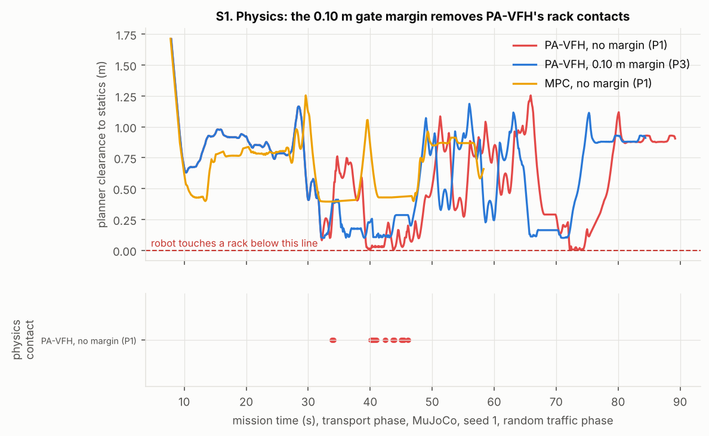
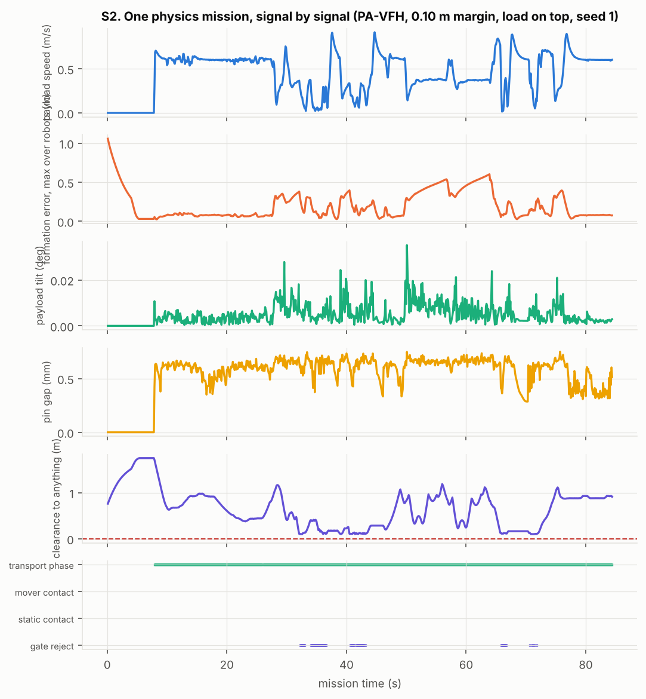
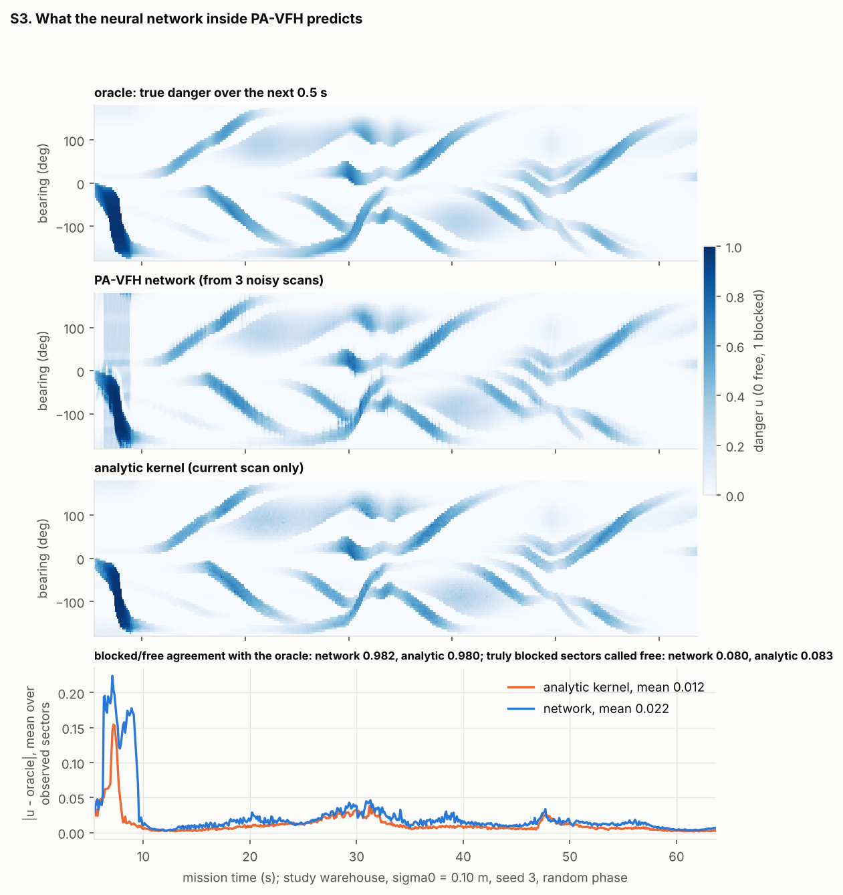
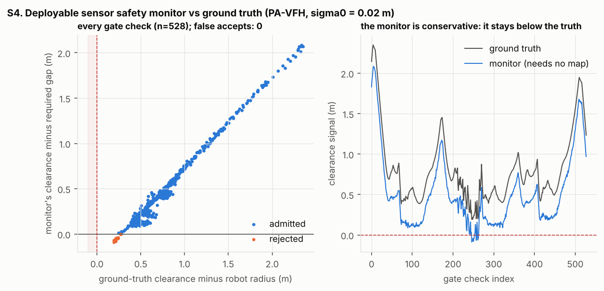
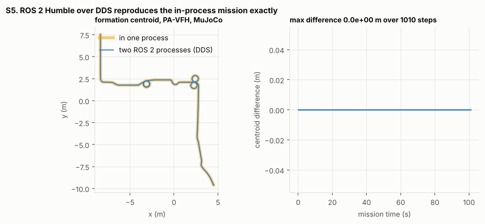
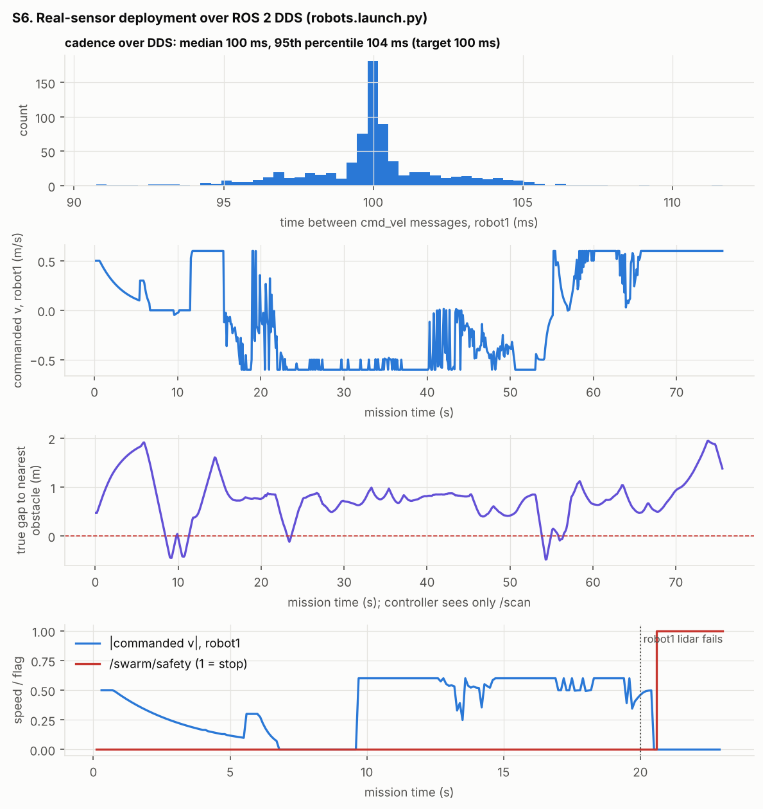

# Signal plots: what happens inside a mission

The tables in [EXTENDED_RESULTS.md](EXTENDED_RESULTS.md) count outcomes.
The plots below show the signals that produce those outcomes, one claim
per figure.

Regenerate them with:

```bash
python3 tools/make_signal_figures.py
```

Figures go to `results/figures_signals/`, recorded data to
`results/signals/`, and the numbers quoted on each figure to
`results/figures_signals/signal_numbers.json`.

---

## S1. The physical safety margin removes PA-VFH's rack contacts



The plot shows the planner's clearance to static obstacles during
transport, for the same MuJoCo mission (seed 1, same traffic phase) in
three versions:
- PA-VFH without a margin (red);
- PA-VFH with the 0.10 m gate margin (blue);
- MPC (amber).

Without the margin, PA-VFH runs about 1 mm from the racks. Wheel slip and
tracking lag use that up, and the lower strip shows the physical contacts.
With the margin, the clearance stays above the line and the contacts
disappear.

Batch results: [EXTENDED_RESULTS.md](EXTENDED_RESULTS.md) R8, batches P3
and P4.

## S2. One physics mission, signal by signal



PA-VFH with the margin, load carried on top. The panels show:
- payload speed;
- the largest robot-to-slot error;
- payload tilt;
- the pin gap between robot and load;
- clearance to anything.

The bottom strip marks gate rejections, contacts and the transport phase.
It shows the load stays level and attached while the formation slows and
steers around traffic.

## S3. What the neural network inside PA-VFH predicts



Per-sector danger (bearing × time) over a whole mission at σ0 = 0.10 m:
1. **Oracle**: the true danger over the next 0.5 s, computed from the
   simulator's knowledge of the future. This is the training target.
2. **Network**: what PA-VFH computes from its last three noisy scans.
3. **Analytic kernel**: computed from the current scan only.

The bottom panel is each method's per-step error against the oracle. The
values below are for this mission, and each number is regenerated with the
figure:

| | network | analytic kernel |
|---|---|---|
| blocked/free agreement with the oracle | 98.2 % | 98.0 % |
| truly blocked sectors called free | 8.0 % | 8.3 % |
| free sectors called blocked | 0.97 % | 1.09 % |
| mean absolute danger error (observed sectors) | 0.022 | 0.012 |

What it shows:
- **Decisions.** The network makes slightly better blocked/free decisions,
  which is what drives steering.
- **Values.** Its mean value error is larger: it puts small, hedged danger
  values on free sectors, and those do not change the decision.
- **Start-up transient.** In the first seconds of transport (5–10 s) the
  network over-predicts danger at every bearing. It has fewer than three
  frames of history then. Warm-starting the history during docking is the
  obvious fix and is not yet done.

This matches the mission-level ablation (E19, R9): a consistent but small
improvement that is not statistically significant.

## S4. The deployable sensor monitor against ground truth



Every gate check of one PA-VFH mission in which the **sensor monitor
decides**. The monitor uses only the scans; the ground truth is used only
to score it.
- **Left:** the monitor's clearance estimate against the true clearance. A
  false accept would be a blue point in the shaded region (true clearance
  below 0).
- **Right:** both signals over the mission. The monitor stays below the
  truth, so it is conservative.

## S5. ROS 2 over DDS reproduces the in-process mission exactly



The same PA-VFH physics mission is run two ways:
- as two ROS 2 Humble processes, the plant node and the controller node
  exchanging `/swarm/state` and `/swarm/command` over DDS in lockstep;
- in one process.

The centroid trajectories overlap, and their difference is exactly 0 m at
every step.

## S6. Real-sensor deployment over DDS and the watchdog



`robots.launch.py` runs with simulated robots that publish `/robotN/odom`
and `/robotN/scan` over real DDS. The panels show:
1. The `cmd_vel` cadence the robots actually receive.
2. robot1's commanded speed.
3. The true gap to the nearest obstacle. The controller never sees this;
   it sees only the scans.
4. The watchdog test: robot1's lidar stops at t = 20 s, `/swarm/safety`
   goes to 1, and the commanded speed of every robot drops to zero.
